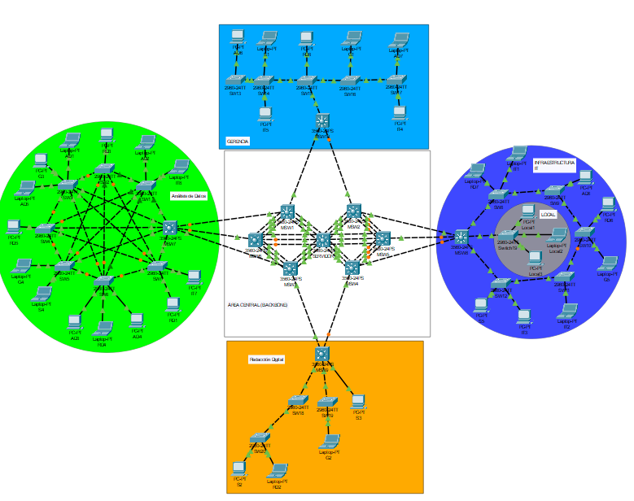
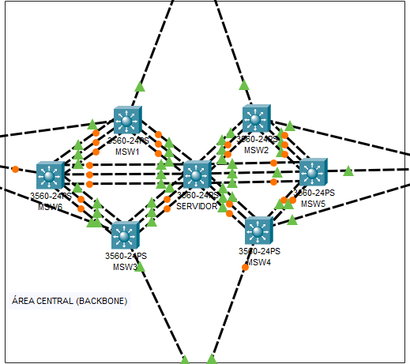
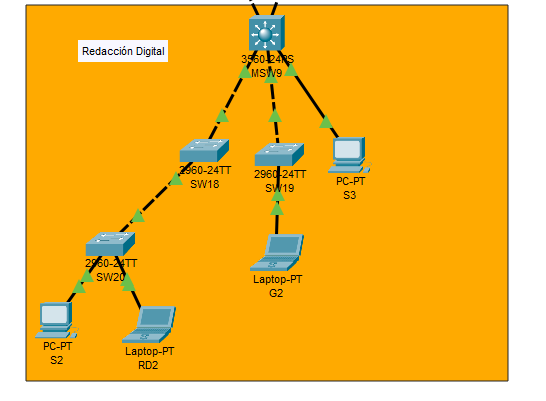
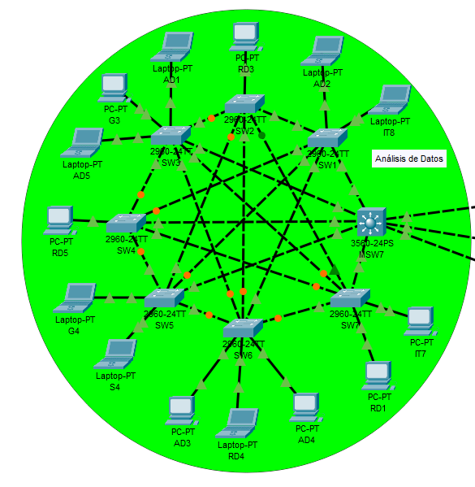
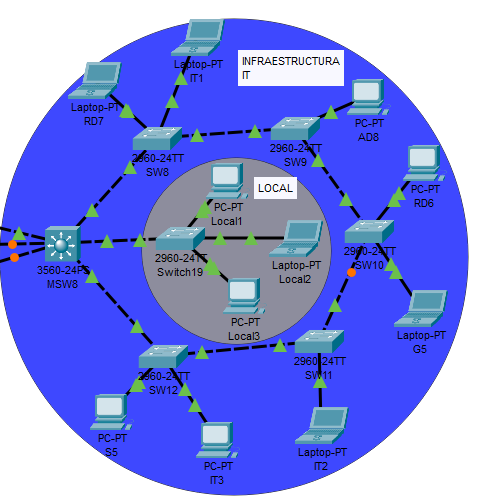
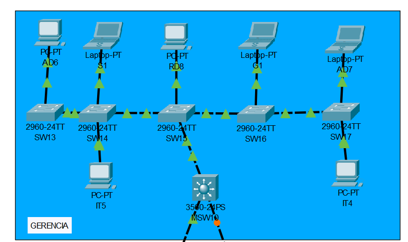
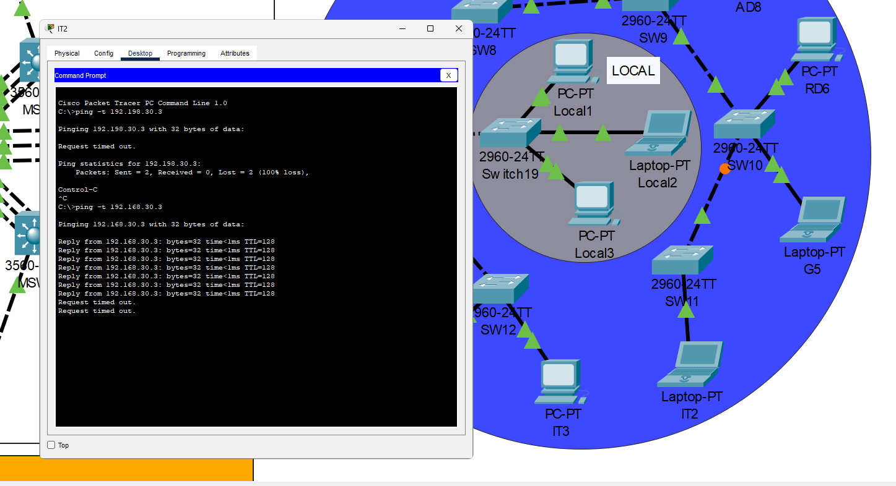
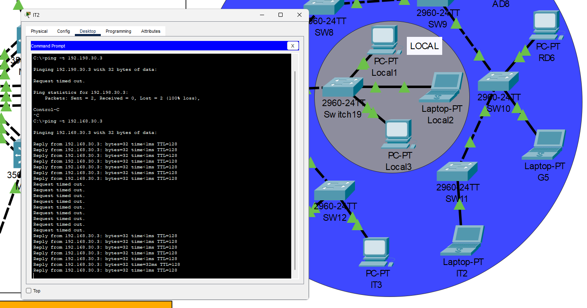
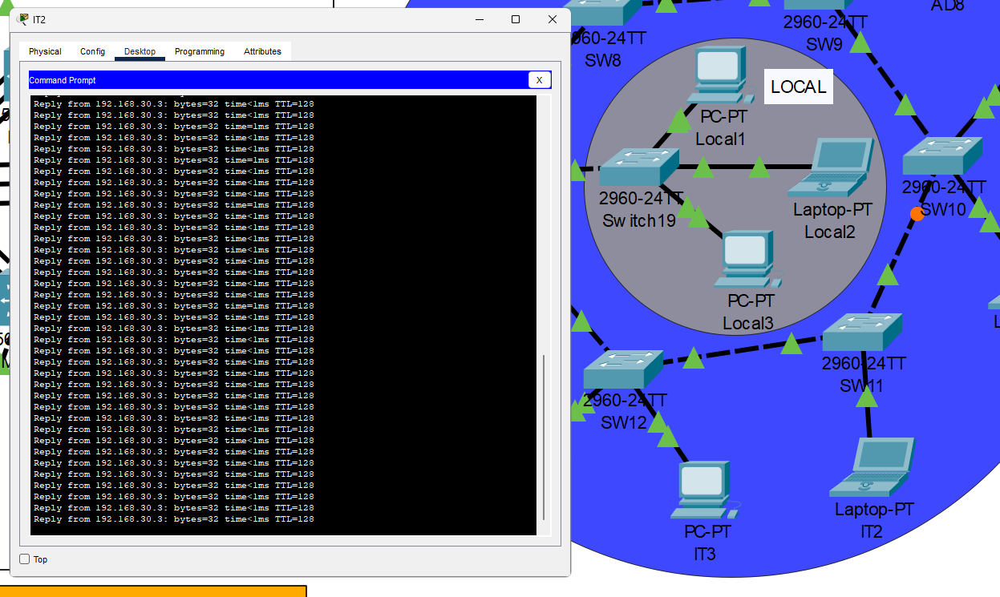

# Manual Técnico - Proyecto 1

## Tabla de Contenidos
- [Manual Técnico - Proyecto 1](#manual-técnico---proyecto-1)
  - [Tabla de Contenidos](#tabla-de-contenidos)
  - [1. Objetivos](#1-objetivos)
    - [1.1 Objetivo General](#11-objetivo-general)
    - [1.2 Objetivos Específicos](#12-objetivos-específicos)
  - [2. Alcance del Proyecto](#2-alcance-del-proyecto)
    - [2.1 Inclusiones](#21-inclusiones)
    - [2.2 Exclusiones](#22-exclusiones)
  - [3. Topología de Red](#3-topología-de-red)
    - [3.1 Area Central](#31-area-central)
    - [3.2 Redacción Digital](#32-redacción-digital)
    - [3.3 Análilis de Datos](#33-análilis-de-datos)
    - [3.4 Infraestructura IT](#34-infraestructura-it)
    - [3.5 Gerencia](#35-gerencia)
  - [](#)
  - [4. Tabla de Direccionamiento IP](#4-tabla-de-direccionamiento-ip)
  - [5. Configuraciones de Dispositivos](#5-configuraciones-de-dispositivos)
    - [5.1 Área Central](#51-área-central)
      - [5.1.1 Servidor](#511-servidor)
        - [5.1.1.1 Conecciones del Servidor con sus switches adyacentes](#5111-conecciones-del-servidor-con-sus-switches-adyacentes)
      - [5.1.2 Switches en modo cliente](#512-switches-en-modo-cliente)
        - [5.1.2.1 MSW1](#5121-msw1)
        - [5.1.2.2 MSW2](#5122-msw2)
        - [5.1.2.3 MSW3](#5123-msw3)
        - [5.1.2.4 MSW4](#5124-msw4)
        - [5.1.2.5 MSW5](#5125-msw5)
        - [5.1.2.6 MSW6](#5126-msw6)
        - [5.1.2.7 Conexiones entre los Switches Cliente](#5127-conexiones-entre-los-switches-cliente)
    - [5.2 Gerencia](#52-gerencia)
      - [5.2.1 Switch MSW10](#521-switch-msw10)
      - [5.2.2 Switch SW15](#522-switch-sw15)
      - [5.2.3 Switch SW14](#523-switch-sw14)
      - [5.2.4 Switch SW13](#524-switch-sw13)
      - [5.2.5 Switch SW16](#525-switch-sw16)
      - [5.2.6 Switch SW17](#526-switch-sw17)
      - [5.2.7 Conexión entre los Switches](#527-conexión-entre-los-switches)
      - [5.2.8 Dispositivos finales](#528-dispositivos-finales)
    - [5.3 Infraestructura IT](#53-infraestructura-it)
      - [5.3.1 Switch MSW8](#531-switch-msw8)
      - [5.3.2 Switch19 (Local Transparente)](#532-switch19-local-transparente)
      - [5.3.3 Switch SW8](#533-switch-sw8)
      - [5.3.4 Switch SW9](#534-switch-sw9)
      - [5.3.5 Switch SW10](#535-switch-sw10)
      - [5.3.6 Switch SW11](#536-switch-sw11)
      - [5.3.7 Switch SW12](#537-switch-sw12)
      - [5.3.8 Conexión entre los Switches](#538-conexión-entre-los-switches)
      - [5.3.9 Dispositivos finales](#539-dispositivos-finales)
    - [5.4 Análisis de Datos](#54-análisis-de-datos)
      - [5.4.1 Switch MSW7](#541-switch-msw7)
      - [5.4.2 Switch SW1](#542-switch-sw1)
      - [5.4.3 Switch SW2](#543-switch-sw2)
      - [5.4.4 Switch SW3](#544-switch-sw3)
      - [5.4.5 Switch SW4](#545-switch-sw4)
      - [5.4.6 Switch SW5](#546-switch-sw5)
      - [5.4.7 Switch SW6](#547-switch-sw6)
      - [5.4.8 Switch SW7](#548-switch-sw7)
      - [5.4.9 Conexión entre los Switches](#549-conexión-entre-los-switches)
      - [5.4.10 Dispositivos finales](#5410-dispositivos-finales)
    - [5.5 Redacción Digital](#55-redacción-digital)
      - [5.5.1 Switch MSW9](#551-switch-msw9)
      - [5.5.2 Switch SW18](#552-switch-sw18)
      - [5.5.3 Switch SW19](#553-switch-sw19)
      - [5.5.4 Switch SW20](#554-switch-sw20)
      - [5.5.5 Conexiones entre los Switches](#555-conexiones-entre-los-switches)
      - [5.5.6 Dispositivos finales](#556-dispositivos-finales)
  - [6. Pruebas y validaciones](#6-pruebas-y-validaciones)
    - [6.1. Validación de VTP y VLANs](#61-validación-de-vtp-y-vlans)
    - [6.2. Validación de Spanning Tree](#62-validación-de-spanning-tree)
    - [6.3. Validación de EtherChannel](#63-validación-de-etherchannel)
    - [6.4. Validación de Conectividad de Extremo a Extremo](#64-validación-de-conectividad-de-extremo-a-extremo)
      - [6.4.1. PING dentro de la misma VLAN](#641-ping-dentro-de-la-misma-vlan)
      - [6.4.2. PING entre diferentes VLANs (debe de fallar)](#642-ping-entre-diferentes-vlans-debe-de-fallar)
    - [6.5. Prueba de Resiliencia y Redundancia](#65-prueba-de-resiliencia-y-redundancia)
    - [6.6. Conclusión](#66-conclusión)
  - [7. Presupuesto](#7-presupuesto)


## 1. Objetivos

### 1.1 Objetivo General
 Diseñar e implementar una red LAN escalable y redundante para la empresa FIUComm Technologies, utilizando Cisco Packet Tracer. El diseño busca garantizar una comunicación interna eficiente y segura mediante la segmentación con VLANs, la administración centralizada con VTP, la prevención de bucles con STP y la optimización de enlaces con EtherChannel.

### 1.2 Objetivos Específicos
* Segmentar la red lógicamente en VLANs por departamento para mejorar la organización y seguridad.
* Implementar VTP para la administración centralizada y propagación de VLANs.
* Configurar STP para garantizar una topología de red redundante y libre de bucles.
* Utilizar EtherChannel (LACP y PAGP) para incrementar el ancho de banda y la tolerancia a fallos en enlaces troncales.
* Validar la conectividad de la red y el correcto funcionamiento de los protocolos implementados.

---

## 2. Alcance del Proyecto

### 2.1 Inclusiones
* El diseño, configuración y validación se realizan íntegramente en el simulador **Cisco Packet Tracer**.
* La topología abarca **cinco áreas funcionales**: Gerencia, Infraestructura IT, Análisis de Datos, Redacción Digital y un Backbone central.
* Configuración de VLANs, VTP (modos servidor, cliente y transparente), STP (PVST o Rapid PVST)  y EtherChannel (LACP y PAGP) siguiendo las especificaciones del proyecto.
* Asignación de direccionamiento IP  y configuración de dispositivos mediante **CLI**
* Personalización de switches seleccionados con un **banner MOTD**.

### 2.2 Exclusiones
* Configuración de enrutadores o enrutamiento inter-VLAN. El proyecto se centra en tecnologías de Capa 2.
* Conexión con redes externas (WAN/Internet).
* Implementación de mecanismos de seguridad avanzados más allá de la segmentación por VLANs.
* Implementación física del hardware de red.

---

## 3. Topología de Red

A continuación, se presenta el diagrama de la topología de red implementada en Cisco Packet Tracer para FIUComm Technologies. La red está segmentada en cinco áreas departamentales (Gerencia, Infraestructura IT, Análisis de Datos, Redacción Digital y Seguridad) que se interconectan a través de un área de Backbone central, garantizando redundancia y un flujo de tráfico organizado.

### 3.1 Area Central


### 3.2 Redacción Digital


### 3.3 Análilis de Datos


### 3.4 Infraestructura IT


### 3.5 Gerencia

---

## 4. Tabla de Direccionamiento IP

La siguiente tabla detalla el esquema de direccionamiento IP estático asignado a los dispositivos finales dentro de cada VLAN departamental.

   Nombre    | VLAN | Dirección IP     | Máscara de Red   |
 |-----------|------|------------------|------------------|
 | RD1       | 10   | 192.168.10.1     | 255.255.255.0    |
 | RD2       | 10   | 192.168.10.2     | 255.255.255.0    |
 | RD3       | 10   | 192.168.10.3     | 255.255.255.0    |
 | RD4       | 10   | 192.168.10.4     | 255.255.255.0    |
 | RD5       | 10   | 192.168.10.5     | 255.255.255.0    |
 | RD6       | 10   | 192.168.10.6     | 255.255.255.0    |
 | RD7       | 10   | 192.168.10.7     | 255.255.255.0    |
 | RD8       | 10   | 192.168.10.8     | 255.255.255.0    |
 | AD1       | 20   | 192.168.20.1     | 255.255.255.0    |
 | AD2       | 20   | 192.168.20.2     | 255.255.255.0    |
 | AD3       | 20   | 192.168.20.3     | 255.255.255.0    |
 | AD4       | 20   | 192.168.20.4     | 255.255.255.0    |
 | AD5       | 20   | 192.168.20.5     | 255.255.255.0    |
 | AD6       | 20   | 192.168.20.6     | 255.255.255.0    |
 | AD7       | 20   | 192.168.20.7     | 255.255.255.0    |
 | AD8       | 20   | 192.168.20.8     | 255.255.255.0    |
 | IT1       | 30   | 192.168.30.1     | 255.255.255.0    |
 | IT2       | 30   | 192.168.30.2     | 255.255.255.0    |
 | IT3       | 30   | 192.168.30.3     | 255.255.255.0    |
 | IT4       | 30   | 192.168.30.4     | 255.255.255.0    |
 | IT5       | 30   | 192.168.30.5     | 255.255.255.0    |
 | IT7       | 30   | 192.168.30.7     | 255.255.255.0    |
 | IT8       | 30   | 192.168.30.8     | 255.255.255.0    |
 | S1        | 40   | 192.168.40.1     | 255.255.255.0    |
 | S2        | 40   | 192.168.40.2     | 255.255.255.0    |
 | S3        | 40   | 192.168.40.3     | 255.255.255.0    |
 | S4        | 40   | 192.168.40.4     | 255.255.255.0    |
 | S5        | 40   | 192.168.40.5     | 255.255.255.0    |
 | G1        | 50   | 192.168.50.1     | 255.255.255.0    |
 | G2        | 50   | 192.168.50.2     | 255.255.255.0    |
 | G3        | 50   | 192.168.50.3     | 255.255.255.0    |
 | G4        | 50   | 192.168.50.4     | 255.255.255.0    |
 | G5        | 50   | 192.168.50.5     | 255.255.255.0    |
 | Local1    | 70   | 192.168.70.1     | 255.255.255.0    |
 | Local2    | 70   | 192.168.70.2     | 255.255.255.0    |
 | Local3    | 70   | 192.168.70.3     | 255.255.255.0    |

---

## 5. Configuraciones de Dispositivos

En esta sección se documentan los comandos clave utilizados para la configuración de los switches de la red.
Antes de la configuración siempre se recomienda que se elimine toda configuración previa con el comando ```write erase``` y luego ```delete vlan.dat``` para finalizar con ```reload```.

### 5.1 Área Central

#### 5.1.1 Servidor
Este switch actúa como VTP Server y Root Bridge para el protocolo STP.

```bash
enable
configure terminal

! Primero nombro y asigno contraseña
hostname SERVIDOR

! Configuro las vlan
vlan 10
 name Redaccion_Digital
 exit
vlan 20
 name Analisis_de_Datos
 exit
vlan 30
 name Infraestructura_IT
 exit
vlan 40
 name Seguridad
 exit
vlan 50
 name Gerencia
 exit

! Configuro el switch como servidor vtp
vtp mode server
vtp domain C2_FIUComm
vtp password proyecto12025

! Configuro STP
spanning-tree mode pvst
spanning-tree vlan 10,20,30,40,50 root primary

! -- Configuro el EtherChannel --
! Grupo 1 con pagp
interface range FastEthernet0/1 - 3
 shutdown
 channel-protocol pagp
 channel-group 1 mode desirable
 no shutdown
 exit
interface Port-channel1
 switchport trunk encapsulation dot1q
 switchport mode trunk
 exit

! Grupo 2 con pagp
interface range FastEthernet0/4 - 6
 shutdown
 channel-protocol pagp
 channel-group 2 mode desirable
 no shutdown
 exit
interface Port-channel2
 switchport trunk encapsulation dot1q
 switchport mode trunk
 exit


! Grupo 3 con lacp
interface range FastEthernet0/13 - 15
 shutdown
 channel-protocol lacp
 channel-group 3 mode active
 no shutdown
 exit
interface Port-channel3
 switchport trunk encapsulation dot1q
 switchport mode trunk
 exit


! Grupo 4 con lacp
interface range FastEthernet0/16 - 18
 shutdown
 channel-protocol lacp
 channel-group 4 mode active
 no shutdown
 exit
interface Port-channel4
 switchport trunk encapsulation dot1q
 switchport mode trunk
 exit

! Grupo 5 con lacp
interface range FastEthernet0/19 - 21
 shutdown
 channel-protocol lacp
 channel-group 5 mode active
 no shutdown
 exit
interface Port-channel5
 switchport trunk encapsulation dot1q
 switchport mode trunk
 exit


 ! Grupo 6 con lacp
interface range FastEthernet0/22 - 24
 shutdown
 channel-protocol lacp
 channel-group 6 mode active
 no shutdown
 exit
interface Port-channel6
 switchport trunk encapsulation dot1q
 switchport mode trunk
 exit

!Finalizo y guardo
end
copy running-config startup-config

```

##### 5.1.1.1 Conecciones del Servidor con sus switches adyacentes

   Puerto en SERVIDOR | Grupo de Canal | Protocolo | Conexión a Switch  |
 |--------------------|----------------|-----------|-------------------|
 | FastEthernet 1-3   | Port-channel1  | PAgP      | MSW3, puertos 1-3 |
 | FastEthernet 4-6   | Port-channel2  | PAgP      | MSW4, puertos 4-6 |
 | FastEthernet 13-15 | Port-channel3  | LACP      | MSW2, puertos 13-15 |
 | FastEthernet 16-18 | Port-channel4  | LACP      | MSW1, puertos 16-18 |
 | FastEthernet 19-21 | Port-channel5  | LACP      | MSW6, puertos 19-21 |
 | FastEthernet 22-24 | Port-channel6  | LACP      | MSW5, puertos 22-24 |

#### 5.1.2 Switches en modo cliente

A continuación se listan las configuraciones de los switches en modo cliente junto con sus conexiones físicas tanto con el servidor como con sus clientes adyacentes.

##### 5.1.2.1 MSW1
- **Conexión:** Puertos 16-18 a SERVIDOR (LACP)
-  **Conexión 2:** Puertos 22-24 a MSW6 (LACP)

```bash
enable
configure terminal
hostname MSW1

! Configuro el cliente
vtp mode client
vtp domain C2_FIUComm
vtp password proyecto12025

! Lo configuro en LACP
interface range FastEthernet0/16 - 18
 shutdown
 channel-protocol lacp
 channel-group 4 mode active
 no shutdown
 exit
interface Port-channel4
 switchport trunk encapsulation dot1q
 switchport mode trunk
 exit

! EtherChannel hacia MSW6 LACP
interface range FastEthernet0/22 - 24
 shutdown
 channel-protocol lacp
 channel-group 10 mode active
 no shutdown
 exit
interface Port-channel10
 switchport trunk encapsulation dot1q
 switchport mode trunk
 exit

! Enlace Troncal hacia MSW10 (Gerencia)
interface FastEthernet0/21
 switchport trunk encapsulation dot1q
 switchport mode trunk
 exit

! Enlace Troncal hacia MSW7 (Análisis de Datos)
interface FastEthernet0/10
 switchport trunk encapsulation dot1q
 switchport mode trunk
 exit

! Termino y guardo 
end
copy running-config startup-config
```

##### 5.1.2.2 MSW2
- **Conexión 1:** Puertos 13-15 a SERVIDOR (LACP)
- **Conexión 2:** Puertos 10-12 a MSW5 (LACP)

```bash
enable
configure terminal
hostname MSW2

! Configuro el cliente
vtp mode client
vtp domain C2_FIUComm
vtp password proyecto12025

! Lo configuro en LACP
interface range FastEthernet0/13 - 15
 shutdown
 channel-protocol lacp
 channel-group 3 mode active
 no shutdown
 exit
interface Port-channel3
 switchport trunk encapsulation dot1q
 switchport mode trunk
 exit

! EtherChannel hacia MSW5 (LACP)
interface range FastEthernet0/10 - 12
 shutdown
 channel-protocol lacp
 channel-group 11 mode active
 no shutdown
 exit
interface Port-channel11
 switchport trunk encapsulation dot1q
 switchport mode trunk
 exit

! Enlace Troncal hacia MSW10 (Gerencia) 
interface FastEthernet0/20
 switchport trunk encapsulation dot1q
 switchport mode trunk
 exit

! Enlace Troncal hacia MSW8 (Infraestructura IT)
 interface FastEthernet0/1
 switchport trunk encapsulation dot1q
 switchport mode trunk
 exit

! Termino y guardo
end
copy running-config startup-config
```

##### 5.1.2.3 MSW3
- **Conexión 1:** Puertos 1-3 a SERVIDOR (PAgP)
- **Conexión 2:** Puertos 4-6 a MSW6 (PAgP)

```bash
enable
configure terminal
hostname MSW3

! Configuro el cliente
vtp mode client
vtp domain C2_FIUComm
vtp password proyecto12025

! Lo configuro en PAGP
interface range FastEthernet0/1 - 3
 shutdown
 channel-protocol pagp
 channel-group 1 mode desirable
 no shutdown
 exit
interface Port-channel1
 switchport trunk encapsulation dot1q
 switchport mode trunk
 exit

! EtherChannel hacia MSW6 (PAgP)
interface range FastEthernet0/4 - 6
 shutdown
 channel-protocol pagp
 channel-group 12 mode desirable
 no shutdown
 exit
interface Port-channel12
 switchport trunk encapsulation dot1q
 switchport mode trunk
 exit

! Enlace Troncal hacia MSW9 (Redacción Digital)
interface FastEthernet0/24
 switchport trunk encapsulation dot1q
 switchport mode trunk
 exit

! Enlace Troncal hacia MSW7 (Análisis de Datos)
interface FastEthernet0/10
 switchport trunk encapsulation dot1q
 switchport mode trunk
 exit

! Termino y guardo 
end
copy running-config startup-config
```

##### 5.1.2.4 MSW4
- **Conexión 1:** Puertos 4-6 a SERVIDOR (PAgP)
- **Conexión 2:** Puertos 7-9 a MSW5 (PAgP)

```bash
enable
configure terminal
hostname MSW4

! Configuro el cliente
vtp mode client
vtp domain C2_FIUComm
vtp password proyecto12025

! Lo configuro en LACP
interface range FastEthernet0/4 - 6
 shutdown
 channel-protocol pagp
 channel-group 2 mode desirable
 no shutdown
 exit
interface Port-channel2
 switchport trunk encapsulation dot1q
 switchport mode trunk
 exit

 !  EtherChannel hacia MSW5 (PAgP)
interface range FastEthernet0/7 - 9
 shutdown
 channel-protocol pagp
 channel-group 13 mode desirable
 no shutdown
 exit
interface Port-channel13
 switchport trunk encapsulation dot1q
 switchport mode trunk
 exit

 ! Enlace Troncal hacia MSW9 (Redacción Digital)
interface FastEthernet0/24
 switchport trunk encapsulation dot1q
 switchport mode trunk
 exit

 ! Enlace Troncal hacia MSW8 (Infraestructura IT) 
interface FastEthernet0/1
 switchport trunk encapsulation dot1q
 switchport mode trunk
 exit

! Termino y guardo
end
copy running-config startup-config
```

##### 5.1.2.5 MSW5
- **Conexión 1:** Puertos 22-24 a SERVIDOR (LACP)
- **Conexión 2:** Puertos 7-9 a MSW4 (PAgP)
- **Conexión 3:** Puertos 10-12 a MSW2 (LACP)

```bash
enable
configure terminal
hostname MSW5

! Configuro el cliente
vtp mode client
vtp domain C2_FIUComm
vtp password proyecto12025

! Lo configuro en LACP
interface range FastEthernet0/22 - 24
 shutdown
 channel-protocol lacp
 channel-group 6 mode active
 no shutdown
 exit
interface Port-channel6
 switchport trunk encapsulation dot1q
 switchport mode trunk
 exit

!  EtherChannel hacia MSW4 (PAgP)
interface range FastEthernet0/7 - 9
 shutdown
 channel-protocol pagp
 channel-group 13 mode desirable
 no shutdown
 exit
interface Port-channel13
 switchport trunk encapsulation dot1q
 switchport mode trunk
 exit

! EtherChannel hacia MSW2 (LACP)
interface range FastEthernet0/10 - 12
 shutdown
 channel-protocol lacp
 channel-group 11 mode active
 no shutdown
 exit
interface Port-channel11
 switchport trunk encapsulation dot1q
 switchport mode trunk
 exit

! Enlace Troncal hacia MSW8 (Infraestructura IT)
interface FastEthernet0/1
 switchport trunk encapsulation dot1q
 switchport mode trunk
 exit

! Termino y guardo
end
copy running-config startup-config
```

##### 5.1.2.6 MSW6
- **Conexión 1:** Puertos 19-21 a SERVIDOR (LACP)
- **Conexión 2:** Puertos 4-6 a SERVIDOR (PAgP)
- **Conexión 3:** Puertos 22-24 a MSW1 (LACP)

```bash
enable
configure terminal
hostname MSW6

! Configuro el cliente
vtp mode client
vtp domain C2_FIUComm
vtp password proyecto12025

! Lo configuro en LACP
interface range FastEthernet0/19 - 21
 shutdown
 channel-protocol lacp
 channel-group 5 mode active
 no shutdown
 exit
interface Port-channel5
 switchport trunk encapsulation dot1q
 switchport mode trunk
 exit

! EtherChannel hacia MSW3 (PAgP)
interface range FastEthernet0/4 - 6
 shutdown
 channel-protocol pagp
 channel-group 12 mode desirable
 no shutdown
 exit
interface Port-channel12
 switchport trunk encapsulation dot1q
 switchport mode trunk
 exit

! EtherChannel hacia MSW1 (LACP)
interface range FastEthernet0/22 - 24
 shutdown
 channel-protocol lacp
 channel-group 10 mode active
 no shutdown
 exit
interface Port-channel10
 switchport trunk encapsulation dot1q
 switchport mode trunk
 exit

! Enlace Troncal hacia MSW7 (Análisis de Datos)
interface FastEthernet0/10
 switchport trunk encapsulation dot1q
 switchport mode trunk
 exit

! Termino y guardo
end
copy running-config startup-config
```

##### 5.1.2.7 Conexiones entre los Switches Cliente

 | Switch  | Puerto en Switch | Protocolo | Conexión a Switch |
 |---------|------------------|-----------|-------------------|
 | MSW4    | FastEthernet 7-9 | PAgP      | MSW5, puertos 7-9 |
 | MSW5    | FastEthernet 10-12 | LACP    | MSW2, puertos 10-12 |
 | MSW3    | FastEthernet 4-6 | PAgP      | MSW6, puertos 4-6 |
 | MSW6    | FastEthernet 22-24 | LACP    | MSW1, puertos 22-24 |
 | MSW1    | FastEthernet 22-24 | LACP    | MSW6, puertos 22-24 |
 | MSW2    | FastEthernet 10-12 | LACP    | MSW5, puertos 10-12 |
 | MSW5    | FastEthernet 7-9 | PAgP      | MSW4, puertos 7-9 |
 | MSW6    | FastEthernet 4-6 | PAgP      | MSW3, puertos 4-6 |


### 5.2 Gerencia

A continuación se listan las configuraciones de los switches de esta area.

#### 5.2.1 Switch MSW10

```bash
enable
configure terminal
hostname MSW10

! Configuración VTP (Modo Cliente)
vtp mode client
vtp domain C2_FIUComm
vtp password proyecto12025

! Configuración de Uplinks Troncales hacia el Backbone 
interface FastEthernet0/21
 switchport trunk encapsulation dot1q
 switchport mode trunk
 exit
interface FastEthernet0/20
 switchport trunk encapsulation dot1q
 switchport mode trunk
 exit

! Configuración de Downlink Troncal hacia Switches de Acceso
interface FastEthernet0/1
 switchport trunk encapsulation dot1q
 switchport mode trunk
 exit
 
! Guardar Configuración
end
copy running-config startup-config
```

#### 5.2.2 Switch SW15

```bash
enable
configure terminal
hostname SW15

! Configuración VTP (Modo Cliente)
vtp mode client
vtp domain C2_FIUComm
vtp password proyecto12025

! Enlaces Troncales 
! Uplink a MSW10
interface FastEthernet0/24 
 switchport mode trunk
 exit

! Downlink a SW14
interface FastEthernet0/1 
 switchport mode trunk
 exit

! Downlink a SW16
interface FastEthernet0/2 
 switchport mode trunk
 exit

! Puerto de Acceso 
! PC-PT RD8
interface FastEthernet0/3 
 switchport mode access
 switchport access vlan 10
 spanning-tree portfast
 exit
 
! Guardar Configuración
end
copy running-config startup-config
```

#### 5.2.3 Switch SW14

```bash
enable
configure terminal
hostname SW14

! Configuración VTP (Modo Cliente) 
vtp mode client
vtp domain C2_FIUComm
vtp password proyecto12025

! Enlaces Troncales 
! Uplink a SW15
interface FastEthernet0/24 
 switchport mode trunk
 exit

! Downlink a SW13
interface FastEthernet0/1 
 switchport mode trunk
 exit

! Puertos de Acceso 
! Laptop-PT S1
interface FastEthernet0/2
 switchport mode access
 switchport access vlan 40
 spanning-tree portfast
 exit

! PC-PT IT5
interface FastEthernet0/3 
 switchport mode access
 switchport access vlan 30
 spanning-tree portfast
 exit
 
! Guardar Configuración
end
copy running-config startup-config
```

#### 5.2.4 Switch SW13

```bash
enable
configure terminal
hostname SW13

! Configuración VTP (Modo Cliente)
vtp mode client
vtp domain C2_FIUComm
vtp password proyecto12025

! Enlace Troncal
! Uplink a SW14
interface FastEthernet0/24 
 switchport mode trunk
 exit

! Puerto de Acceso
! PC-PT AD6
interface FastEthernet0/1 
 switchport mode access
 switchport access vlan 20
 spanning-tree portfast
 exit
 
! Guardar Configuración
end
copy running-config startup-config
```

#### 5.2.5 Switch SW16

```bash
enable
configure terminal
hostname SW16

! Configuración VTP (Modo Cliente)
vtp mode client
vtp domain C2_FIUComm
vtp password proyecto12025

! Enlaces Troncales
! Uplink a SW15
interface FastEthernet0/24 
 switchport mode trunk
 exit

! Downlink a SW17
interface FastEthernet0/1 
 switchport mode trunk
 exit

! Puerto de Acceso
! Laptop-PT G1
interface FastEthernet0/3 
 switchport mode access
 switchport access vlan 50
 spanning-tree portfast
 exit
 
! Guardar Configuración
end
copy running-config startup-config
```

#### 5.2.6 Switch SW17

```bash
enable
configure terminal
hostname SW17

! Configuración VTP (Modo Cliente)
vtp mode client
vtp domain C2_FIUComm
vtp password proyecto12025

! Enlace Troncal
! Uplink a SW16
interface FastEthernet0/24 
 switchport mode trunk
 exit

! Puertos de Acceso
! PC-PT IT4
interface FastEthernet0/2 
 switchport mode access
 switchport access vlan 30
 spanning-tree portfast
 exit

! Laptop-PT AD7
interface FastEthernet0/1 
 switchport mode access
 switchport access vlan 20
 spanning-tree portfast
 exit
 
! Guardar Configuración
end
copy running-config startup-config
```


#### 5.2.7 Conexión entre los Switches
   Switch | Puerto en Switch | Conexión a Switch | Puerto en Conexión |
 |--------|------------------|-------------------|--------------------|
 | MSW1   | fa21             | MSW10             | fa21               |
 | MSW2   | fa20             | MSW10             | fa20               |
 | SW15   | fa24             | MSW10             | fa1                |
 | SW15   | fa1              | SW14              | fa24               |
 | SW15   | fa2              | SW16              | fa24               |
 | SW16   | fa1              | SW17              | fa24               |
 | SW14   | fa1              | SW13              | fa24               |

#### 5.2.8 Dispositivos finales
 | Switch | Puerto en Switch | Dispositivo Final |
 |--------|------------------|-------------------|
 | SW15   | fa3              | PC-PT RD8         |
 | SW14   | fa2              | Laptop-PT S1      |
 | SW14   | fa3              | PC-PT IT5         |
 | SW13   | fa1              | PC-PT AD6         |
 | SW16   | fa3              | Laptop-PT G1      |
 | SW17   | fa1              | PC-PT AD7         |
 | SW17   | fa2              | PC-PT IT4         |

### 5.3 Infraestructura IT

A continuación se listan las configuraciones de los switches de esta area.

#### 5.3.1 Switch MSW8

```bash
enable
configure terminal
hostname MSW8

! Configuración VTP (Modo Cliente)
vtp mode client
vtp domain C2_FIUComm
vtp password proyecto12025

! Uplinks Troncales hacia el Backbone 
! Hacia MSW4
interface FastEthernet0/22 
 switchport trunk encapsulation dot1q
 switchport mode trunk
 exit

! Hacia MSW5
interface FastEthernet0/23 
 switchport trunk encapsulation dot1q
 switchport mode trunk
 exit

! Hacia MSW2
interface FastEthernet0/24 
 switchport trunk encapsulation dot1q
 switchport mode trunk
 exit

! Downlinks Troncales hacia Switches de Acceso
! Hacia SW8
interface FastEthernet0/1 
 switchport trunk encapsulation dot1q
 switchport mode trunk
 exit

! Hacia Switch19
interface FastEthernet0/2 
 switchport trunk encapsulation dot1q
 switchport mode trunk
 exit

! Hacia SW12
interface FastEthernet0/3 
 switchport trunk encapsulation dot1q
 switchport mode trunk
 exit
 
! Guardar Configuración 
end
copy running-config startup-config
```


#### 5.3.2 Switch19 (Local Transparente)

- **Rol:** Tiene el modo VTP Transparente. No aprende VLANs del servidor, pero tiene su propria VLAN local.

```bash
enable
configure terminal
hostname Switch19

! Configuración VTP (Modo Transparente)
vtp mode transparent
vtp domain C2_FIUComm
vtp password proyecto12025

! VLAN Local (Solo existe en este switch)
vlan 70
 name Recepcion
 exit
 
! Enlace Troncal (Uplink)
! Hacia MSW8
interface FastEthernet0/24 
 switchport mode trunk
 exit

! Puertos de Acceso para VLAN Local
! PC-PT Local1
interface FastEthernet0/1 
 switchport mode access
 switchport access vlan 70
 spanning-tree portfast
 exit

! Laptop-PT Local2
interface FastEthernet0/2 
 switchport mode access
 switchport access vlan 70
 spanning-tree portfast
 exit

! PC-PT Local3
interface FastEthernet0/3 
 switchport mode access
 switchport access vlan 70
 spanning-tree portfast
 exit
 
! Guardar Configuración 
end
copy running-config startup-config
```

#### 5.3.3 Switch SW8

```bash
enable
configure terminal
hostname SW8

! Configuración VTP (Modo Cliente)
vtp mode client
vtp domain C2_FIUComm
vtp password proyecto12025

! Enlaces Troncales
! Uplink a MSW8
interface FastEthernet0/24 
 switchport mode trunk
 exit

! Enlace a SW9
interface FastEthernet0/23 
 switchport mode trunk
 exit

! Puertos de Acceso
! Laptop-PT RD7
interface FastEthernet0/1 
 switchport mode access
 switchport access vlan 10
 spanning-tree portfast
 exit

! Laptop-PT IT1
interface FastEthernet0/2 
 switchport mode access
 switchport access vlan 30
 spanning-tree portfast
 exit

! Guardar Configuración
end
copy running-config startup-config
```


#### 5.3.4 Switch SW9

```bash
enable
configure terminal
hostname SW9

! Configuración VTP (Modo Cliente)
vtp mode client
vtp domain C2_FIUComm
vtp password proyecto12025

! Enlaces Troncales
! Uplink a SW10
interface FastEthernet0/24 
 switchport mode trunk
 exit

! Enlace a SW8
interface FastEthernet0/1 
 switchport mode trunk
 exit

! Puerto de Acceso
! PC-PT AD8
interface FastEthernet0/2 
 switchport mode access
 switchport access vlan 20
 spanning-tree portfast
 exit

! Guardar Configuración
end
copy running-config startup-config
```

#### 5.3.5 Switch SW10

```bash
enable
configure terminal
hostname SW10

! Configuración VTP (Modo Cliente) 
vtp mode client
vtp domain C2_FIUComm
vtp password proyecto12025

! Enlaces Troncales
! Uplink a SW11
interface FastEthernet0/24 
 switchport mode trunk
 exit
! Enlace a SW9
interface FastEthernet0/1 
 switchport mode trunk
 exit

! Puertos de Acceso 
! Laptop-PT G5
interface FastEthernet0/2 
 switchport mode access
 switchport access vlan 50
 spanning-tree portfast
 exit

! PC-PT RD6
interface FastEthernet0/3 
 switchport mode access
 switchport access vlan 10
 spanning-tree portfast
 exit

! Guardar Configuración
end
copy running-config startup-config
```

#### 5.3.6 Switch SW11

```bash
enable
configure terminal
hostname SW11

! Configuración VTP (Modo Cliente)
vtp mode client
vtp domain C2_FIUComm
vtp password proyecto12025

! Enlaces Troncales
! Uplink a SW12
interface FastEthernet0/24 
 switchport mode trunk
 exit
! Enlace a SW10
interface FastEthernet0/1 
 switchport mode trunk
 exit

! Puerto de Acceso
! Laptop-PT IT2
interface FastEthernet0/2 
 switchport mode access
 switchport access vlan 30
 spanning-tree portfast
 exit

! Guardar Configuración
end
copy running-config startup-config
```

#### 5.3.7 Switch SW12

```bash
enable
configure terminal
hostname SW12

! Configuración VTP (Modo Cliente)
vtp mode client
vtp domain C2_FIUComm
vtp password proyecto12025

! Enlaces Troncales
! Uplink a MSW8
interface FastEthernet0/24 
 switchport mode trunk
 exit

! Enlace a SW11
interface FastEthernet0/1 
 switchport mode trunk
 exit

! Puertos de Acceso 
! PC-PT S5
interface FastEthernet0/2 
 switchport mode access
 switchport access vlan 40
 spanning-tree portfast
 exit

! PC-PT IT3
interface FastEthernet0/3 
 switchport mode access
 switchport access vlan 30
 spanning-tree portfast
 exit

! Guardar Configuración
end
copy running-config startup-config
```

#### 5.3.8 Conexión entre los Switches
   Switch   | Puerto en Switch | Conexión a Switch | Puerto en Conexión |
 |----------|------------------|-------------------|--------------------|
 | MSW5    | fa1              | MSW8              | fa23               |
 | MSW4    | fa1              | MSW8              | fa22               |
 | MSW2    | fa1              | MSW8              | fa24               |
 | MSW8    | fa1              | SW8               | fa24               |
 | MSW8    | fa2              | Switch19          | fa24               |
 | MSW8    | fa3              | SW12              | fa24               |
 | SW12    | fa1              | SW11              | fa24               |
 | SW11    | fa1              | SW10              | fa24               |
 | SW10    | fa1              | SW9               | fa24               |
 | SW9     | fa1              | SW8               | fa23               |

#### 5.3.9 Dispositivos finales
 | Switch   | Puerto en Switch | Dispositivo Final |
 |----------|------------------|-------------------|
 | Switch19 | fa1              | PC-PT Local1      |
 | Switch19 | fa2              | Laptop-PT Local2  |
 | Switch19 | fa3              | PC-PT Local3      |
 | SW8      | fa1              | Laptop-PT RD7     |
 | SW8      | fa2              | Laptop-PT IT1     |
 | SW9      | fa2              | PC-PT AD8         |
 | SW10     | fa2              | Laptop-PT G5      |
 | SW10     | fa3              | PC-PT RD6         |
 | SW11     | fa2              | Laptop-PT IT2     |
 | SW12     | fa2              | PC-PT S5          |
 | SW12     | fa3              | PC-PT IT3         |

### 5.4 Análisis de Datos 

A continuación se listan las configuraciones de los switches de esta area.

#### 5.4.1 Switch MSW7

```bash
enable
configure terminal
hostname MSW7

! Configuración VTP (Modo Cliente)
vtp mode client
vtp domain C2_FIUComm
vtp password proyecto12025

! Uplinks Troncales hacia el Backbone
! Hacia MSW3
interface FastEthernet0/22 
 switchport trunk encapsulation dot1q
 switchport mode trunk
 exit

! Hacia MSW6
interface FastEthernet0/23 
 switchport trunk encapsulation dot1q
 switchport mode trunk
 exit

! Hacia MSW1
interface FastEthernet0/24 
 switchport trunk encapsulation dot1q
 switchport mode trunk
 exit

! Downlinks Troncales hacia Switches de Acceso
interface range FastEthernet0/1 - 5
 switchport trunk encapsulation dot1q
 switchport mode trunk
 exit
 
! Guardar Configuración
end
copy running-config startup-config
```

#### 5.4.2 Switch SW1

```bash
enable
configure terminal
hostname SW1

! Configuración VTP (Modo Cliente)
vtp mode client
vtp domain C2_FIUComm
vtp password proyecto12025

! Enlaces Troncales
! Uplink a MSW7
interface FastEthernet0/24 
 switchport mode trunk
 exit
interface range FastEthernet0/1 - 4
 switchport mode trunk
 exit

! Puertos de Acceso
! Laptop-PT AD2
interface FastEthernet0/5 
 switchport mode access
 switchport access vlan 20
 spanning-tree portfast
 exit

! Laptop-PT IT8
interface FastEthernet0/6 
 switchport mode access
 switchport access vlan 30
 spanning-tree portfast
 exit
 
! Guardar Configuración
end
copy running-config startup-config
```

#### 5.4.3 Switch SW2
```bash
enable
configure terminal
hostname SW2

! Configuración VTP (Modo Cliente) 
vtp mode client
vtp domain C2_FIUComm
vtp password proyecto12025

! Enlaces Troncales
! Enlace a SW1
interface FastEthernet0/24 
 switchport mode trunk
 exit
interface range FastEthernet0/1 - 4
 switchport mode trunk
 exit

! Puerto de Acceso
! PC-PT RD3
interface FastEthernet0/5 
 switchport mode access
 switchport access vlan 10
 spanning-tree portfast
 exit
 
! Guardar Configuración
end
copy running-config startup-config
```


#### 5.4.4 Switch SW3

```bash
enable
configure terminal
hostname SW3

! Configuración VTP (Modo Cliente)
vtp mode client
vtp domain C2_FIUComm
vtp password proyecto12025

! Enlaces Troncales
! Uplink a MSW7
interface FastEthernet0/24 
 switchport mode trunk
 exit

! Enlace a SW2
interface FastEthernet0/23 
 switchport mode trunk
 exit
interface range FastEthernet0/1 - 3
 switchport mode trunk
 exit

! Puertos de Acceso
! Laptop-PT AD5
interface FastEthernet0/4 
 switchport mode access
 switchport access vlan 20
 spanning-tree portfast
 exit

! PC-PT G3
interface FastEthernet0/5 
 switchport mode access
 switchport access vlan 50
 spanning-tree portfast
 exit

! Laptop-PT AD1
interface FastEthernet0/6 
 switchport mode access
 switchport access vlan 20
 spanning-tree portfast
 exit
 
! Guardar Configuración
end
copy running-config startup-config
```


#### 5.4.5 Switch SW4

```bash
enable
configure terminal
hostname SW4

! Configuración VTP (Modo Cliente)
vtp mode client
vtp domain C2_FIUComm
vtp password proyecto12025

! Enlaces Troncales
! Uplink a MSW7
interface FastEthernet0/24 
 switchport mode trunk
 exit

! Enlace a SW1
interface FastEthernet0/23 
 switchport mode trunk
 exit

! Enlace a SW3
interface FastEthernet0/22 
 switchport mode trunk
 exit
interface range FastEthernet0/1 - 2
 switchport mode trunk
 exit

! Puerto de Acceso
! PC-PT RD5
interface FastEthernet0/3 
 switchport mode access
 switchport access vlan 10
 spanning-tree portfast
 exit
 
! Guardar Configuración
end
copy running-config startup-config
```


#### 5.4.6 Switch SW5

```bash
enable
configure terminal
hostname SW5

! Configuración VTP (Modo Cliente)
vtp mode client
vtp domain C2_FIUComm
vtp password proyecto12025

! Enlaces Troncales
! Uplink a MSW7
interface FastEthernet0/24 
 switchport mode trunk
 exit

! Enlace a SW1
interface FastEthernet0/23 
 switchport mode trunk
 exit

! Enlace a SW2
interface FastEthernet0/22 
 switchport mode trunk
 exit

! Enlace a SW4
interface FastEthernet0/21 
 switchport mode trunk
 exit
interface FastEthernet0/1
 switchport mode trunk
 exit

! Puertos de Acceso
! Laptop-PT S4
interface FastEthernet0/2 
 switchport mode access
 switchport access vlan 40
 spanning-tree portfast
 exit

! Laptop-PT G4
interface FastEthernet0/3 
 switchport mode access
 switchport access vlan 50
 spanning-tree portfast
 exit
 
! Guardar Configuración
end
copy running-config startup-config
```


#### 5.4.7 Switch SW6

```bash
enable
configure terminal
hostname SW6

! Configuración VTP (Modo Cliente)
vtp mode client
vtp domain C2_FIUComm
vtp password proyecto12025

! Enlaces Troncales
! Enlace a SW1
interface FastEthernet0/24 
 switchport mode trunk
 exit

! Enlace a SW2
interface FastEthernet0/23 
 switchport mode trunk
 exit

! Enlace a SW3
interface FastEthernet0/22 
 switchport mode trunk
 exit

! Enlace a SW5
interface FastEthernet0/21 
 switchport mode trunk
 exit
interface FastEthernet0/1
 switchport mode trunk
 exit

! Puertos de Acceso
! PC-PT AD4
interface FastEthernet0/2 
 switchport mode access
 switchport access vlan 20
 spanning-tree portfast
 exit

! Laptop-PT RD4
interface FastEthernet0/3 
 switchport mode access
 switchport access vlan 10
 spanning-tree portfast
 exit

! PC-PT AD3
interface FastEthernet0/4 
 switchport mode access
 switchport access vlan 20
 spanning-tree portfast
 exit
 
! Guardar Configuración
end
copy running-config startup-config
```

#### 5.4.8 Switch SW7

```bash
enable
configure terminal
hostname SW7

! Configuración VTP (Modo Cliente)
vtp mode client
vtp domain C2_FIUComm
vtp password proyecto12025

! Enlaces Troncales
! Uplink a MSW7
interface FastEthernet0/24 
 switchport mode trunk
 exit

! Enlace a SW2
interface FastEthernet0/23 
 switchport mode trunk
 exit

! Enlace a SW3
interface FastEthernet0/22 
 switchport mode trunk
 exit

! Enlace a SW4
interface FastEthernet0/21 
 switchport mode trunk
 exit

! Enlace a SW6
interface FastEthernet0/20 
 switchport mode trunk
 exit

! Puertos de Acceso
! PC-PT IT7
interface FastEthernet0/1 
 switchport mode access
 switchport access vlan 30
 spanning-tree portfast
 exit

! PC-PT RD1
interface FastEthernet0/2 
 switchport mode access
 switchport access vlan 10
 spanning-tree portfast
 exit
 
! Guardar Configuración
end
copy running-config startup-config
```


#### 5.4.9 Conexión entre los Switches
   Switch | Puerto en Switch | Conexión a Switch | Puerto en Conexión |
 |--------|------------------|-------------------|--------------------|
 | MSW1   | fa10             | MSW7              | fa24               |
 | MSW6   | fa10             | MSW7              | fa23               |
 | MSW3   | fa10             | MSW7              | fa22               |
 | MSW7   | fa1              | SW1               | fa24               |
 | MSW7   | fa2              | SW3               | fa24               |
 | MSW7   | fa3              | SW4               | fa24               |
 | MSW7   | fa4              | SW5               | fa24               |
 | MSW7   | fa5              | SW7               | fa24               |
 | SW1    | fa1              | SW2               | fa24               |
 | SW1    | fa2              | SW4               | fa23               |
 | SW1    | fa3              | SW5               | fa23               |
 | SW1    | fa4              | SW6               | fa24               |
 | SW2    | fa1              | SW3               | fa23               |
 | SW2    | fa2              | SW5               | fa22               |
 | SW2    | fa3              | SW6               | fa23               |
 | SW2    | fa4              | SW7               | fa23               |
 | SW3    | fa1              | SW4               | fa22               |
 | SW3    | fa2              | SW6               | fa22               |
 | SW3    | fa3              | SW7               | fa22               |
 | SW4    | fa1              | SW5               | fa21               |
 | SW4    | fa2              | SW7               | fa21               |
 | SW5    | fa1              | SW6               | fa21               |
 | SW6    | fa1              | SW7               | fa20               |

#### 5.4.10 Dispositivos finales
 | Switch | Puerto en Switch | Dispositivo Final |
 |--------|------------------|-------------------|
 | SW1    | fa5              | Laptop-PT AD2     |
 | SW1    | fa6              | Laptop-PT IT8     |
 | SW2    | fa5              | PC-PT RD3         |
 | SW3    | fa4              | Laptop-PT AD5     |
 | SW3    | fa5              | PC-PT G3          |
 | SW3    | fa6              | Laptop-PT AD1     |
 | SW4    | fa3              | PC-PT RD5         |
 | SW5    | fa2              | Laptop-PT S4      |
 | SW5    | fa3              | Laptop-PT G4      |
 | SW6    | fa2              | PC-PT AD4         |
 | SW6    | fa3              | Laptop-PT RD4     |
 | SW6    | fa4              | PC-PT AD3         |
 | SW7    | fa1              | PC-PT IT7         |
 | SW7    | fa2              | PC-PT RD1         |

### 5.5 Redacción Digital

A continuación se listan las configuraciones de los switches de esta area.

#### 5.5.1 Switch MSW9
- 
```bash
enable
configure terminal
hostname MSW9

! Configuración VTP (Modo Cliente) 
vtp mode client
vtp domain C2_FIUComm
vtp password proyecto12025

! Configuración de Uplinks Troncales hacia el Backbone 
interface range GigabitEthernet0/1 - 2
 switchport trunk encapsulation dot1q
 switchport mode trunk
 exit

! Configuración de Downlinks hacia Switches de Acceso
interface range FastEthernet0/1 - 2
 switchport trunk encapsulation dot1q
 switchport mode trunk
 exit

! Configuración de Puerto de Acceso para PC-PT S3
interface FastEthernet0/3
 switchport mode access
 switchport access vlan 40
 spanning-tree portfast
 exit

! Guardar Configuración
end
copy running-config startup-config

```

#### 5.5.2 Switch SW18

```bash
enable
configure terminal
hostname SW18

! Configuración VTP (Modo Cliente)
vtp mode client
vtp domain C2_FIUComm
vtp password proyecto12025

!  Configuración del Enlace Troncal (Uplink) hacia MSW9 
interface FastEthernet0/2
 switchport mode trunk
 exit

! Configuración del Enlace Troncal (Downlink) hacia SW20
interface FastEthernet0/1
 switchport mode trunk
 exit

! Guardar Configuración 
end
copy running-config startup-config

```


#### 5.5.3 Switch SW19

```bash
enable
configure terminal
hostname SW19

! Configuración VTP (Modo Cliente) 
vtp mode client
vtp domain C2_FIUComm
vtp password proyecto12025

! Configuración del Enlace Troncal (Uplink) hacia MSW9
interface FastEthernet0/2
 switchport mode trunk
 exit

!  Configuración de Puertos de Acceso de Laptop-PT G2
interface FastEthernet0/1
 switchport mode access
 switchport access vlan 50
 spanning-tree portfast
 exit
 
! Apagamos el resto de puertos no usados
interface range FastEthernet0/3 - 24
 shutdown
 exit

! Guardar Configuración
end
copy running-config startup-config
```

#### 5.5.4 Switch SW20

```bash
enable
configure terminal
hostname SW20

! Configuración VTP (Modo Cliente)
vtp mode client
vtp domain C2_FIUComm
vtp password proyecto12025

! Configuración del Enlace Troncal (Uplink) hacia SW18 
interface FastEthernet0/3
 switchport mode trunk
 exit

! Puerto para PC-PT S2
interface FastEthernet0/1
 switchport mode access
 switchport access vlan 40
 spanning-tree portfast
 exit
 
! Puerto para Laptop-PT RD2
interface FastEthernet0/2
 switchport mode access
 switchport access vlan 10
 spanning-tree portfast
 exit
 
! Apagamos el resto de puertos no usados
interface range FastEthernet0/4 - 23
 shutdown
 exit

! Guardar Configuración
end
copy running-config startup-config

```

#### 5.5.5 Conexiones entre los Switches

| Switch   | Puerto en Switch   | Conexión a Switch | Puerto en Conexión |
|----------|--------------------|-------------------|--------------------|
| MSW3    | FastEthernet 24   | MSW9              | GigabitEthernet 1  |
| MSW4    | FastEthernet 24   | MSW9              | GigabitEthernet 2  |
| SW18    | FastEthernet 2    | MSW9              | FastEthernet 1     |
| SW18    | FastEthernet 1    | SW20              | FastEthernet 3     |
| SW19    | FastEthernet 2    | MSW9              | FastEthernet 2     |

#### 5.5.6 Dispositivos finales

| Switch   | Puerto en Switch | Dispositivo Final |
|----------|------------------|-------------------|
| MSW9    | FastEthernet 3   | PC-PT S3          |
| SW19    | FastEthernet 1   | Laptop-PT G2      |
| SW20    | FastEthernet 1   | PC-PT S2          |
| SW20    | FastEthernet 2   | Laptop-PT RD2     |


## 6. Pruebas y validaciones

A continuación, se detalla el proceso de validación para confirmar que la red está configurada y funciona de acuerdo con los objetivos del proyecto. Las pruebas se dividen en la verificación de protocolos de Capa 2 y la validación de conectividad de extremo a extremo.

### 6.1. Validación de VTP y VLANs

**Objetivo:** Confirmar que el VTP Server (SERVIDOR) está distribuyendo correctamente la base de datos de VLANs y que todos los switches cliente la han recibido.

Ejecutando el SERVIDOR ``show vtp status`` se puede observar que se encuentra en modo **server**.

```bash
VTP Version capable             : 1 to 2
VTP version running             : 1
VTP Domain Name                 : C2_FIUComm
VTP Pruning Mode                : Disabled
VTP Traps Generation            : Disabled
Device ID                       : 0000.0C1A.B2A0
Configuration last modified by 0.0.0.0 at 3-1-93 00:00:00
Local updater ID is 0.0.0.0 (no valid interface found)

Feature VLAN : 
--------------
VTP Operating Mode                : Server
Maximum VLANs supported locally   : 1005
Number of existing VLANs          : 10
Configuration Revision            : 25
MD5 digest                        : 0xF0 0xD0 0xF6 0xFB 0x3E 0xDE 0x5C 0x3E 
                                    0x61 0x90 0xE7 0x70 0x6C 0xA6 0x67 0xB1 
```

Ahora ejecutando en cualquier switch que no sea el server, se puede notar que efectivamente se encuentra en modo cliente.
```bash
show vtp status
show vlan brief
```
Se puede observar que se encuentra en modo cliente, que el código de revisión es el mismo y que la tabla muestra las 5 vlan configuradas en server.

```bash
VTP Version capable             : 1 to 2
VTP version running             : 1
VTP Domain Name                 : C2_FIUComm
VTP Pruning Mode                : Disabled
VTP Traps Generation            : Disabled
Device ID                       : 0001.634E.D250
Configuration last modified by 0.0.0.0 at 3-1-93 00:00:00

Feature VLAN : 
--------------
VTP Operating Mode                : Client
Maximum VLANs supported locally   : 1005
Number of existing VLANs          : 10
Configuration Revision            : 25
MD5 digest                        : 0xF0 0xD0 0xF6 0xFB 0x3E 0xDE 0x5C 0x3E 
                                    0x61 0x90 0xE7 0x70 0x6C 0xA6 0x67 0xB1 
MSW6>show vlan brief

VLAN Name                             Status    Ports
---- -------------------------------- --------- -------------------------------
1    default                          active    Fa0/1, Fa0/2, Fa0/3, Fa0/7
                                                Fa0/8, Fa0/9, Fa0/11, Fa0/12
                                                Fa0/13, Fa0/14, Fa0/15, Fa0/16
                                                Fa0/17, Fa0/18, Gig0/1, Gig0/2
10   Redaccion_Digital                active    
20   Analisis_de_Datos                active    
30   Infraestructura_IT               active    
40   Seguridad                        active    
50   Gerencia                         active    
1002 fddi-default                     active    
1003 token-ring-default               active    
1004 fddinet-default                  active    
1005 trnet-default                    active 
```

Este deberia de mostrarse igual o similar en todos los switches.


### 6.2. Validación de Spanning Tree

**Objetivo:** Para evitar que existan bucles, ahora se validará que STP esté funcionando correctamente.

Ejecutando el siguiente comando en SERVIDOR ```show spanning-tree``` se observa que server es la raiz ```This bridge is the root```.

```bash
VTP Version capable             : 1 to 2
VTP version running             : 1
VTP Domain Name                 : C2_FIUComm
VTP Pruning Mode                : Disabled
VTP Traps Generation            : Disabled
Device ID                       : 0000.0C1A.B2A0
Configuration last modified by 0.0.0.0 at 3-1-93 00:00:00
Local updater ID is 0.0.0.0 (no valid interface found)

Feature VLAN : 
--------------
VTP Operating Mode                : Server
Maximum VLANs supported locally   : 1005
Number of existing VLANs          : 10
Configuration Revision            : 25
MD5 digest                        : 0xF0 0xD0 0xF6 0xFB 0x3E 0xDE 0x5C 0x3E 
                                    0x61 0x90 0xE7 0x70 0x6C 0xA6 0x67 0xB1 
SERVIDOR>
SERVIDOR>
SERVIDOR>
SERVIDOR>
SERVIDOR>show spanning-tree
VLAN0001
  Spanning tree enabled protocol ieee
  Root ID    Priority    32769
             Address     0001.43E5.BC16
             Cost        9
             Port        27(Port-channel1)
             Hello Time  2 sec  Max Age 20 sec  Forward Delay 15 sec

  Bridge ID  Priority    32769  (priority 32768 sys-id-ext 1)
             Address     000A.F325.2529
             Hello Time  2 sec  Max Age 20 sec  Forward Delay 15 sec
             Aging Time  20

Interface        Role Sts Cost      Prio.Nbr Type
---------------- ---- --- --------- -------- --------------------------------
Po2              Desg FWD 9         128.28   Shr
Po1              Root FWD 9         128.27   Shr
Po3              Desg FWD 9         128.29   Shr
Po4              Desg FWD 9         128.30   Shr
Po5              Desg FWD 9         128.31   Shr
Po6              Desg FWD 9         128.32   Shr

VLAN0010
  Spanning tree enabled protocol ieee
  Root ID    Priority    24586
             Address     000A.F325.2529
             This bridge is the root
             Hello Time  2 sec  Max Age 20 sec  Forward Delay 15 sec

  Bridge ID  Priority    24586  (priority 24576 sys-id-ext 10)
             Address     000A.F325.2529
             Hello Time  2 sec  Max Age 20 sec  Forward Delay 15 sec
             Aging Time  20

Interface        Role Sts Cost      Prio.Nbr Type
---------------- ---- --- --------- -------- --------------------------------
Po2              Desg FWD 9         128.28   Shr
Po1              Desg FWD 9         128.27   Shr
Po3              Desg FWD 9         128.29   Shr
Po4              Desg FWD 9         128.30   Shr
Po5              Desg FWD 9         128.31   Shr
Po6              Desg FWD 9         128.32   Shr

VLAN0020
  Spanning tree enabled protocol ieee
  Root ID    Priority    24596
             Address     000A.F325.2529
             This bridge is the root
             Hello Time  2 sec  Max Age 20 sec  Forward Delay 15 sec

  Bridge ID  Priority    24596  (priority 24576 sys-id-ext 20)
             Address     000A.F325.2529
             Hello Time  2 sec  Max Age 20 sec  Forward Delay 15 sec
             Aging Time  20

Interface        Role Sts Cost      Prio.Nbr Type
---------------- ---- --- --------- -------- --------------------------------
Po2              Desg FWD 9         128.28   Shr
Po1              Desg FWD 9         128.27   Shr
Po3              Desg FWD 9         128.29   Shr
Po4              Desg FWD 9         128.30   Shr
Po5              Desg FWD 9         128.31   Shr
Po6              Desg FWD 9         128.32   Shr

VLAN0030
  Spanning tree enabled protocol ieee
  Root ID    Priority    24606
             Address     000A.F325.2529
             This bridge is the root
             Hello Time  2 sec  Max Age 20 sec  Forward Delay 15 sec

  Bridge ID  Priority    24606  (priority 24576 sys-id-ext 30)
             Address     000A.F325.2529
             Hello Time  2 sec  Max Age 20 sec  Forward Delay 15 sec
             Aging Time  20

Interface        Role Sts Cost      Prio.Nbr Type
---------------- ---- --- --------- -------- --------------------------------
Po2              Desg FWD 9         128.28   Shr
Po1              Desg FWD 9         128.27   Shr
Po3              Desg FWD 9         128.29   Shr
Po4              Desg FWD 9         128.30   Shr
Po5              Desg FWD 9         128.31   Shr
Po6              Desg FWD 9         128.32   Shr

VLAN0040
  Spanning tree enabled protocol ieee
  Root ID    Priority    24616
             Address     000A.F325.2529
             This bridge is the root
             Hello Time  2 sec  Max Age 20 sec  Forward Delay 15 sec

  Bridge ID  Priority    24616  (priority 24576 sys-id-ext 40)
             Address     000A.F325.2529
             Hello Time  2 sec  Max Age 20 sec  Forward Delay 15 sec
             Aging Time  20

Interface        Role Sts Cost      Prio.Nbr Type
---------------- ---- --- --------- -------- --------------------------------
Po2              Desg FWD 9         128.28   Shr
Po1              Desg FWD 9         128.27   Shr
Po3              Desg FWD 9         128.29   Shr
Po4              Desg FWD 9         128.30   Shr
Po5              Desg FWD 9         128.31   Shr
Po6              Desg FWD 9         128.32   Shr

VLAN0050
  Spanning tree enabled protocol ieee
  Root ID    Priority    24626
             Address     000A.F325.2529
             This bridge is the root
             Hello Time  2 sec  Max Age 20 sec  Forward Delay 15 sec

  Bridge ID  Priority    24626  (priority 24576 sys-id-ext 50)
             Address     000A.F325.2529
             Hello Time  2 sec  Max Age 20 sec  Forward Delay 15 sec
             Aging Time  20

Interface        Role Sts Cost      Prio.Nbr Type
---------------- ---- --- --------- -------- --------------------------------
Po2              Desg FWD 9         128.28   Shr
Po1              Desg FWD 9         128.27   Shr
Po3              Desg FWD 9         128.29   Shr
Po4              Desg FWD 9         128.30   Shr
Po5              Desg FWD 9         128.31   Shr
Po6              Desg FWD 9         128.32   Shr
```


Y con algún switch que se encuentra en estado blocking para observar como es que esto esta bien configurado.

```bash
VLAN0001
  Spanning tree enabled protocol ieee
  Root ID    Priority    32769
             Address     0001.43E5.BC16
             Cost        38
             Port        24(FastEthernet0/24)
             Hello Time  2 sec  Max Age 20 sec  Forward Delay 15 sec

  Bridge ID  Priority    32769  (priority 32768 sys-id-ext 1)
             Address     00E0.A369.457C
             Hello Time  2 sec  Max Age 20 sec  Forward Delay 15 sec
             Aging Time  20

Interface        Role Sts Cost      Prio.Nbr Type
---------------- ---- --- --------- -------- --------------------------------
Fa0/3            Desg FWD 19        128.3    P2p
Fa0/22           Altn BLK 19        128.22   P2p
Fa0/24           Root FWD 19        128.24   P2p
Fa0/21           Altn BLK 19        128.21   P2p
Fa0/20           Desg FWD 19        128.20   P2p
Fa0/23           Desg FWD 19        128.23   P2p

VLAN0010
  Spanning tree enabled protocol ieee
  Root ID    Priority    24586
             Address     000A.F325.2529
             Cost        47
             Port        24(FastEthernet0/24)
             Hello Time  2 sec  Max Age 20 sec  Forward Delay 15 sec

  Bridge ID  Priority    32778  (priority 32768 sys-id-ext 10)
             Address     00E0.A369.457C
             Hello Time  2 sec  Max Age 20 sec  Forward Delay 15 sec
             Aging Time  20

Interface        Role Sts Cost      Prio.Nbr Type
---------------- ---- --- --------- -------- --------------------------------
Fa0/2            Desg FWD 19        128.2    P2p
Fa0/22           Altn BLK 19        128.22   P2p
Fa0/24           Root FWD 19        128.24   P2p
Fa0/21           Altn BLK 19        128.21   P2p
Fa0/20           Desg FWD 19        128.20   P2p
Fa0/23           Desg FWD 19        128.23   P2p

VLAN0020
  Spanning tree enabled protocol ieee
  Root ID    Priority    24596
             Address     000A.F325.2529
             Cost        47
             Port        24(FastEthernet0/24)
             Hello Time  2 sec  Max Age 20 sec  Forward Delay 15 sec

  Bridge ID  Priority    32788  (priority 32768 sys-id-ext 20)
             Address     00E0.A369.457C
             Hello Time  2 sec  Max Age 20 sec  Forward Delay 15 sec
             Aging Time  20

Interface        Role Sts Cost      Prio.Nbr Type
---------------- ---- --- --------- -------- --------------------------------
Fa0/22           Altn BLK 19        128.22   P2p
Fa0/24           Root FWD 19        128.24   P2p
Fa0/21           Altn BLK 19        128.21   P2p
Fa0/20           Desg FWD 19        128.20   P2p
Fa0/23           Desg FWD 19        128.23   P2p

VLAN0030
  Spanning tree enabled protocol ieee
  Root ID    Priority    24606
             Address     000A.F325.2529
             Cost        47
             Port        24(FastEthernet0/24)
             Hello Time  2 sec  Max Age 20 sec  Forward Delay 15 sec

  Bridge ID  Priority    32798  (priority 32768 sys-id-ext 30)
             Address     00E0.A369.457C
             Hello Time  2 sec  Max Age 20 sec  Forward Delay 15 sec
             Aging Time  20

Interface        Role Sts Cost      Prio.Nbr Type
---------------- ---- --- --------- -------- --------------------------------
Fa0/22           Altn BLK 19        128.22   P2p
Fa0/24           Root FWD 19        128.24   P2p
Fa0/21           Altn BLK 19        128.21   P2p
Fa0/20           Desg FWD 19        128.20   P2p
Fa0/23           Desg FWD 19        128.23   P2p

VLAN0040
  Spanning tree enabled protocol ieee
  Root ID    Priority    24616
             Address     000A.F325.2529
             Cost        47
             Port        24(FastEthernet0/24)
             Hello Time  2 sec  Max Age 20 sec  Forward Delay 15 sec

  Bridge ID  Priority    32808  (priority 32768 sys-id-ext 40)
             Address     00E0.A369.457C
             Hello Time  2 sec  Max Age 20 sec  Forward Delay 15 sec
             Aging Time  20

Interface        Role Sts Cost      Prio.Nbr Type
---------------- ---- --- --------- -------- --------------------------------
Fa0/22           Altn BLK 19        128.22   P2p
Fa0/24           Root FWD 19        128.24   P2p
Fa0/21           Altn BLK 19        128.21   P2p
Fa0/20           Desg FWD 19        128.20   P2p
Fa0/23           Desg FWD 19        128.23   P2p

VLAN0050
  Spanning tree enabled protocol ieee
  Root ID    Priority    24626
             Address     000A.F325.2529
             Cost        47
             Port        24(FastEthernet0/24)
             Hello Time  2 sec  Max Age 20 sec  Forward Delay 15 sec

  Bridge ID  Priority    32818  (priority 32768 sys-id-ext 50)
             Address     00E0.A369.457C
             Hello Time  2 sec  Max Age 20 sec  Forward Delay 15 sec
             Aging Time  20

Interface        Role Sts Cost      Prio.Nbr Type
---------------- ---- --- --------- -------- --------------------------------
Fa0/22           Altn BLK 19        128.22   P2p
Fa0/24           Root FWD 19        128.24   P2p
Fa0/21           Altn BLK 19        128.21   P2p
Fa0/20           Desg FWD 19        128.20   P2p
Fa0/23           Desg FWD 19        128.23   P2p
```

### 6.3. Validación de EtherChannel

**Objetivo:** Confirmar que los grupos de puertos físicos configurados con LACP y PAgP se han agregado exitosamente en un único enlace lógico (Port-channel).

Usando el comando ```show etherchannel summary``` en SERVIDOR se mostrará que tiene el ```Port-channel``` estado **SU** y que cada uno de los puertos miebros tenga el estado **P**.
- ```S``` = Layer 2 
- ```U``` = in use (en uso)
- ```P``` = in port-channel (agrupado)

```bash
Flags:  D - down        P - in port-channel
        I - stand-alone s - suspended
        H - Hot-standby (LACP only)
        R - Layer3      S - Layer2
        U - in use      f - failed to allocate aggregator
        u - unsuitable for bundling
        w - waiting to be aggregated
        d - default port


Number of channel-groups in use: 6
Number of aggregators:           6

Group  Port-channel  Protocol    Ports
------+-------------+-----------+----------------------------------------------

1      Po1(SU)           PAgP   Fa0/1(P) Fa0/2(P) Fa0/3(P) 
2      Po2(SU)           PAgP   Fa0/4(P) Fa0/5(P) Fa0/6(P) 
3      Po3(SU)           LACP   Fa0/13(P) Fa0/14(P) Fa0/15(P) 
4      Po4(SU)           LACP   Fa0/16(P) Fa0/17(P) Fa0/18(P) 
5      Po5(SU)           LACP   Fa0/19(P) Fa0/20(P) Fa0/21(P) 
6      Po6(SU)           LACP   Fa0/22(P) Fa0/23(P) Fa0/24(P) 
```

Y usandolo en otro multiswitch se muestra que también se encuentra ordenados.

```bash
Flags:  D - down        P - in port-channel
        I - stand-alone s - suspended
        H - Hot-standby (LACP only)
        R - Layer3      S - Layer2
        U - in use      f - failed to allocate aggregator
        u - unsuitable for bundling
        w - waiting to be aggregated
        d - default port


Number of channel-groups in use: 3
Number of aggregators:           3

Group  Port-channel  Protocol    Ports
------+-------------+-----------+----------------------------------------------

5      Po5(SU)           LACP   Fa0/19(P) Fa0/20(P) Fa0/21(P) 
10     Po10(SU)           LACP   Fa0/22(P) Fa0/23(P) Fa0/24(P) 
12     Po12(SU)           PAgP   Fa0/4(P) Fa0/5(P) Fa0/6(P) 
```

### 6.4. Validación de Conectividad de Extremo a Extremo

**Objetivo:** Verificar que los dispositivos dentro de la misma VLAN pueden comunicarse y que la segmentación entre diferentes VLANs es efectiva.

#### 6.4.1. PING dentro de la misma VLAN

Realizando un ping entre la Laptop RD2 a la PC RD1 con ```ping 192.168.10.1``` se envían exitosamente los 4 paquetes.

```bash
Pinging 192.168.10.1 with 32 bytes of data:

Reply from 192.168.10.1: bytes=32 time=10ms TTL=128
Reply from 192.168.10.1: bytes=32 time<1ms TTL=128
Reply from 192.168.10.1: bytes=32 time=10ms TTL=128
Reply from 192.168.10.1: bytes=32 time<1ms TTL=128

Ping statistics for 192.168.10.1:
    Packets: Sent = 4, Received = 4, Lost = 0 (0% loss),
Approximate round trip times in milli-seconds:
    Minimum = 0ms, Maximum = 10ms, Average = 5ms
```

#### 6.4.2. PING entre diferentes VLANs (debe de fallar)

Realizando ping de la misma forma, desde laptop RD2 pero ahora a otro departamento, en este caso IT2 usando ```ping 192.168.30.2```, se nota que hay error (como debe de ser) porque son de distintos departamentos, divididos por la VLAN.

```bash
Pinging 192.168.30.2 with 32 bytes of data:

Request timed out.
Request timed out.
Request timed out.
Request timed out.

Ping statistics for 192.168.30.2:
    Packets: Sent = 4, Received = 0, Lost = 4 (100% loss),
```

### 6.5. Prueba de Resiliencia y Redundancia

**Objetivo:** Validar que el protocolo STP puede reconverger la red y mantener la conectividad en caso de que un enlace principal falle, utilizando los caminos redundantes diseñados.

Se inicio un ping continuo (````ping -t````) entre dos dispositivos en areas de alta redundancia y durante el ping se eliminó manualmente el cable de enlace que estaba siendo usado. Al eliminarse, el ping falló durante un breve periodo de tiempo, pero se recuperó recalculando la topología automáticamente.





### 6.6. Conclusión

Las pruebas validan que la comunicación intra-VLAN es funcional en toda la red y que la segmentación lógica entre VLANs es robusta y previene el tráfico no autorizado entre departamentos.


## 7. Presupuesto

| Categoría                          | Ítem                  | Modelo / Especificación                                                     | Cant. | Precio Unitario (GTQ) | Subtotal (GTQ)  |
|------------------------------------|-----------------------|--------------------------------------------------------------------------------|-------|-----------------------|-----------------|
| Switches de Backbone y Distribución | Switch Multicapa      | Cisco Catalyst 3560-24PS (Nuevo)                                            | 11    | Q 4,500.00            | Q 49,500.00     |
| Switches de Acceso                  | Switch de Acceso      | Cisco Catalyst 2960-24TT (Nuevo)                                            | 21    | Q 3,200.00            | Q 67,200.00     |
| Equipo de Cómputo                  | Laptops               | Dell/HP, Core i5, 8GB RAM, 256GB SSD (Nuevas)                               | 17    | Q 4,500.00            | Q 76,500.00     |
| Equipo de Cómputo                  | PCs de Escritorio     | Dell/HP, Core i5, 8GB RAM, 256GB SSD + Monitor (Nuevas)                      | 19    | Q 5,200.00            | Q 98,800.00     |
| Cableado Estructurado              | Cable UTP             | Cat 6, 100% Cobre, Bobina de 305m (1000 pies)                               | 12    | Q 1,600.00            | Q 19,200.00     |
| Conectividad y Organización        | Conectores RJ-45      | Categoría 6, Paquete de 100 unidades                                        | 4     | Q 150.00              | Q 600.00        |
| Conectividad y Organización        | Patch Panel           | 24 Puertos, Cat 6, para Rack de 19                                          | 6     | Q 450.00              | Q 2,700.00      |
| Conectividad y Organización        | Patch Cords           | 1 metro, Cat 6, fabricados en fábrica (varios colores)                      | 75    | Q 25.00               | Q 1,875.00      |
| Infraestructura Física             | Rack de Comunicaciones| Gabinete de Pared o de Piso, 12U                                           | 4     | Q 1,800.00            | Q 7,200.00      |
| Infraestructura Física             | Organizadores de Cable| Horizontales, para Rack de 19"                                             | 8     | Q 125.00              | Q 1,000.00      |
| Suministro Eléctrico               | UPS / PDU             | Regleta de poder para Rack (PDU) y UPS de 1500VA                           | 4     | Q 2,000.00            | Q 8,000.00      |
| Mano de Obra e Instalación         | Instalación y Configuración | Técnico de redes (estimado 80 horas de trabajo)                     | 1     | Q 15,000.00           | Q 15,000.00     |
 | | | | | Total del Proyecto: |Q 347,575.00 |


