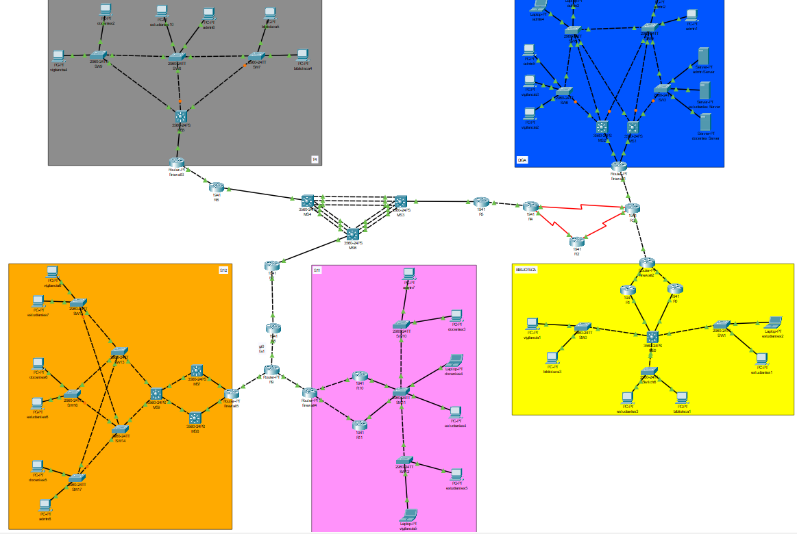
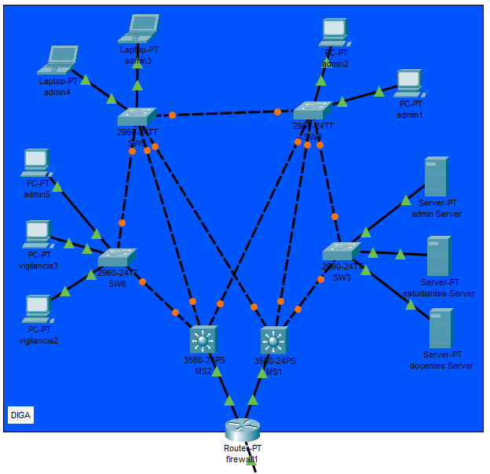
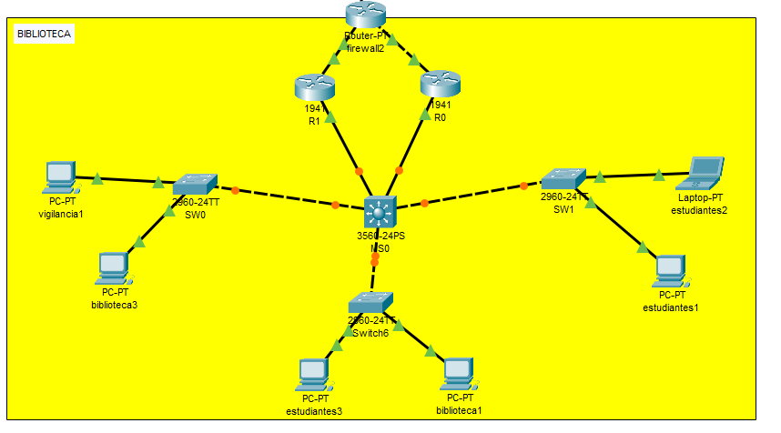
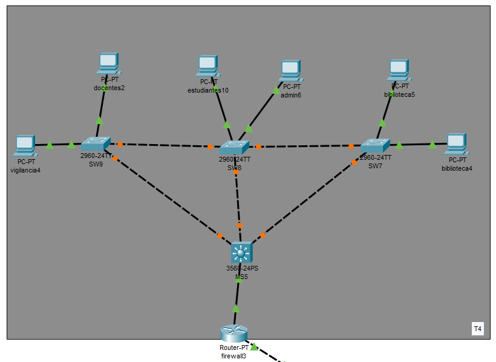
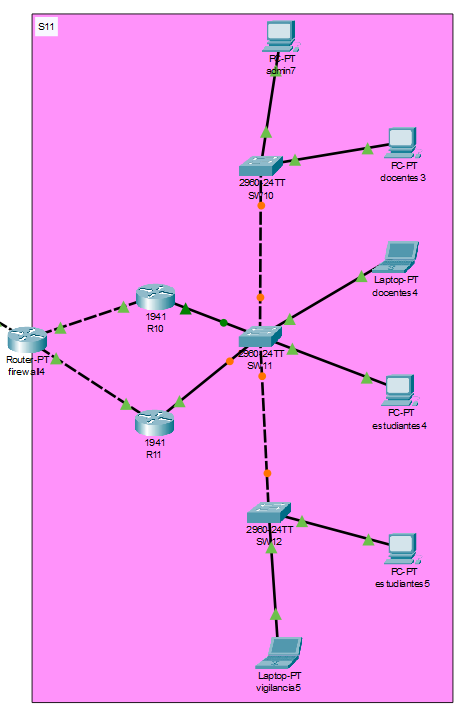
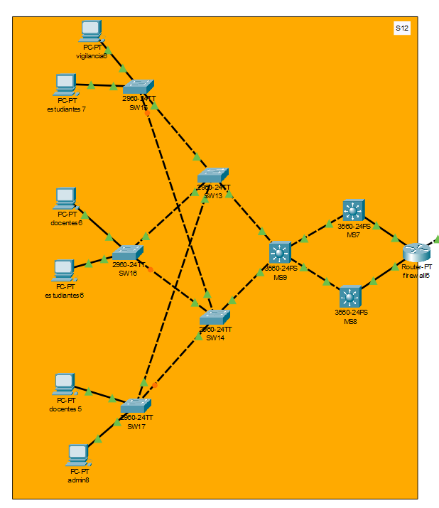
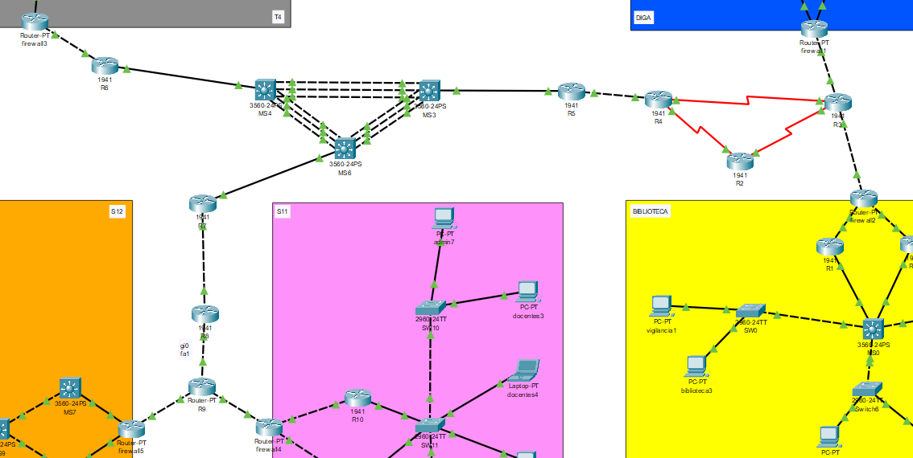

# Manual Técnico - Proyecto 2

## Tabla de Contenidos
- [Manual Técnico - Proyecto 2](#manual-técnico---proyecto-2)
  - [Tabla de Contenidos](#tabla-de-contenidos)
  - [1. Objetivos](#1-objetivos)
    - [1.1 Objetivo General](#11-objetivo-general)
    - [1.2 Objetivos Específicos](#12-objetivos-específicos)
  - [2. Alcance del Proyecto](#2-alcance-del-proyecto)
    - [2.1 Inclusiones](#21-inclusiones)
    - [2.2 Exclusiones](#22-exclusiones)
  - [3. Topología de Red](#3-topología-de-red)
    - [3.1 DIGA](#31-diga)
    - [3.2 Biblioteca](#32-biblioteca)
    - [3.3 Edificio T4](#33-edificio-t4)
    - [3.4 Edificio S11](#34-edificio-s11)
    - [3.5 Edificio S12](#35-edificio-s12)
    - [3.6 BACKBONE](#36-backbone)
  - [4. Tabla de Direccionamiento IP](#4-tabla-de-direccionamiento-ip)
    - [4.1 Direcciones de dispositivos](#41-direcciones-de-dispositivos)
      - [4.1.1 DIGA](#411-diga)
      - [4.1.2 Biblioteca](#412-biblioteca)
      - [4.1.3. Edificio T4](#413-edificio-t4)
      - [4.1.4 Edificio S11](#414-edificio-s11)
      - [4.1.5 Edificio S12](#415-edificio-s12)
    - [4.2 Direcciones de Puertas de enlace](#42-direcciones-de-puertas-de-enlace)
      - [4.2.1 DIGA](#421-diga)
      - [4.2.2 Biblioteca](#422-biblioteca)
      - [4.2.3. Edificio T4](#423-edificio-t4)
      - [4.2.4 Edificio S11](#424-edificio-s11)
      - [4.2.5 Edificio S12](#425-edificio-s12)
      - [4.2.6 Backbone](#426-backbone)
  - [5. Subnetting](#5-subnetting)
    - [5.1 DIGA](#51-diga)
    - [5.2 Biblioteca](#52-biblioteca)
    - [5.3 Edificio T4](#53-edificio-t4)
    - [5.4 Edificio S11](#54-edificio-s11)
    - [5.5 Edificio S12](#55-edificio-s12)
    - [5.6 BACKBONE](#56-backbone)
  - [6. Configuraciones de Dispositivos](#6-configuraciones-de-dispositivos)
    - [6.1 DIGA](#61-diga)
      - [6.1.1 Configuración Switches](#611-configuración-switches)
        - [6.1.1.1 SW3](#6111-sw3)
        - [6.1.1.2 SW4](#6112-sw4)
        - [6.1.1.3 SW5 (Servidor VTP)](#6113-sw5-servidor-vtp)
        - [6.1.1.4 SW6](#6114-sw6)
      - [6.1.2 Configuración Multiswitches](#612-configuración-multiswitches)
        - [6.1.2.1 MS1](#6121-ms1)
        - [6.1.2.2 MS2](#6122-ms2)
      - [6.1.3 Configuración Routers](#613-configuración-routers)
        - [6.1.3.1 Firewall1](#6131-firewall1)
      - [6.1.4 Conexiones entre los switches](#614-conexiones-entre-los-switches)
      - [6.1.5 Conexiones a dispositivos finales](#615-conexiones-a-dispositivos-finales)
    - [6.2 Biblioteca](#62-biblioteca)
      - [6.2.1 Configuraciones Switches](#621-configuraciones-switches)
        - [6.2.1.1 SW0](#6211-sw0)
        - [6.2.1.2 SW1](#6212-sw1)
        - [6.2.1.3 Switch6](#6213-switch6)
      - [6.2.2 Configuración Multiswitch MS0 (Servidor VTP)](#622-configuración-multiswitch-ms0-servidor-vtp)
      - [6.2.3 Configuración Routers](#623-configuración-routers)
        - [6.2.3.1 R0](#6231-r0)
        - [6.2.3.2 R1](#6232-r1)
        - [6.2.3.3 Firewall2](#6233-firewall2)
      - [6.2.4 Conexiones entre los switches y routers](#624-conexiones-entre-los-switches-y-routers)
      - [6.2.5 Conexiones a dispositivos finales](#625-conexiones-a-dispositivos-finales)
    - [6.3 Edificio T4](#63-edificio-t4)
      - [6.3.1 Configuraciones Switches](#631-configuraciones-switches)
        - [6.3.1.1 SW7](#6311-sw7)
        - [6.3.1.2 SW8 (Servidor VTP)](#6312-sw8-servidor-vtp)
        - [6.3.1.3 SW9](#6313-sw9)
      - [6.3.2 Configuración Multiswitch MS5](#632-configuración-multiswitch-ms5)
      - [6.3.3 Configuración Routers](#633-configuración-routers)
        - [6.3.3.1 Firewall3](#6331-firewall3)
      - [6.3.4 Conexiones entre los switches](#634-conexiones-entre-los-switches)
      - [6.3.5 Conexiones a dispositivos finales](#635-conexiones-a-dispositivos-finales)
    - [6.4 Edificio S11](#64-edificio-s11)
      - [6.4.1 Configuraciones Switches](#641-configuraciones-switches)
        - [6.4.1.1 SW10](#6411-sw10)
        - [6.4.1.2 SW11 (Servidor VTP)](#6412-sw11-servidor-vtp)
        - [6.4.1.3 SW12](#6413-sw12)
      - [6.4.2 Configuración Routers](#642-configuración-routers)
        - [6.4.2.1 R10](#6421-r10)
        - [6.4.2.2 R11](#6422-r11)
        - [6.4.2.3 firewall4](#6423-firewall4)
      - [6.4.3 Conexiones entre los switches](#643-conexiones-entre-los-switches)
      - [6.4.4 Conexiones a dispositivos finales](#644-conexiones-a-dispositivos-finales)
    - [6.5 Edificio S12](#65-edificio-s12)
      - [6.5.1 Configuraciones Switches](#651-configuraciones-switches)
        - [6.5.1.1 SW13](#6511-sw13)
        - [6.5.1.2 SW14](#6512-sw14)
        - [6.5.1.3 SW15](#6513-sw15)
        - [6.5.1.4 SW16](#6514-sw16)
        - [6.5.1.5 SW17](#6515-sw17)
      - [6.5.2 Configuración Multiswitches](#652-configuración-multiswitches)
        - [6.5.2.1 MS7](#6521-ms7)
        - [6.5.2.2 MS8](#6522-ms8)
        - [6.5.2.3 MS9 (Servidor VTP)](#6523-ms9-servidor-vtp)
      - [6.5.3.1 Configuracion Routers](#6531-configuracion-routers)
        - [6.5.3.1.1 Firewall5](#65311-firewall5)
      - [6.5.3 Conexiones entre los switches](#653-conexiones-entre-los-switches)
      - [6.5.4 Conexiones a dispositivos finales](#654-conexiones-a-dispositivos-finales)
    - [6.6 BACKBONE](#66-backbone)
    - [6.6.1 Configuración Routers](#661-configuración-routers)
      - [6.6.1.1 R2](#6611-r2)
      - [6.6.1.2 R3](#6612-r3)
      - [6.6.1.3 R4](#6613-r4)
      - [6.6.1.4 R5](#6614-r5)
      - [6.6.1.5 R6](#6615-r6)
      - [6.6.1.6 R7](#6616-r7)
      - [6.6.1.7 R8](#6617-r8)
      - [6.6.1.8 R9](#6618-r9)
    - [6.6.2 Configuración de MultiSwitches](#662-configuración-de-multiswitches)
      - [6.6.2.1 MS3](#6621-ms3)
      - [6.6.2.2 MS4](#6622-ms4)
      - [6.6.2.3 MS6](#6623-ms6)
      - [6.6.3 RIP (Routing Information Protocol)](#663-rip-routing-information-protocol)
      - [6.6.4 OSPF (Open Shortest Path First)](#664-ospf-open-shortest-path-first)
      - [6.6.5 EIGRP (Enhances Interior Gateway Routing Protocol)](#665-eigrp-enhances-interior-gateway-routing-protocol)
      - [6.6.6 Rutas Estáticas](#666-rutas-estáticas)


## 1. Objetivos

### 1.1 Objetivo General
 Diseñar, configurar y simular una infraestructura de red inter-edificios para el campus central de la Universidad de San Carlos (NetUSAC) utilizando Cisco Packet Tracer. El diseño busca garantizar una comunicación eficiente, segura y redundante entre cinco edificios clave, implementando segmentación de red, protocolos de enrutamiento avanzado y alta disponibilidad.

### 1.2 Objetivos Específicos
* **Segmentar** la red de cada edificio en VLANs para separar el tráfico de distintas áreas (Estudiantes, Docentes, Administración, etc.).
* **Implementar** un esquema de direccionamiento IP jerárquico utilizando VLSM y FLSM para optimizar el uso del espacio de direcciones.
* **Configurar** enrutamiento Inter-VLAN para permitir la comunicación controlada entre las diferentes VLANs de la topología.
* **Establecer** la interconexión del backbone de la red mediante protocolos de enrutamiento dinámico (RIP, OSPF, EIGRP) y rutas estáticas.
* **Asegurar** la alta disponibilidad de la red implementando protocolos de redundancia de primer salto como HSRP.
* **Implementar** políticas de seguridad básicas mediante Listas de Control de Acceso (ACLs) para filtrar el tráfico entre VLANs.
* **Validar** la conectividad completa de la red y el correcto funcionamiento de los protocolos implementados tanto en la simulación como en la implementación física.

---

## 2. Alcance del Proyecto

### 2.1 Inclusiones
* El diseño, configuración y validación se realizan principalmente en el simulador **Cisco Packet Tracer**.
* La topología abarca la interconexión de **cinco edificios**: Biblioteca Central, Edificio T4, Edificio S11, Edificio S12 y DIGA.
* Configuración de tecnologías de Capa 2 y Capa 3, incluyendo VLANs, VTP, enrutamiento Inter-VLAN, HSRP, RIP, OSPF, EIGRP, rutas estáticas y redistribución de rutas.
* Implementación de una **parte física** de la topología para validar la configuración de VLANs en equipos reales.
* Asignación de direccionamiento IP y configuración de todos los dispositivos de red mediante la **Interfaz de Línea de Comandos (CLI)**.

### 2.2 Exclusiones
* La conexión de la red del campus con redes externas como WAN o Internet.
* La implementación de mecanismos de seguridad avanzados más allá de las Listas de Control de Acceso (ACLs) estándar/extendidas.
* Configuración de servicios de red como DHCP, DNS o servidores web, a menos que sea estrictamente necesario para pruebas de conectividad.
* El uso de interfaces gráficas de usuario (GUI) para la configuración de los dispositivos.

---

## 3. Topología de Red
A continuación, se presenta el diagrama de la topología de red implementada en Cisco Packet Tracer para el proyecto NetUSAC. La red interconecta cinco edificios clave del campus central de la Universidad de San Carlos: Biblioteca Central, Edificio T4, Edificio S11, Edificio S12 y DIGA. La comunicación entre estos edificios se gestiona a través de un Backbone central, diseñado para garantizar la redundancia, la seguridad y un flujo de tráfico eficiente mediante enrutamiento avanzado.



### 3.1 DIGA



### 3.2 Biblioteca



### 3.3 Edificio T4



### 3.4 Edificio S11



### 3.5 Edificio S12



### 3.6 BACKBONE



## 4. Tabla de Direccionamiento IP

### 4.1 Direcciones de dispositivos

#### 4.1.1 DIGA
| Nombre                    | VLAN | Dirección IP     | Máscara de Red   | Puerta de Enlace  |
|---------------------------|------|------------------|------------------|-------------------|
| estudiantes Server        | 12   | 192.168.20.169   | 255.255.255.248  | 192.168.20.174    |
| docentes Server           | 22   | 192.168.20.161   | 255.255.255.248  | 192.168.20.166    |
| vigilancia2               | 32   | 192.168.20.129   | 255.255.255.224  | 192.168.20.158    |
| vigilancia3               | 32   | 192.168.20.130   | 255.255.255.224  | 192.168.20.158    |
| admin1                    | 42   | 192.168.20.1     | 255.255.255.128  | 192.168.20.126    |
| admin2                    | 42   | 192.168.20.2     | 255.255.255.128  | 192.168.20.126    |
| admin3                    | 42   | 192.168.20.3     | 255.255.255.128  | 192.168.20.126    |
| admin4                    | 42   | 192.168.20.4     | 255.255.255.128  | 192.168.20.126    |
| admin5                    | 42   | 192.168.20.5     | 255.255.255.128  | 192.168.20.126    |
| admin Server              | 42   | 192.168.20.6     | 255.255.255.128  | 192.168.20.126    |
| SVI MS1 (DIGA)            | 12   | 192.168.20.173   | 255.255.255.248  | 192.168.20.174    |
| SVI MS2 (DIGA)            | 12   | 192.168.20.172   | 255.255.255.248  | 192.168.20.174    |
| SVI MS1 (DIGA)            | 22   | 192.168.20.165   | 255.255.255.248  | 192.168.20.166    |
| SVI MS2 (DIGA)            | 22   | 192.168.20.164   | 255.255.255.248  | 192.168.20.166    |
| SVI MS1 (DIGA)            | 32   | 192.168.20.157   | 255.255.255.224  | 192.168.20.158    |
| SVI MS2 (DIGA)            | 32   | 192.168.20.156   | 255.255.255.224  | 192.168.20.158    |
| SVI MS1 (DIGA)            | 42   | 192.168.20.125   | 255.255.255.128  | 192.168.20.126    |
| SVI MS2 (DIGA)            | 42   | 192.168.20.124   | 255.255.255.128  | 192.168.20.126    |


#### 4.1.2 Biblioteca

| Nombre                        | VLAN | Dirección IP    | Máscara de Red   | Puerta de Enlace  |
|-------------------------------|------|-----------------|------------------|-------------------|
| estudiantes1                  | 12   | 192.158.20.1    | 255.255.255.128  | 192.158.20.126    |
| estudiantes2                  | 12   | 192.158.20.2    | 255.255.255.128  | 192.158.20.126    |
| estudiantes3                  | 12   | 192.158.20.3    | 255.255.255.128  | 192.158.20.126    |
| vigilancia1                   | 32   | 192.158.20.129  | 255.255.255.224  | 192.158.20.158    |
| biblioteca1                   | 52   | 192.158.20.161  | 255.255.255.224  | 192.158.20.190    |
| biblioteca3                   | 52   | 192.158.20.162  | 255.255.255.224  | 192.158.20.190    |
| Sub-interfaz R0 (biblioteca)  | 12   | 192.158.20.125  | 255.255.255.128  | 192.158.20.126    |
| Sub-interfaz R1 (biblioteca)  | 12   | 192.158.20.124  | 255.255.255.128  | 192.158.20.126    |
| Sub-interfaz R0 (biblioteca)  | 32   | 192.158.20.157  | 255.255.255.224  | 192.158.20.158    |
| Sub-interfaz R1 (biblioteca)  | 32   | 192.158.20.156  | 255.255.255.224  | 192.158.20.158    |
| Sub-interfaz R0 (biblioteca)  | 52   | 192.158.20.189  | 255.255.255.224  | 192.158.20.190    |
| Sub-interfaz R1 (biblioteca)  | 52   | 192.158.20.188  | 255.255.255.224  | 192.158.20.190    |


#### 4.1.3. Edificio T4
| Nombre           | VLAN | Dirección IP    | Máscara de Red   | Puerta de Enlace |
|------------------|------|-----------------|------------------|------------------|
| estudiantes10    | 12   | 172.16.20.129   | 255.255.255.192  | 172.16.20.190    |
| docentes2        | 22   | 172.16.20.241   | 255.255.255.240  | 172.16.20.254    |
| vigilancia4      | 32   | 172.16.20.193   | 255.255.255.224  | 172.16.20.222    |
| admin6           | 42   | 172.16.20.1     | 255.255.255.128  | 172.16.20.126    |
| biblioteca4      | 52   | 172.16.20.225   | 255.255.255.240  | 172.16.20.238    |
| biblioteca5      | 52   | 172.16.20.226   | 255.255.255.240  | 172.16.20.238    |
| SVI MS5 (T4)     | 12   | 172.16.20.189   | 255.255.255.192  | 172.16.20.190    |
| SVI MS5 (T4)     | 22   | 172.16.20.253   | 255.255.255.240  | 172.16.20.254    |
| SVI MS5 (T4)     | 32   | 172.16.20.221   | 255.255.255.224  | 172.16.20.222    |
| SVI MS5 (T4)     | 42   | 172.16.20.125   | 255.255.255.128  | 172.16.20.126    |
| SVI MS5 (T4)     | 52   | 172.16.20.237   | 255.255.255.240  | 172.16.20.238    |


#### 4.1.4 Edificio S11
| Nombre                    | VLAN | Dirección IP    | Máscara de Red   | Puerta de Enlace |
|---------------------------|------|-----------------|------------------|------------------|
| estudiantes4              | 12   | 172.148.20.1    | 255.255.255.128  | 172.148.20.126    |
| estudiantes5              | 12   | 172.148.20.2    | 255.255.255.128  | 172.148.20.126    |
| docentes3                 | 22   | 172.148.20.193  | 255.255.255.224  | 172.148.20.222    |
| docentes4                 | 22   | 172.148.20.194  | 255.255.255.224  | 172.148.20.222    |
| vigilancia5               | 32   | 172.148.20.225  | 255.255.255.240  | 172.148.20.238    |
| admin7                    | 42   | 172.148.20.129  | 255.255.255.192  | 172.148.20.190    |
| Sub-interfaz R10 (S11)    | 12   | 172.148.20.125  | 255.255.255.128  | 172.148.20.126    |
| Sub-interfaz R11 (S11)    | 12   | 172.148.20.124  | 255.255.255.128  | 172.148.20.126    |
| Sub-interfaz R10 (S11)    | 22   | 172.148.20.221  | 255.255.255.224  | 172.148.20.222    |
| Sub-interfaz R11 (S11)    | 22   | 172.148.20.220  | 255.255.255.224  | 172.148.20.222    |
| Sub-interfaz R10 (S11)    | 32   | 172.148.20.237  | 255.255.255.240  | 172.148.20.238    |
| Sub-interfaz R11 (S11)    | 32   | 172.148.20.236  | 255.255.255.240  | 172.148.20.238    |
| Sub-interfaz R10 (S11)    | 42   | 172.148.20.189  | 255.255.255.192  | 172.148.20.190    |
| Sub-interfaz R11 (S11)    | 42   | 172.148.20.188  | 255.255.255.192  | 172.148.20.190    |


#### 4.1.5 Edificio S12
| Nombre         | VLAN | Dirección IP     | Máscara de Red   | Puerta de Enlace  |
|----------------|------|------------------|------------------|-------------------|
| estudiantes6   | 12   | 192.128.20.1     | 255.255.255.128  | 192.128.20.126    |
| estudiantes7   | 12   | 192.128.20.2     | 255.255.255.128  | 192.128.20.126    |
| docentes5      | 22   | 192.128.20.129   | 255.255.255.192  | 192.128.20.190    |
| docentes6      | 22   | 192.128.20.130   | 255.255.255.192  | 192.128.20.190    |
| vigilancia6    | 32   | 192.128.20.225   | 255.255.255.224  | 192.128.20.254    |
| admin8         | 42   | 192.128.20.193   | 255.255.255.224  | 192.128.20.222    |
| SVI MS7 (S12)   | 12   | 192.128.20.125   | 255.255.255.128  | 192.128.20.126    |
| SVI MS8 (S12)   | 12   | 192.128.20.124   | 255.255.255.128  | 192.128.20.126    |
| SVI MS7 (S12)   | 22   | 192.128.20.189   | 255.255.255.192  | 192.128.20.190    |
| SVI MS8 (S12)   | 22   | 192.128.20.188   | 255.255.255.192  | 192.128.20.190    |
| SVI MS7 (S12)   | 32   | 192.128.20.253   | 255.255.255.224  | 192.128.20.254    |
| SVI MS8 (S12)   | 32   | 192.128.20.252   | 255.255.255.224  | 192.128.20.254    |
| SVI MS7 (S12)   | 42   | 192.128.20.221   | 255.255.255.224  | 192.128.20.222    |
| SVI MS8 (S12)   | 42   | 192.128.20.220   | 255.255.255.224  | 192.128.20.222    |


### 4.2 Direcciones de Puertas de enlace

#### 4.2.1 DIGA
| Nombre      | VLAN | Dirección IP    | Máscara de Red   |
|-------------|------|-----------------|------------------|
| Estudiantes | 12   | 192.168.20.174  | 255.255.255.248  |
| Docentes    | 22   | 192.168.20.166  | 255.255.255.248  |
| Vigilancia  | 32   | 192.168.20.158  | 255.255.255.224  |
| Admin       | 42   | 192.168.20.126  | 255.255.255.128  |


#### 4.2.2 Biblioteca
| Nombre      | VLAN | Dirección IP    | Máscara de Red   |
|-------------|------|-----------------|------------------|
| Estudiantes | 12   | 192.158.20.126  | 255.255.255.128  |
| Vigilancia  | 32   | 192.158.20.158  | 255.255.255.224  |
| Biblioteca  | 52   | 192.158.20.190  | 255.255.255.224  |


#### 4.2.3. Edificio T4
| Nombre      | VLAN | Dirección IP    | Máscara de Red   |
|-------------|------|-----------------|------------------|
| Estudiantes | 12   | 172.16.20.190   | 255.255.255.192  |
| Docentes    | 22   | 172.16.20.254   | 255.255.255.240  |
| Vigilancia  | 32   | 172.16.20.222   | 255.255.255.224  |
| Admin       | 42   | 172.16.20.126   | 255.255.255.128  |
| Biblioteca  | 52   | 172.16.20.238   | 255.255.255.240  |


#### 4.2.4 Edificio S11
| Nombre      | VLAN | Dirección IP     | Máscara de Red   |
|-------------|------|------------------|------------------|
| Estudiantes | 12   | 172.148.20.126   | 255.255.255.128  |
| Docentes    | 22   | 172.148.20.222   | 255.255.255.224  |
| Vigilancia  | 32   | 172.148.20.238   | 255.255.255.240  |
| Admin       | 42   | 172.148.20.190   | 255.255.255.192  |


#### 4.2.5 Edificio S12
| Nombre      | VLAN | Dirección IP    | Máscara de Red   |
|-------------|------|-----------------|------------------|
| Estudiantes | 12   | 192.128.20.126  | 255.255.255.128  |
| Docentes    | 22   | 192.128.20.190  | 255.255.255.192  |
| Vigilancia  | 32   | 192.128.20.254  | 255.255.255.224  |
| Admin       | 42   | 192.128.20.222  | 255.255.255.224  |

#### 4.2.6 Backbone

| Dispositivo   | Interfaz      | IP              | Máscara           | Red Conectada      |
|---------------|---------------|-----------------|-------------------|--------------------|
| firewall1     | fa0/0         | 10.0.0.70       | 255.255.255.252   | Hacia MS1          |
| firewall1     | fa1/0         | 10.0.0.74       | 255.255.255.252   | Hacia MS2          |
| firewall1     | fa6/0         | 10.0.0.62       | 255.255.255.252   | Hacia R3           |
| firewall2     | fa0/0         | 10.0.0.82       | 255.255.255.252   | Hacia R0           |
| firewall2     | fa1/0         | 10.0.0.78       | 255.255.255.252   | Hacia R1           |
| firewall2     | fa6/0         | 10.0.0.66       | 255.255.255.252   | Hacia R3           |
| firewall3     | fa0/0         | 10.0.0.86       | 255.255.255.252   | Hacia MS5          |
| firewall3     | fa1/0         | 10.0.0.1        | 255.255.255.252   | Hacia R6           |
| firewall4     | fa0/0         | 10.0.0.90       | 255.255.255.252   | Hacia R10          |
| firewall4     | fa1/0         | 10.0.0.94       | 255.255.255.252   | Hacia R11          |
| firewall4     | fa6/0         | 10.0.0.30       | 255.255.255.252   | Hacia R9           |
| firewall5     | fa0/0         | 10.0.0.98       | 255.255.255.252   | Hacia MS7          |
| firewall5     | fa1/0         | 10.0.0.102      | 255.255.255.252   | Hacia MS8          |
| firewall5     | fa6/0         | 10.0.0.26       | 255.255.255.252   | Hacia R9           |

## 5. Subnetting

### 5.1 DIGA
Para este edificio se usa VLSM:
| HOSTS NECESARIOS | VLAN | OFICINA    | ID RED        | MASCARA           | WILDCARD     | PRIMER HOST    | ULTIMO HOST     | BROADCAST      | HOST. UTILIZABLES |
|-----------------|------|------------|---------------|-------------------|--------------|----------------|-----------------|----------------|------------------|
| 120             | 42   | Admin      | 192.168.20.0  | 255.255.255.128   | 0.0.0.127    | 192.168.20.1   | 192.168.20.126  | 192.168.20.127  | 126              |
| 20              | 32   | Vigilancia | 192.168.20.128| 255.255.255.224   | 0.0.0.31     | 192.168.20.129 | 192.168.20.158  | 192.168.20.159  | 30               |
| 5               | 22   | Docentes   | 192.168.20.160| 255.255.255.248   | 0.0.0.7      | 192.168.20.161 | 192.168.20.166  | 192.168.20.167  | 6                |
| 5               | 12   | Estudiantes| 192.168.20.168| 255.255.255.248   | 0.0.0.7      | 192.168.20.169 | 192.168.20.174  | 192.168.20.175  | 6                |

### 5.2 Biblioteca
Para este edificio se usa VLSM:

| HOSTS NECESARIOS | VLAN | OFICINA    | ID RED        | MASCARA           | WILDCARD     | PRIMER HOST    | ULTIMO HOST     | BROADCAST      | HOST. UTILIZABLES |
|-----------------|------|------------|---------------|-------------------|--------------|----------------|-----------------|----------------|------------------|
| 75              | 12   | Estudiantes| 192.158.20.0  | 255.255.255.128   | 0.0.0.127    | 192.158.20.1   | 192.158.20.126  | 192.158.20.127  | 126              |
| 30              | 32   | Vigilancia | 192.158.20.128| 255.255.255.224   | 0.0.0.31     | 192.158.20.129 | 192.158.20.158  | 192.158.20.159  | 30               |
| 25              | 52   | Biblioteca | 192.158.20.160| 255.255.255.224   | 0.0.0.31     | 192.158.20.161 | 192.158.20.190  | 192.158.20.191  | 30               |

### 5.3 Edificio T4

Para este edificio se usa VLSM:
| HOSTS NECESARIOS | VLAN | OFICINA    | ID RED        | MASCARA           | WILDCARD     | PRIMER HOST    | ULTIMO HOST     | BROADCAST      | HOST. UTILIZABLES | HOST UTILIZADOS | DESPERDICIO |
|-----------------|------|------------|---------------|-------------------|--------------|----------------|-----------------|----------------|------------------|----------------|-------------|
| 75              | 42   | Admin      | 172.16.20.0   | 255.255.255.128   | 0.0.0.127    | 172.16.20.1    | 172.16.20.126   | 172.16.20.127   | 126              | 1              | 125         |
| 60              | 12   | Estudiantes| 172.16.20.128 | 255.255.255.192   | 0.0.0.63     | 172.16.20.129  | 172.16.20.190   | 172.16.20.191   | 62               | 1              | 61          |
| 15              | 32   | Vigilancia | 172.16.20.192 | 255.255.255.224   | 0.0.0.31     | 172.16.20.193  | 172.16.20.222   | 172.16.20.223   | 30               | 1              | 29          |
| 12              | 52   | Biblioteca | 172.16.20.224 | 255.255.255.240   | 0.0.0.15     | 172.16.20.225  | 172.16.20.238   | 172.16.20.239   | 14               | 2              | 12          |
| 10              | 22   | Docentes   | 172.16.20.240 | 255.255.255.240   | 0.0.0.15     | 172.16.20.241  | 172.16.20.254   | 172.16.20.255   | 14               | 1              | 13          |


### 5.4 Edificio S11
Para este edificio se usa VLSM:
| HOSTS NECESARIOS | VLAN | OFICINA    | ID RED        | MASCARA           | WILDCARD     | PRIMER HOST    | ULTIMO HOST     | BROADCAST      | HOST. UTILIZABLES | HOST UTILIZADOS | DESPERDICIO |
|-----------------|------|------------|---------------|-------------------|--------------|----------------|-----------------|----------------|------------------|----------------|-------------|
| 100             | 12   | Estudiantes| 172.148.20.0  | 255.255.255.128   | 0.0.0.127    | 172.148.20.1   | 172.148.20.126  | 172.148.20.127  | 126              | 2              | 124         |
| 55              | 42   | Admin      | 172.148.20.128| 255.255.255.192   | 0.0.0.63     | 172.148.20.129 | 172.148.20.190  | 172.148.20.191  | 62               | 1              | 61          |
| 15              | 22   | Docentes   | 172.148.20.192| 255.255.255.224   | 0.0.0.31     | 172.148.20.193 | 172.148.20.222  | 172.148.20.223  | 30               | 2              | 28          |
| 10              | 32   | Vigilancia | 172.148.20.224| 255.255.255.240   | 0.0.0.15     | 172.148.20.225 | 172.148.20.238  | 172.148.20.239  | 14               | 1              | 13          |


### 5.5 Edificio S12
Para este edificio se usa VLSM:
| HOSTS NECESARIOS | VLAN | OFICINA    | ID RED        | MASCARA           | WILDCARD     | PRIMER HOST    | ULTIMO HOST     | BROADCAST      | HOST. UTILIZABLES | HOST UTILIZADOS | DESPERDICIO |
|-----------------|------|------------|---------------|-------------------|--------------|----------------|-----------------|----------------|------------------|----------------|-------------|
| 125             | 12   | Estudiantes| 192.128.20.0  | 255.255.255.128   | 0.0.0.127    | 192.128.20.1   | 192.128.20.126  | 192.128.20.127  | 126              | 2              | 124         |
| 35              | 22   | Docentes   | 192.128.20.128| 255.255.255.192   | 0.0.0.63     | 192.128.20.129 | 192.128.20.190  | 192.128.20.191  | 62               | 2              | 60          |
| 25              | 42   | Admin      | 192.128.20.192| 255.255.255.224   | 0.0.0.31     | 192.128.20.193 | 192.128.20.222  | 192.128.20.223  | 30               | 1              | 29          |
| 20              | 32   | Vigilancia | 192.128.20.224| 255.255.255.224   | 0.0.0.31     | 192.128.20.225 | 192.128.20.254  | 192.128.20.255  | 30               | 1              | 29          |

### 5.6 BACKBONE

| HOSTS NECESARIOS | Dispositivo A | Dispositivo B | ID RED     | MASCARA           | WILDCARD   | PRIMER HOST (Dispositivo A) | ULTIMO HOST (Dispositivo B) | BROADCAST    | HOST. UTILIZABLES | HOST UTILIZADOS | DESPERDICIO |
|------------------|---------------|---------------|------------|-------------------|------------|-----------------------------|-----------------------------|--------------|------------------|----------------|-------------|
| 2                | firewall3     | R6            | 10.0.0.0   | 255.255.255.252   | 0.0.0.3    | 10.0.0.1                    | 10.0.0.2                     | 10.0.0.3     | 2                | 2              | 0           |
| 2                | R6            | MS4           | 10.0.0.4   | 255.255.255.252   | 0.0.0.3    | 10.0.0.5                    | 10.0.0.6                     | 10.0.0.7     | 2                | 2              | 0           |
| 2                | MS4           | MS6           | 10.0.0.8   | 255.255.255.252   | 0.0.0.3    | 10.0.0.9                    | 10.0.0.10                    | 10.0.0.11    | 2                | 2              | 0           |
| 2                | MS6           | R7            | 10.0.0.12  | 255.255.255.252   | 0.0.0.3    | 10.0.0.13                   | 10.0.0.14                    | 10.0.0.15    | 2                | 2              | 0           |
| 2                | R7            | R8            | 10.0.0.16  | 255.255.255.252   | 0.0.0.3    | 10.0.0.17                   | 10.0.0.18                    | 10.0.0.19    | 2                | 2              | 0           |
| 2                | R8            | R9            | 10.0.0.20  | 255.255.255.252   | 0.0.0.3    | 10.0.0.21                   | 10.0.0.22                    | 10.0.0.23    | 2                | 2              | 0           |
| 2                | R9            | firewall5     | 10.0.0.24  | 255.255.255.252   | 0.0.0.3    | 10.0.0.25                   | 10.0.0.26                    | 10.0.0.27    | 2                | 2              | 0           |
| 2                | R9            | firewall4     | 10.0.0.28  | 255.255.255.252   | 0.0.0.3    | 10.0.0.29                   | 10.0.0.30                    | 10.0.0.31    | 2                | 2              | 0           |
| 2                | MS6           | MS3           | 10.0.0.32  | 255.255.255.252   | 0.0.0.3    | 10.0.0.33                   | 10.0.0.34                    | 10.0.0.35    | 2                | 2              | 0           |
| 2                | MS4           | MS3           | 10.0.0.36  | 255.255.255.252   | 0.0.0.3    | 10.0.0.37                   | 10.0.0.38                    | 10.0.0.39    | 2                | 2              | 0           |
| 2                | MS3           | R5            | 10.0.0.40  | 255.255.255.252   | 0.0.0.3    | 10.0.0.41                   | 10.0.0.42                    | 10.0.0.43    | 2                | 2              | 0           |
| 2                | R5            | R4            | 10.0.0.44  | 255.255.255.252   | 0.0.0.3    | 10.0.0.45                   | 10.0.0.46                    | 10.0.0.47    | 2                | 2              | 0           |
| 2                | R4            | R2            | 10.0.0.48  | 255.255.255.252   | 0.0.0.3    | 10.0.0.49                   | 10.0.0.50                    | 10.0.0.51    | 2                | 2              | 0           |
| 2                | R4            | R3            | 10.0.0.52  | 255.255.255.252   | 0.0.0.3    | 10.0.0.53                   | 10.0.0.54                    | 10.0.0.55    | 2                | 2              | 0           |
| 2                | R2            | R3            | 10.0.0.56  | 255.255.255.252   | 0.0.0.3    | 10.0.0.57                   | 10.0.0.58                    | 10.0.0.59    | 2                | 2              | 0           |
| 2                | R3            | firewall1     | 10.0.0.60  | 255.255.255.252   | 0.0.0.3    | 10.0.0.61                   | 10.0.0.62                    | 10.0.0.63    | 2                | 2              | 0           |
| 2                | R3            | firewall2     | 10.0.0.64  | 255.255.255.252   | 0.0.0.3    | 10.0.0.65                   | 10.0.0.66                    | 10.0.0.67    | 2                | 2              | 0           |
| 2                | MS1           | firewall1     | 10.0.0.68  | 255.255.255.252   | 0.0.0.3    | 10.0.0.69                   | 10.0.0.70                    | 10.0.0.71    | 2                | 2              | 0           |
| 2                | MS2           | firewall1     | 10.0.0.72  | 255.255.255.252   | 0.0.0.3    | 10.0.0.73                   | 10.0.0.74                    | 10.0.0.75    | 2                | 2              | 0           |
| 2                | R1            | firewall2     | 10.0.0.76  | 255.255.255.252   | 0.0.0.3    | 10.0.0.77                   | 10.0.0.78                    | 10.0.0.79    | 2                | 2              | 0           |
| 2                | R0            | firewall2     | 10.0.0.80  | 255.255.255.252   | 0.0.0.3    | 10.0.0.81                   | 10.0.0.82                    | 10.0.0.83    | 2                | 2              | 0           |
| 2                | MS5           | firewall3     | 10.0.0.84  | 255.255.255.252   | 0.0.0.3    | 10.0.0.85                   | 10.0.0.86                    | 10.0.0.87    | 2                | 2              | 0           |
| 2                | R10           | firewall4     | 10.0.0.88  | 255.255.255.252   | 0.0.0.3    | 10.0.0.89                   | 10.0.0.90                    | 10.0.0.91    | 2                | 2              | 0           |
| 2                | R11           | firewall4     | 10.0.0.92  | 255.255.255.252   | 0.0.0.3    | 10.0.0.93                   | 10.0.0.94                    | 10.0.0.95    | 2                | 2              | 0           |
| 2                | MS7           | firewall5     | 10.0.0.96  | 255.255.255.252   | 0.0.0.3    | 10.0.0.97                   | 10.0.0.98                    | 10.0.0.99    | 2                | 2              | 0           |
| 2                | MS8           | firewall5     | 10.0.0.100 | 255.255.255.252   | 0.0.0.3    | 10.0.0.101                  | 10.0.0.102                   | 10.0.0.103   | 2                | 2              | 0           |


## 6. Configuraciones de Dispositivos

### 6.1 DIGA


#### 6.1.1 Configuración Switches

##### 6.1.1.1 SW3
```bash
enable
configure terminal

! 1. Configuración Básica y VTP
hostname SW3
vtp mode client
vtp domain #202302220
vtp password usac2025

! 2. Configuración de Puertas Troncales
interface FastEthernet0/23
 description Enlace_a_SW4
 switchport mode trunk
 exit
interface FastEthernet0/24
 description Enlace_a_MS1
 switchport mode trunk
 exit

! 3. Configuración de Puertas de Acceso
interface FastEthernet0/1
 description admin_Server
 switchport mode access
 switchport access vlan 42
 spanning-tree portfast
 exit
interface FastEthernet0/2
 description estudiantes_Server
 switchport mode access
 switchport access vlan 12
 spanning-tree portfast
 exit
interface FastEthernet0/3
 description docentes_Server
 switchport mode access
 switchport access vlan 22
 spanning-tree portfast
 exit

end
write memory
```

##### 6.1.1.2 SW4
```bash
enable
configure terminal

! 1. Configuración Básica y VTP
hostname SW4
vtp mode client
vtp domain #202302220
vtp password usac2025

! 2. Configuración de Puertas Troncales
interface FastEthernet0/22
 description Enlace_a_SW5
 switchport mode trunk
 exit
interface FastEthernet0/3
 description Enlace_a_SW3
 switchport mode trunk
 exit
interface FastEthernet0/24
 description Enlace_a_MS2
 switchport mode trunk
 exit
interface FastEthernet0/23
 description Enlace_a_MS1
 switchport mode trunk
 exit

! 3. Configuración de Puertas de Acceso
interface FastEthernet0/1
 description PC_admin2
 switchport mode access
 switchport access vlan 42
 spanning-tree portfast
 exit
interface FastEthernet0/2
 description PC_admin1
 switchport mode access
 switchport access vlan 42
 spanning-tree portfast
 exit

end
write memory
```

##### 6.1.1.3 SW5 (Servidor VTP)
```bash
enable
configure terminal

! 1. Configuración Básica y VTP
hostname SW5
vtp mode server
vtp domain #202302220
vtp password usac2025

! 2. Creación de VLANs
vlan 12
 name Estudiantes
vlan 22
 name Docentes
vlan 32
 name Vigilancia
vlan 42
 name Admin

! 3. Configuración de Puertas Troncales
interface FastEthernet0/22
 description Enlace_a_SW6
 switchport mode trunk
 exit
interface FastEthernet0/3
 description Enlace_a_SW4
 switchport mode trunk
 exit
interface FastEthernet0/24
 description Enlace_a_MS2
 switchport mode trunk
 exit
interface FastEthernet0/23
 description Enlace_a_MS1
 switchport mode trunk
 exit

! 4. Configuración de Puertas de Acceso
interface FastEthernet0/1
 description PC_admin4
 switchport mode access
 switchport access vlan 42
 spanning-tree portfast
 exit
interface FastEthernet0/2
 description PC_admin3
 switchport mode access
 switchport access vlan 42
 spanning-tree portfast
 exit

end
write memory
```

##### 6.1.1.4 SW6
```bash
enable
configure terminal

! 1. Configuración Básica y VTP
hostname SW6
vtp mode client
vtp domain #202302220
vtp password usac2025

! 2. Configuración de Puertas Troncales
interface FastEthernet0/4
 description Enlace_a_SW5
 switchport mode trunk
 exit
interface FastEthernet0/24
 description Enlace_a_MS2
 switchport mode trunk
 exit

! 3. Configuración de Puertas de Acceso
interface FastEthernet0/1
 description PC_vigilancia2
 switchport mode access
 switchport access vlan 32
 spanning-tree portfast
 exit
interface FastEthernet0/2
 description PC_vigilancia3
 switchport mode access
 switchport access vlan 32
 spanning-tree portfast
 exit
interface FastEthernet0/3
 description PC_admin5
 switchport mode access
 switchport access vlan 42
 spanning-tree portfast
 exit

end
write memory
```


#### 6.1.2 Configuración Multiswitches

##### 6.1.2.1 MS1
```bash
enable
configure terminal

! 1. Habilitar Enrutamiento de Capa 3
ip routing

! 2. Configuración Básica y VTP
hostname MS1
vtp mode client
vtp domain #202302220
vtp password usac2025

! 3. Configuración de Puertas Troncales
interface FastEthernet0/1
 description Enlace_a_SW5
 switchport trunk encapsulation dot1q
 switchport mode trunk
 exit
interface FastEthernet0/2
 description Enlace_a_SW4
 switchport trunk encapsulation dot1q
 switchport mode trunk
 exit
interface FastEthernet0/3
 description Enlace_a_SW3
 switchport trunk encapsulation dot1q
 switchport mode trunk
 exit

! 4. Puerta Enrutado hacia el Firewall 
interface FastEthernet0/24
 description Enlace_hacia_Firewall1
 no switchport
 ip address 10.0.0.69 255.255.255.252 
 no shutdown
 exit

! 5. Configuración de SVIs y HSRP (ACTIVO)
interface Vlan12
 ip address 192.168.20.173 255.255.255.248
 standby 4 ip 192.168.20.174
 standby 4 priority 105
 standby 4 preempt
 exit

interface Vlan22
 ip address 192.168.20.165 255.255.255.248
 standby 3 ip 192.168.20.166
 standby 3 priority 105
 standby 3 preempt
 exit
interface Vlan32
 ip address 192.168.20.157 255.255.255.224
 standby 2 ip 192.168.20.158
 standby 2 priority 105
 standby 2 preempt
 exit
interface Vlan42
 ip address 192.168.20.125 255.255.255.128
 standby 1 ip 192.168.20.126
 standby 1 priority 105
 standby 1 preempt
 exit

! 6. Configuración del Protocolo de Enrutamiento (RIP)
router rip
 version 2
 no auto-summary
 network 192.168.20.0
 network 10.0.0.0
 exit

end
write memory
```

##### 6.1.2.2 MS2

```bash
enable
configure terminal

! 1. Habilitar Enrutamiento de Capa 3
ip routing

! 2. Configuración Básica y VTP
hostname MS2
vtp mode client
vtp domain #202302220
vtp password usac2025

! 3. Configuración de Puertas Troncales
interface FastEthernet0/1
 description Enlace_a_SW6
 switchport trunk encapsulation dot1q
 switchport mode trunk
 exit
interface FastEthernet0/2
 description Enlace_a_SW5
 switchport trunk encapsulation dot1q
 switchport mode trunk
 exit
interface FastEthernet0/3
 description Enlace_a_SW4
 switchport trunk encapsulation dot1q
 switchport mode trunk
 exit

! 4. Puerta Enrutado hacia el Firewall
interface FastEthernet0/24
 description Enlace_hacia_Firewall1
 no switchport
 ip address 10.0.0.73 255.255.255.252
 no shutdown
 exit

! 5. Configuración de SVIs y HSRP (RESPALDO)
interface Vlan12
 ip address 192.168.20.172 255.255.255.248
 standby 4 ip 192.168.20.174
 standby 4 priority 100
 standby 4 preempt
 exit
interface Vlan22
 ip address 192.168.20.164 255.255.255.248
 standby 3 ip 192.168.20.166
 standby 3 priority 100
 standby 3 preempt
 exit
interface Vlan32
 ip address 192.168.20.156 255.255.255.224
 standby 2 ip 192.168.20.158
 standby 2 priority 100
 standby 2 preempt
 exit
interface Vlan42
 ip address 192.168.20.124 255.255.255.128
 standby 1 ip 192.168.20.126
 standby 1 priority 100
 standby 1 preempt
 exit

! 6. Configuración del Protocolo de Enrutamiento (RIP)
router rip
 version 2
 no auto-summary
 network 192.168.20.0
 network 10.0.0.0
 exit

end
write memory
```


#### 6.1.3 Configuración Routers

##### 6.1.3.1 Firewall1

```bash
enable
configure terminal
hostname firewall1

! 1. Crear la Lista de Acceso de Seguridad Global (ACL)
!=======================================================
ip access-list extended ACL_SEGURIDAD_GLOBAL


 ! --- Reglas para ESTUDIANTES (VLAN 12) ---
 remark ### Reglas de comunicacion para ESTUDIANTES ###
 permit ip 192.168.20.168 0.0.0.7 192.158.20.0 0.0.0.127
 permit ip 192.168.20.168 0.0.0.7 172.16.20.128 0.0.0.63
 permit ip 192.168.20.168 0.0.0.7 172.148.20.0 0.0.0.127
 permit ip 192.168.20.168 0.0.0.7 192.128.20.0 0.0.0.127
 permit ip 192.158.20.0 0.0.0.127 192.168.20.168 0.0.0.7
 permit ip 192.158.20.0 0.0.0.127 172.16.20.128 0.0.0.63
 permit ip 192.158.20.0 0.0.0.127 172.148.20.0 0.0.0.127
 permit ip 192.158.20.0 0.0.0.127 192.128.20.0 0.0.0.127
 permit ip 172.16.20.128 0.0.0.63 192.168.20.168 0.0.0.7
 permit ip 172.16.20.128 0.0.0.63 192.158.20.0 0.0.0.127
 permit ip 172.16.20.128 0.0.0.63 172.148.20.0 0.0.0.127
 permit ip 172.16.20.128 0.0.0.63 192.128.20.0 0.0.0.127
 permit ip 172.148.20.0 0.0.0.127 192.168.20.168 0.0.0.7
 permit ip 172.148.20.0 0.0.0.127 192.158.20.0 0.0.0.127
 permit ip 172.148.20.0 0.0.0.127 172.16.20.128 0.0.0.63
 permit ip 172.148.20.0 0.0.0.127 192.128.20.0 0.0.0.127
 permit ip 192.128.20.0 0.0.0.127 192.168.20.168 0.0.0.7
 permit ip 192.128.20.0 0.0.0.127 192.158.20.0 0.0.0.127
 permit ip 192.128.20.0 0.0.0.127 172.16.20.128 0.0.0.63
 permit ip 192.128.20.0 0.0.0.127 172.148.20.0 0.0.0.127
 ! Permite tráfico dentro de la misma subred
 permit ip 192.168.20.168 0.0.0.7 192.168.20.168 0.0.0.7
 permit ip 192.158.20.0 0.0.0.127 192.158.20.0 0.0.0.127
 permit ip 172.16.20.128 0.0.0.63 172.16.20.128 0.0.0.63
 permit ip 172.148.20.0 0.0.0.127 172.148.20.0 0.0.0.127
 permit ip 192.128.20.0 0.0.0.127 192.128.20.0 0.0.0.127

 ! --- Reglas para DOCENTES (VLAN 22) ---
 remark ### Reglas de comunicacion para DOCENTES ###
 permit ip 192.168.20.160 0.0.0.7 172.16.20.240 0.0.0.15
 permit ip 192.168.20.160 0.0.0.7 172.148.20.192 0.0.0.31
 permit ip 192.168.20.160 0.0.0.7 192.128.20.128 0.0.0.63
 permit ip 172.16.20.240 0.0.0.15 192.168.20.160 0.0.0.7
 permit ip 172.16.20.240 0.0.0.15 172.148.20.192 0.0.0.31
 permit ip 172.16.20.240 0.0.0.15 192.128.20.128 0.0.0.63
 permit ip 172.148.20.192 0.0.0.31 192.168.20.160 0.0.0.7
 permit ip 172.148.20.192 0.0.0.31 172.16.20.240 0.0.0.15
 permit ip 172.148.20.192 0.0.0.31 192.128.20.128 0.0.0.63
 permit ip 192.128.20.128 0.0.0.63 192.168.20.160 0.0.0.7
 permit ip 192.128.20.128 0.0.0.63 172.16.20.240 0.0.0.15
 permit ip 192.128.20.128 0.0.0.63 172.148.20.192 0.0.0.31
 ! Permite tráfico dentro de la misma subred
 permit ip 192.168.20.160 0.0.0.7 192.168.20.160 0.0.0.7
 permit ip 172.16.20.240 0.0.0.15 172.16.20.240 0.0.0.15
 permit ip 172.148.20.192 0.0.0.31 172.148.20.192 0.0.0.31
 permit ip 192.128.20.128 0.0.0.63 192.128.20.128 0.0.0.63

 ! --- Reglas para VIGILANCIA (VLAN 32) ---
 remark ### Reglas de comunicacion para VIGILANCIA ###
 ! DIGA 192.168.20.128/27 con todas las demás subredes de Vigilancia
 permit ip 192.168.20.128 0.0.0.31 192.158.20.128 0.0.0.31
 permit ip 192.168.20.128 0.0.0.31 172.16.20.192 0.0.0.31
 permit ip 192.168.20.128 0.0.0.31 172.148.20.224 0.0.0.15
 permit ip 192.168.20.128 0.0.0.31 192.128.20.224 0.0.0.31
 ! Biblioteca 192.158.20.128/27 con todas las demás
 permit ip 192.158.20.128 0.0.0.31 192.168.20.128 0.0.0.31
 permit ip 192.158.20.128 0.0.0.31 172.16.20.192 0.0.0.31
 permit ip 192.158.20.128 0.0.0.31 172.148.20.224 0.0.0.15
 permit ip 192.158.20.128 0.0.0.31 192.128.20.224 0.0.0.31
 ! Edificio T4 172.16.20.192/27 con todas las demás
 permit ip 172.16.20.192 0.0.0.31 192.168.20.128 0.0.0.31
 permit ip 172.16.20.192 0.0.0.31 192.158.20.128 0.0.0.31
 permit ip 172.16.20.192 0.0.0.31 172.148.20.224 0.0.0.15
 permit ip 172.16.20.192 0.0.0.31 192.128.20.224 0.0.0.31
 ! Edificio S11 172.148.20.224/28 con todas las demás
 permit ip 172.148.20.224 0.0.0.15 192.168.20.128 0.0.0.31
 permit ip 172.148.20.224 0.0.0.15 192.158.20.128 0.0.0.31
 permit ip 172.148.20.224 0.0.0.15 172.16.20.192 0.0.0.31
 permit ip 172.148.20.224 0.0.0.15 192.128.20.224 0.0.0.31
 ! Edificio S12 192.128.20.224/27 con todas las demás
 permit ip 192.128.20.224 0.0.0.31 192.168.20.128 0.0.0.31
 permit ip 192.128.20.224 0.0.0.31 192.158.20.128 0.0.0.31
 permit ip 192.128.20.224 0.0.0.31 172.16.20.192 0.0.0.31
 permit ip 192.128.20.224 0.0.0.31 172.148.20.224 0.0.0.15
 ! Permite tráfico dentro de la misma subred
 permit ip 192.168.20.128 0.0.0.31 192.168.20.128 0.0.0.31
 permit ip 192.158.20.128 0.0.0.31 192.158.20.128 0.0.0.31
 permit ip 172.16.20.192 0.0.0.31 172.16.20.192 0.0.0.31
 permit ip 172.148.20.224 0.0.0.15 172.148.20.224 0.0.0.15
 permit ip 192.128.20.224 0.0.0.31 192.128.20.224 0.0.0.31

 ! --- Reglas para ADMIN (VLAN 42) ---
 remark ### Reglas de comunicacion para ADMIN ###
 ! DIGA 192.168.20.0/25 con todas las demás subredes de Admin
 permit ip 192.168.20.0 0.0.0.127 172.16.20.0 0.0.0.127
 permit ip 192.168.20.0 0.0.0.127 172.148.20.128 0.0.0.63
 permit ip 192.168.20.0 0.0.0.127 192.128.20.192 0.0.0.31
 ! Edificio T4 172.16.20.0/25 con todas las demás
 permit ip 172.16.20.0 0.0.0.127 192.168.20.0 0.0.0.127
 permit ip 172.16.20.0 0.0.0.127 172.148.20.128 0.0.0.63
 permit ip 172.16.20.0 0.0.0.127 192.128.20.192 0.0.0.31
 ! Edificio S11 172.148.20.128/26 con todas las demás
 permit ip 172.148.20.128 0.0.0.63 192.168.20.0 0.0.0.127
 permit ip 172.148.20.128 0.0.0.63 172.16.20.0 0.0.0.127
 permit ip 172.148.20.128 0.0.0.63 192.128.20.192 0.0.0.31
 ! Edificio S12 192.128.20.192/27 con todas las demás
 permit ip 192.128.20.192 0.0.0.31 192.168.20.0 0.0.0.127
 permit ip 192.128.20.192 0.0.0.31 172.16.20.0 0.0.0.127
 permit ip 192.128.20.192 0.0.0.31 172.148.20.128 0.0.0.63
 ! Permite tráfico dentro de la misma subred
 permit ip 192.168.20.0 0.0.0.127 192.168.20.0 0.0.0.127
 permit ip 172.16.20.0 0.0.0.127 172.16.20.0 0.0.0.127
 permit ip 172.148.20.128 0.0.0.63 172.148.20.128 0.0.0.63
 permit ip 192.128.20.192 0.0.0.31 192.128.20.192 0.0.0.31
 
 ! --- Reglas para BIBLIOTECA (VLAN 52) ---
 remark ### Reglas de comunicacion para BIBLIOTECA ###
 permit ip 192.158.20.160 0.0.0.31 172.16.20.224 0.0.0.15
 permit ip 172.16.20.224 0.0.0.15 192.158.20.160 0.0.0.31
 ! Permite tráfico dentro de la misma subred
 permit ip 192.158.20.160 0.0.0.31 192.158.20.160 0.0.0.31
 permit ip 172.16.20.224 0.0.0.15 172.16.20.224 0.0.0.15

 ! Permitir rip
 permit udp any any eq 520
  ! Permitir OSPF
 permit ospf any any
 permit eigrp any any
exit


! 2. Configurar Interfaces
!=============================
! --- Conexiones a Edificio DIGA (INTERNAS) ---
interface FastEthernet1/0 
 description Enlace_a_MS2
 ip address 10.0.0.74 255.255.255.252
 ip access-group ACL_SEGURIDAD_GLOBAL in
 no shutdown
 exit
interface FastEthernet0/0 
 description Enlace_a_MS1
 ip address 10.0.0.70 255.255.255.252
 ip access-group ACL_SEGURIDAD_GLOBAL in
 no shutdown
 exit

! --- Conexión al Backbone (EXTERNA) ---
interface FastEthernet6/0 
 description Enlace_a_R3
 ip address 10.0.0.62 255.255.255.252
 no shutdown
 exit

! 3. Configurar Protocolo de Enrutamiento RIP
!==========================================
router rip
 version 2
 no auto-summary
 network 10.0.0.0
 network 192.168.20.0
 exit

end
write memory
```


#### 6.1.4 Conexiones entre los switches
| Switch/Router | Puerta1 | Switch/Router2 | Puerta2 |
|--------------|---------|---------------|---------|
| SW6          | fa4     | SW5           | fa22    |
| SW5          | fa3     | SW4           | fa22    |
| SW4          | fa3     | SW3           | fa23    |
| MS2          | fa1     | SW6           | fa24    |
| MS2          | fa2     | SW5           | fa24    |
| MS2          | fa3     | SW4           | fa24    |
| MS1          | fa1     | SW5           | fa23    |
| MS1          | fa2     | SW4           | fa23    |
| MS1          | fa3     | SW3           | fa24    |
| firewall1    | fa1     | MS2           | fa24    |
| firewall1    | fa0     | MS1           | fa24    |


#### 6.1.5 Conexiones a dispositivos finales

| Switch/Router | Puerta en Switch | Dispositivo Final |
|--------------|------------------|-------------------|
| SW6          | fa1              | vigilancia2       |
| SW6          | fa2              | vigilancia3       |
| SW6          | fa3              | admin5            |
| SW5          | fa1              | admin4            |
| SW5          | fa2              | admin3            |
| SW4          | fa1              | admin2            |
| SW4          | fa2              | admin1            |
| SW3          | fa1              | admin Server      |
| SW3          | fa2              | estudiantes Server|
| SW3          | fa3              | docentes Server   |


### 6.2 Biblioteca

#### 6.2.1 Configuraciones Switches

##### 6.2.1.1 SW0

```bash
enable
configure terminal
hostname SW0
vtp mode client
vtp domain #202302220
vtp password usac2025

! Puerto Troncal
interface FastEthernet0/24
 description Enlace_a_MS0
 switchport mode trunk
 exit

! Puertos de Acceso
interface FastEthernet0/1
 description PC_vigilancia1
 switchport mode access
 switchport access vlan 32
 spanning-tree portfast
 exit
interface FastEthernet0/2
 description PC_biblioteca3
 switchport mode access
 switchport access vlan 52
 spanning-tree portfast
 exit
end
write memory
```

##### 6.2.1.2 SW1

```bash
enable
configure terminal
hostname SW1
vtp mode client
vtp domain #202302220
vtp password usac2025

! Puerto Troncal
interface FastEthernet0/24
 description Enlace_a_MS0
 switchport mode trunk
 exit

! Puertos de Acceso
interface FastEthernet0/1
 description PC_estudiantes1
 switchport mode access
 switchport access vlan 12
 spanning-tree portfast
 exit
interface FastEthernet0/2
 description Laptop_estudiantes2
 switchport mode access
 switchport access vlan 12
 spanning-tree portfast
 exit
end
write memory
```


##### 6.2.1.3 Switch6
```bash
enable
configure terminal
hostname Switch6
vtp mode client
vtp domain #202302220
vtp password usac2025

! Puerto Troncal
interface FastEthernet0/24
 description Enlace_a_MS0
 switchport mode trunk
 exit

! Puertos de Acceso
interface FastEthernet0/1
 description PC_estudiantes3
 switchport mode access
 switchport access vlan 12
 spanning-tree portfast
 exit
interface FastEthernet0/2
 description PC_biblioteca1
 switchport mode access
 switchport access vlan 52
 spanning-tree portfast
 exit
end
write memory
```


#### 6.2.2 Configuración Multiswitch MS0 (Servidor VTP)
```bash
enable
configure terminal

! 1. Configuración Básica y VTP
hostname MS0
vtp mode server
vtp domain #202302220
vtp password usac2025

! 2. Creación de VLANs (Solo se hace aquí)
vlan 12
 name Estudiantes
vlan 32
 name Vigilancia
vlan 52
 name Biblioteca

! 3. Configuración de Puertos Troncales
interface FastEthernet0/1
 description Enlace_a_SW0
 switchport trunk encapsulation dot1q
 switchport mode trunk
 exit
interface FastEthernet0/2
 description Enlace_a_Switch6
 switchport trunk encapsulation dot1q
 switchport mode trunk
 exit
interface FastEthernet0/3
 description Enlace_a_SW1
 switchport trunk encapsulation dot1q
 switchport mode trunk
 exit
interface FastEthernet0/24
 description Enlace_a_Router_R1
 switchport trunk encapsulation dot1q
 switchport mode trunk
 exit
interface FastEthernet0/23
 description Enlace_a_Router_R0
 switchport trunk encapsulation dot1q
 switchport mode trunk
 exit

end
write memory
```


#### 6.2.3 Configuración Routers

##### 6.2.3.1 R0
```bash
enable
configure terminal
hostname R0

! 1. Configuración de Sub-interfaces (Gateways de VLANs)
! --- VLAN 12 (Estudiantes) ---
interface GigabitEthernet0/0.12
 description Gateway_VLAN_12
 encapsulation dot1Q 12
 ip address 192.158.20.125 255.255.255.128
 standby 1 ip 192.158.20.126
 standby 1 priority 105
 standby 1 preempt
! --- VLAN 32 (Vigilancia) ---
interface GigabitEthernet0/0.32
 description Gateway_VLAN_32
 encapsulation dot1Q 32
 ip address 192.158.20.157 255.255.255.224
 standby 2 ip 192.158.20.158
 standby 2 priority 105
 standby 2 preempt
! --- VLAN 52 (Biblioteca) ---
interface GigabitEthernet0/0.52
 description Gateway_VLAN_52
 encapsulation dot1Q 52
 ip address 192.158.20.189 255.255.255.224
 standby 3 ip 192.158.20.190
 standby 3 priority 105
 standby 3 preempt
! Encender la interfaz física
interface GigabitEthernet0/0
 no shutdown
 exit

! 2. Configuración del Backbone (hacia Firewall2)
interface GigabitEthernet0/1
 description Enlace_Backbone_a_Firewall2
 ip address 10.0.0.81 255.255.255.252 
 no shutdown
 exit

! 3. Configuración del Protocolo de Enrutamiento (RIP)
router rip
 version 2
 no auto-summary
 network 192.158.20.0
 network 10.0.0.0
 exit

end
write memory
```


##### 6.2.3.2 R1
```bash
enable
configure terminal
hostname R1

! 1. Configuración de Sub-interfaces (Gateways de VLANs)
! --- VLAN 12 (Estudiantes) ---
interface GigabitEthernet0/0.12
 description Gateway_VLAN_12
 encapsulation dot1Q 12
 ip address 192.158.20.124 255.255.255.128
 standby 1 ip 192.158.20.126
 standby 1 priority 100
 standby 1 preempt
! --- VLAN 32 (Vigilancia) ---
interface GigabitEthernet0/0.32
 description Gateway_VLAN_32
 encapsulation dot1Q 32
 ip address 192.158.20.156 255.255.255.224
 standby 2 ip 192.158.20.158
 standby 2 priority 100
 standby 2 preempt
! --- VLAN 52 (Biblioteca) ---
interface GigabitEthernet0/0.52
 description Gateway_VLAN_52
 encapsulation dot1Q 52
 ip address 192.158.20.188 255.255.255.224
 standby 3 ip 192.158.20.190
 standby 3 priority 100
 standby 3 preempt
! Encender la interfaz física
interface GigabitEthernet0/0
 no shutdown
 exit

! 2. Configuración del Backbone (hacia Firewall2)
interface GigabitEthernet0/1
 description Enlace_Backbone_a_Firewall2
 ip address 10.0.0.77 255.255.255.252 
 no shutdown
 exit

! 3. Configuración del Protocolo de Enrutamiento (RIP)
router rip
 version 2
 no auto-summary
 network 192.158.20.0
 network 10.0.0.0
 exit

end
write memory
```

##### 6.2.3.3 Firewall2
```bash
enable
configure terminal
hostname firewall2

! 1. Crear la Lista de Acceso de Seguridad Global (ACL)
!=======================================================
ip access-list extended ACL_SEGURIDAD_GLOBAL


 ! --- Reglas para ESTUDIANTES (VLAN 12) ---
 remark ### Reglas de comunicacion para ESTUDIANTES ###
 permit ip 192.168.20.168 0.0.0.7 192.158.20.0 0.0.0.127
 permit ip 192.168.20.168 0.0.0.7 172.16.20.128 0.0.0.63
 permit ip 192.168.20.168 0.0.0.7 172.148.20.0 0.0.0.127
 permit ip 192.168.20.168 0.0.0.7 192.128.20.0 0.0.0.127
 permit ip 192.158.20.0 0.0.0.127 192.168.20.168 0.0.0.7
 permit ip 192.158.20.0 0.0.0.127 172.16.20.128 0.0.0.63
 permit ip 192.158.20.0 0.0.0.127 172.148.20.0 0.0.0.127
 permit ip 192.158.20.0 0.0.0.127 192.128.20.0 0.0.0.127
 permit ip 172.16.20.128 0.0.0.63 192.168.20.168 0.0.0.7
 permit ip 172.16.20.128 0.0.0.63 192.158.20.0 0.0.0.127
 permit ip 172.16.20.128 0.0.0.63 172.148.20.0 0.0.0.127
 permit ip 172.16.20.128 0.0.0.63 192.128.20.0 0.0.0.127
 permit ip 172.148.20.0 0.0.0.127 192.168.20.168 0.0.0.7
 permit ip 172.148.20.0 0.0.0.127 192.158.20.0 0.0.0.127
 permit ip 172.148.20.0 0.0.0.127 172.16.20.128 0.0.0.63
 permit ip 172.148.20.0 0.0.0.127 192.128.20.0 0.0.0.127
 permit ip 192.128.20.0 0.0.0.127 192.168.20.168 0.0.0.7
 permit ip 192.128.20.0 0.0.0.127 192.158.20.0 0.0.0.127
 permit ip 192.128.20.0 0.0.0.127 172.16.20.128 0.0.0.63
 permit ip 192.128.20.0 0.0.0.127 172.148.20.0 0.0.0.127
 ! Permite tráfico dentro de la misma subred
 permit ip 192.168.20.168 0.0.0.7 192.168.20.168 0.0.0.7
 permit ip 192.158.20.0 0.0.0.127 192.158.20.0 0.0.0.127
 permit ip 172.16.20.128 0.0.0.63 172.16.20.128 0.0.0.63
 permit ip 172.148.20.0 0.0.0.127 172.148.20.0 0.0.0.127
 permit ip 192.128.20.0 0.0.0.127 192.128.20.0 0.0.0.127

 ! --- Reglas para DOCENTES (VLAN 22) ---
 remark ### Reglas de comunicacion para DOCENTES ###
 permit ip 192.168.20.160 0.0.0.7 172.16.20.240 0.0.0.15
 permit ip 192.168.20.160 0.0.0.7 172.148.20.192 0.0.0.31
 permit ip 192.168.20.160 0.0.0.7 192.128.20.128 0.0.0.63
 permit ip 172.16.20.240 0.0.0.15 192.168.20.160 0.0.0.7
 permit ip 172.16.20.240 0.0.0.15 172.148.20.192 0.0.0.31
 permit ip 172.16.20.240 0.0.0.15 192.128.20.128 0.0.0.63
 permit ip 172.148.20.192 0.0.0.31 192.168.20.160 0.0.0.7
 permit ip 172.148.20.192 0.0.0.31 172.16.20.240 0.0.0.15
 permit ip 172.148.20.192 0.0.0.31 192.128.20.128 0.0.0.63
 permit ip 192.128.20.128 0.0.0.63 192.168.20.160 0.0.0.7
 permit ip 192.128.20.128 0.0.0.63 172.16.20.240 0.0.0.15
 permit ip 192.128.20.128 0.0.0.63 172.148.20.192 0.0.0.31
 ! Permite tráfico dentro de la misma subred
 permit ip 192.168.20.160 0.0.0.7 192.168.20.160 0.0.0.7
 permit ip 172.16.20.240 0.0.0.15 172.16.20.240 0.0.0.15
 permit ip 172.148.20.192 0.0.0.31 172.148.20.192 0.0.0.31
 permit ip 192.128.20.128 0.0.0.63 192.128.20.128 0.0.0.63

 ! --- Reglas para VIGILANCIA (VLAN 32) ---
 remark ### Reglas de comunicacion para VIGILANCIA ###
 ! DIGA 192.168.20.128/27 con todas las demás subredes de Vigilancia
 permit ip 192.168.20.128 0.0.0.31 192.158.20.128 0.0.0.31
 permit ip 192.168.20.128 0.0.0.31 172.16.20.192 0.0.0.31
 permit ip 192.168.20.128 0.0.0.31 172.148.20.224 0.0.0.15
 permit ip 192.168.20.128 0.0.0.31 192.128.20.224 0.0.0.31
 ! Biblioteca 192.158.20.128/27 con todas las demás
 permit ip 192.158.20.128 0.0.0.31 192.168.20.128 0.0.0.31
 permit ip 192.158.20.128 0.0.0.31 172.16.20.192 0.0.0.31
 permit ip 192.158.20.128 0.0.0.31 172.148.20.224 0.0.0.15
 permit ip 192.158.20.128 0.0.0.31 192.128.20.224 0.0.0.31
 ! Edificio T4 172.16.20.192/27 con todas las demás
 permit ip 172.16.20.192 0.0.0.31 192.168.20.128 0.0.0.31
 permit ip 172.16.20.192 0.0.0.31 192.158.20.128 0.0.0.31
 permit ip 172.16.20.192 0.0.0.31 172.148.20.224 0.0.0.15
 permit ip 172.16.20.192 0.0.0.31 192.128.20.224 0.0.0.31
 ! Edificio S11 172.148.20.224/28 con todas las demás
 permit ip 172.148.20.224 0.0.0.15 192.168.20.128 0.0.0.31
 permit ip 172.148.20.224 0.0.0.15 192.158.20.128 0.0.0.31
 permit ip 172.148.20.224 0.0.0.15 172.16.20.192 0.0.0.31
 permit ip 172.148.20.224 0.0.0.15 192.128.20.224 0.0.0.31
 ! Edificio S12 192.128.20.224/27 con todas las demás
 permit ip 192.128.20.224 0.0.0.31 192.168.20.128 0.0.0.31
 permit ip 192.128.20.224 0.0.0.31 192.158.20.128 0.0.0.31
 permit ip 192.128.20.224 0.0.0.31 172.16.20.192 0.0.0.31
 permit ip 192.128.20.224 0.0.0.31 172.148.20.224 0.0.0.15
 ! Permite tráfico dentro de la misma subred
 permit ip 192.168.20.128 0.0.0.31 192.168.20.128 0.0.0.31
 permit ip 192.158.20.128 0.0.0.31 192.158.20.128 0.0.0.31
 permit ip 172.16.20.192 0.0.0.31 172.16.20.192 0.0.0.31
 permit ip 172.148.20.224 0.0.0.15 172.148.20.224 0.0.0.15
 permit ip 192.128.20.224 0.0.0.31 192.128.20.224 0.0.0.31

 ! --- Reglas para ADMIN (VLAN 42) ---
 remark ### Reglas de comunicacion para ADMIN ###
 ! DIGA 192.168.20.0/25 con todas las demás subredes de Admin
 permit ip 192.168.20.0 0.0.0.127 172.16.20.0 0.0.0.127
 permit ip 192.168.20.0 0.0.0.127 172.148.20.128 0.0.0.63
 permit ip 192.168.20.0 0.0.0.127 192.128.20.192 0.0.0.31
 ! Edificio T4 172.16.20.0/25 con todas las demás
 permit ip 172.16.20.0 0.0.0.127 192.168.20.0 0.0.0.127
 permit ip 172.16.20.0 0.0.0.127 172.148.20.128 0.0.0.63
 permit ip 172.16.20.0 0.0.0.127 192.128.20.192 0.0.0.31
 ! Edificio S11 172.148.20.128/26 con todas las demás
 permit ip 172.148.20.128 0.0.0.63 192.168.20.0 0.0.0.127
 permit ip 172.148.20.128 0.0.0.63 172.16.20.0 0.0.0.127
 permit ip 172.148.20.128 0.0.0.63 192.128.20.192 0.0.0.31
 ! Edificio S12 192.128.20.192/27 con todas las demás
 permit ip 192.128.20.192 0.0.0.31 192.168.20.0 0.0.0.127
 permit ip 192.128.20.192 0.0.0.31 172.16.20.0 0.0.0.127
 permit ip 192.128.20.192 0.0.0.31 172.148.20.128 0.0.0.63
 ! Permite tráfico dentro de la misma subred
 permit ip 192.168.20.0 0.0.0.127 192.168.20.0 0.0.0.127
 permit ip 172.16.20.0 0.0.0.127 172.16.20.0 0.0.0.127
 permit ip 172.148.20.128 0.0.0.63 172.148.20.128 0.0.0.63
 permit ip 192.128.20.192 0.0.0.31 192.128.20.192 0.0.0.31
 
 ! --- Reglas para BIBLIOTECA (VLAN 52) ---
 remark ### Reglas de comunicacion para BIBLIOTECA ###
 permit ip 192.158.20.160 0.0.0.31 172.16.20.224 0.0.0.15
 permit ip 172.16.20.224 0.0.0.15 192.158.20.160 0.0.0.31
 ! Permite tráfico dentro de la misma subred
 permit ip 192.158.20.160 0.0.0.31 192.158.20.160 0.0.0.31
 permit ip 172.16.20.224 0.0.0.15 172.16.20.224 0.0.0.15

 ! Permitir rip
 permit udp any any eq 520
  ! Permitir OSPF
 permit ospf any any
 permit eigrp any any
exit

! 2. Configurar Interfaces
!=============================
! --- Conexiones a Edificio Biblioteca (INTERNAS) ---
interface FastEthernet1/0 
 description Enlace_a_R1
 ip address 10.0.0.78 255.255.255.252
 ip access-group ACL_SEGURIDAD_GLOBAL in
 no shutdown
 exit
interface FastEthernet0/0 
 description Enlace_a_R0
 ip address 10.0.0.82 255.255.255.252
 ip access-group ACL_SEGURIDAD_GLOBAL in
 no shutdown
 exit

! --- Conexión al Backbone (EXTERNA) ---
interface FastEthernet6/0 
 description Enlace_a_R3
 ip address 10.0.0.66 255.255.255.252
 no shutdown
 exit

! 3. Configurar Protocolo de Enrutamiento RIP
!==========================================
router rip
 version 2
 no auto-summary
 network 10.0.0.0
 network 192.158.20.0
 exit

end
write memory
```


#### 6.2.4 Conexiones entre los switches y routers
| Switch/Router | Puerta1 | Switch/Router2 | Puerta2 |
|--------------|---------|---------------|---------|
| MS0          | fa1     | SW0           | fa24    |
| MS0          | fa2     | Switch6       | fa24    |
| MS0          | fa3     | SW1           | fa24    |
| R1           | gi0     | MS0           | fa24    |
| R0           | gi0     | MS0           | fa23    |
| firewall2    | fa1     | R1            | gi1     |
| firewall2    | fa0     | R0            | gi1     |


#### 6.2.5 Conexiones a dispositivos finales

| Switch/Router | Puerta en Switch | Dispositivo Final |
|--------------|------------------|-------------------|
| SW0          | fa1              | vigilancia1       |
| SW0          | fa2              | biblioteca3        |
| Switch6      | fa1              | estudiantes3      |
| Switch6      | fa2              | biblioteca1        |
| SW1          | fa1              | estudiantes1      |
| SW1          | fa2              | estudiantes2      |


### 6.3 Edificio T4


#### 6.3.1 Configuraciones Switches

##### 6.3.1.1 SW7

```bash
enable
configure terminal

! 1. Configuración Básica y VTP
hostname SW7
vtp mode client
vtp domain #202302220
vtp password usac2025

! 2. Configuración de Puertos Troncales
interface FastEthernet0/23
 description Enlace_a_SW8
 switchport mode trunk
 exit
interface FastEthernet0/24
 description Enlace_a_MS5
 switchport mode trunk
 exit

! 3. Configuración de Puertos de Acceso
interface FastEthernet0/1
 description PC_biblioteca5
 switchport mode access
 switchport access vlan 52
 spanning-tree portfast
 exit
interface FastEthernet0/2
 description PC_biblioteca4
 switchport mode access
 switchport access vlan 52
 spanning-tree portfast
 exit

end
write memory
```

##### 6.3.1.2 SW8 (Servidor VTP)

```bash
enable
configure terminal

! 1. Configuración Básica y VTP
hostname SW8
vtp mode server
vtp domain #202302220
vtp password usac2025

! 2. Creación de VLANs (Solo se hace aquí)
vlan 12
 name Estudiantes
vlan 22
 name Docentes
vlan 32
 name Vigilancia
vlan 42
 name Admin
vlan 52
 name Biblioteca

! 3. Configuración de Puertos Troncales
interface FastEthernet0/23
 description Enlace_a_SW9
 switchport mode trunk
 exit
interface FastEthernet0/3
 description Enlace_a_SW7
 switchport mode trunk
 exit
interface FastEthernet0/24
 description Enlace_a_MS5
 switchport mode trunk
 exit

! 4. Configuración de Puertos de Acceso
interface FastEthernet0/1
 description PC_estudiantes10
 switchport mode access
 switchport access vlan 12
 spanning-tree portfast
 exit
interface FastEthernet0/2
 description PC_admin6
 switchport mode access
 switchport access vlan 42
 spanning-tree portfast
 exit

end
write memory
```


##### 6.3.1.3 SW9

```bash
enable
configure terminal

! 1. Configuración Básica y VTP
hostname SW9
vtp mode client
vtp domain #202302220
vtp password usac2025

! 2. Configuración de Puertos Troncales
interface FastEthernet0/3
 description Enlace_a_SW8
 switchport mode trunk
 exit
interface FastEthernet0/24
 description Enlace_a_MS5
 switchport mode trunk
 exit

! 3. Configuración de Puertos de Acceso
interface FastEthernet0/1
 description PC_vigilancia4
 switchport mode access
 switchport access vlan 32
 spanning-tree portfast
 exit
interface FastEthernet0/2
 description PC_docentes2
 switchport mode access
 switchport access vlan 22
 spanning-tree portfast
 exit

end
write memory
```

#### 6.3.2 Configuración Multiswitch MS5
```bash
enable
configure terminal

! 1. Habilitar Enrutamiento de Capa 3 
ip routing

! 2. Configuración Básica y VTP
hostname MS5
vtp mode client
vtp domain #202302220
vtp password usac2025

! 3. Configuración de Puertos Troncales
interface FastEthernet0/1
 description Enlace_a_SW9
 switchport mode trunk
 exit
interface FastEthernet0/2
 description Enlace_a_SW8
 switchport mode trunk
 exit
interface FastEthernet0/3
 description Enlace_a_SW7
 switchport mode trunk
 exit

! 4. Puerto Enrutado hacia el Firewall3
interface FastEthernet0/24
 description Enlace_Backbone_a_Firewall3
 no switchport
 ip address 10.0.0.85 255.255.255.252
 no shutdown
 exit

! 5. Configuración de SVIs (Gateways para cada VLAN)
interface Vlan12
 description Gateway_Estudiantes
 ip address 172.16.20.190 255.255.255.192
 exit
interface Vlan22
 description Gateway_Docentes
 ip address 172.16.20.254 255.255.255.240
 exit
interface Vlan32
 description Gateway_Vigilancia
 ip address 172.16.20.222 255.255.255.224
 exit
interface Vlan42
 description Gateway_Admin
 ip address 172.16.20.126 255.255.255.128
 exit
interface Vlan52
 description Gateway_Biblioteca
 ip address 172.16.20.238 255.255.255.240
 exit

! 6. RUTA POR DEFECTO HACIA EL FIREWALL
ip route 0.0.0.0 0.0.0.0 10.0.0.86

end
write memory
```

#### 6.3.3 Configuración Routers

##### 6.3.3.1 Firewall3

```bash
enable
configure terminal
hostname firewall3

! 1. Crear la Lista de Acceso de Seguridad Global (ACL)
!=======================================================
ip access-list extended ACL_SEGURIDAD_GLOBAL

 ! --- Reglas para ESTUDIANTES (VLAN 12) ---
 remark ### Reglas de comunicacion para ESTUDIANTES ###
 permit ip 192.168.20.168 0.0.0.7 192.158.20.0 0.0.0.127
 permit ip 192.168.20.168 0.0.0.7 172.16.20.128 0.0.0.63
 permit ip 192.168.20.168 0.0.0.7 172.148.20.0 0.0.0.127
 permit ip 192.168.20.168 0.0.0.7 192.128.20.0 0.0.0.127
 permit ip 192.158.20.0 0.0.0.127 192.168.20.168 0.0.0.7
 permit ip 192.158.20.0 0.0.0.127 172.16.20.128 0.0.0.63
 permit ip 192.158.20.0 0.0.0.127 172.148.20.0 0.0.0.127
 permit ip 192.158.20.0 0.0.0.127 192.128.20.0 0.0.0.127
 permit ip 172.16.20.128 0.0.0.63 192.168.20.168 0.0.0.7
 permit ip 172.16.20.128 0.0.0.63 192.158.20.0 0.0.0.127
 permit ip 172.16.20.128 0.0.0.63 172.148.20.0 0.0.0.127
 permit ip 172.16.20.128 0.0.0.63 192.128.20.0 0.0.0.127
 permit ip 172.148.20.0 0.0.0.127 192.168.20.168 0.0.0.7
 permit ip 172.148.20.0 0.0.0.127 192.158.20.0 0.0.0.127
 permit ip 172.148.20.0 0.0.0.127 172.16.20.128 0.0.0.63
 permit ip 172.148.20.0 0.0.0.127 192.128.20.0 0.0.0.127
 permit ip 192.128.20.0 0.0.0.127 192.168.20.168 0.0.0.7
 permit ip 192.128.20.0 0.0.0.127 192.158.20.0 0.0.0.127
 permit ip 192.128.20.0 0.0.0.127 172.16.20.128 0.0.0.63
 permit ip 192.128.20.0 0.0.0.127 172.148.20.0 0.0.0.127
 ! Permite tráfico dentro de la misma subred
 permit ip 192.168.20.168 0.0.0.7 192.168.20.168 0.0.0.7
 permit ip 192.158.20.0 0.0.0.127 192.158.20.0 0.0.0.127
 permit ip 172.16.20.128 0.0.0.63 172.16.20.128 0.0.0.63
 permit ip 172.148.20.0 0.0.0.127 172.148.20.0 0.0.0.127
 permit ip 192.128.20.0 0.0.0.127 192.128.20.0 0.0.0.127

 ! --- Reglas para DOCENTES (VLAN 22) ---
 remark ### Reglas de comunicacion para DOCENTES ###
 permit ip 192.168.20.160 0.0.0.7 172.16.20.240 0.0.0.15
 permit ip 192.168.20.160 0.0.0.7 172.148.20.192 0.0.0.31
 permit ip 192.168.20.160 0.0.0.7 192.128.20.128 0.0.0.63
 permit ip 172.16.20.240 0.0.0.15 192.168.20.160 0.0.0.7
 permit ip 172.16.20.240 0.0.0.15 172.148.20.192 0.0.0.31
 permit ip 172.16.20.240 0.0.0.15 192.128.20.128 0.0.0.63
 permit ip 172.148.20.192 0.0.0.31 192.168.20.160 0.0.0.7
 permit ip 172.148.20.192 0.0.0.31 172.16.20.240 0.0.0.15
 permit ip 172.148.20.192 0.0.0.31 192.128.20.128 0.0.0.63
 permit ip 192.128.20.128 0.0.0.63 192.168.20.160 0.0.0.7
 permit ip 192.128.20.128 0.0.0.63 172.16.20.240 0.0.0.15
 permit ip 192.128.20.128 0.0.0.63 172.148.20.192 0.0.0.31
 ! Permite tráfico dentro de la misma subred
 permit ip 192.168.20.160 0.0.0.7 192.168.20.160 0.0.0.7
 permit ip 172.16.20.240 0.0.0.15 172.16.20.240 0.0.0.15
 permit ip 172.148.20.192 0.0.0.31 172.148.20.192 0.0.0.31
 permit ip 192.128.20.128 0.0.0.63 192.128.20.128 0.0.0.63

 ! --- Reglas para VIGILANCIA (VLAN 32) ---
 remark ### Reglas de comunicacion para VIGILANCIA ###
 ! DIGA 192.168.20.128/27 con todas las demás subredes de Vigilancia
 permit ip 192.168.20.128 0.0.0.31 192.158.20.128 0.0.0.31
 permit ip 192.168.20.128 0.0.0.31 172.16.20.192 0.0.0.31
 permit ip 192.168.20.128 0.0.0.31 172.148.20.224 0.0.0.15
 permit ip 192.168.20.128 0.0.0.31 192.128.20.224 0.0.0.31
 ! Biblioteca 192.158.20.128/27 con todas las demás
 permit ip 192.158.20.128 0.0.0.31 192.168.20.128 0.0.0.31
 permit ip 192.158.20.128 0.0.0.31 172.16.20.192 0.0.0.31
 permit ip 192.158.20.128 0.0.0.31 172.148.20.224 0.0.0.15
 permit ip 192.158.20.128 0.0.0.31 192.128.20.224 0.0.0.31
 ! Edificio T4 172.16.20.192/27 con todas las demás
 permit ip 172.16.20.192 0.0.0.31 192.168.20.128 0.0.0.31
 permit ip 172.16.20.192 0.0.0.31 192.158.20.128 0.0.0.31
 permit ip 172.16.20.192 0.0.0.31 172.148.20.224 0.0.0.15
 permit ip 172.16.20.192 0.0.0.31 192.128.20.224 0.0.0.31
 ! Edificio S11 172.148.20.224/28 con todas las demás
 permit ip 172.148.20.224 0.0.0.15 192.168.20.128 0.0.0.31
 permit ip 172.148.20.224 0.0.0.15 192.158.20.128 0.0.0.31
 permit ip 172.148.20.224 0.0.0.15 172.16.20.192 0.0.0.31
 permit ip 172.148.20.224 0.0.0.15 192.128.20.224 0.0.0.31
 ! Edificio S12 192.128.20.224/27 con todas las demás
 permit ip 192.128.20.224 0.0.0.31 192.168.20.128 0.0.0.31
 permit ip 192.128.20.224 0.0.0.31 192.158.20.128 0.0.0.31
 permit ip 192.128.20.224 0.0.0.31 172.16.20.192 0.0.0.31
 permit ip 192.128.20.224 0.0.0.31 172.148.20.224 0.0.0.15
 ! Permite tráfico dentro de la misma subred
 permit ip 192.168.20.128 0.0.0.31 192.168.20.128 0.0.0.31
 permit ip 192.158.20.128 0.0.0.31 192.158.20.128 0.0.0.31
 permit ip 172.16.20.192 0.0.0.31 172.16.20.192 0.0.0.31
 permit ip 172.148.20.224 0.0.0.15 172.148.20.224 0.0.0.15
 permit ip 192.128.20.224 0.0.0.31 192.128.20.224 0.0.0.31

 ! --- Reglas para ADMIN (VLAN 42) ---
 remark ### Reglas de comunicacion para ADMIN ###
 ! DIGA 192.168.20.0/25 con todas las demás subredes de Admin
 permit ip 192.168.20.0 0.0.0.127 172.16.20.0 0.0.0.127
 permit ip 192.168.20.0 0.0.0.127 172.148.20.128 0.0.0.63
 permit ip 192.168.20.0 0.0.0.127 192.128.20.192 0.0.0.31
 ! Edificio T4 172.16.20.0/25 con todas las demás
 permit ip 172.16.20.0 0.0.0.127 192.168.20.0 0.0.0.127
 permit ip 172.16.20.0 0.0.0.127 172.148.20.128 0.0.0.63
 permit ip 172.16.20.0 0.0.0.127 192.128.20.192 0.0.0.31
 ! Edificio S11 172.148.20.128/26 con todas las demás
 permit ip 172.148.20.128 0.0.0.63 192.168.20.0 0.0.0.127
 permit ip 172.148.20.128 0.0.0.63 172.16.20.0 0.0.0.127
 permit ip 172.148.20.128 0.0.0.63 192.128.20.192 0.0.0.31
 ! Edificio S12 192.128.20.192/27 con todas las demás
 permit ip 192.128.20.192 0.0.0.31 192.168.20.0 0.0.0.127
 permit ip 192.128.20.192 0.0.0.31 172.16.20.0 0.0.0.127
 permit ip 192.128.20.192 0.0.0.31 172.148.20.128 0.0.0.63
 ! Permite tráfico dentro de la misma subred
 permit ip 192.168.20.0 0.0.0.127 192.168.20.0 0.0.0.127
 permit ip 172.16.20.0 0.0.0.127 172.16.20.0 0.0.0.127
 permit ip 172.148.20.128 0.0.0.63 172.148.20.128 0.0.0.63
 permit ip 192.128.20.192 0.0.0.31 192.128.20.192 0.0.0.31
 
 ! --- Reglas para BIBLIOTECA (VLAN 52) ---
 remark ### Reglas de comunicacion para BIBLIOTECA ###
 permit ip 192.158.20.160 0.0.0.31 172.16.20.224 0.0.0.15
 permit ip 172.16.20.224 0.0.0.15 192.158.20.160 0.0.0.31
 ! Permite tráfico dentro de la misma subred
 permit ip 192.158.20.160 0.0.0.31 192.158.20.160 0.0.0.31
 permit ip 172.16.20.224 0.0.0.15 172.16.20.224 0.0.0.15

 ! Permitir rip
 permit udp any any eq 520
  ! Permitir OSPF
 permit ospf any any
 permit eigrp any any
exit

! 2. Configurar Interfaces
!=============================
! --- Interfaz hacia Edificio T4 (INTERNA) ---
interface FastEthernet0/0 
 description Enlace_a_MS5
 ip address 10.0.0.86 255.255.255.252
 ip access-group ACL_SEGURIDAD_GLOBAL in
 no shutdown
 exit

! --- Interfaz hacia el Backbone (EXTERNA) ---
interface FastEthernet1/0
 description Enlace_a_R6
 ip address 10.0.0.1 255.255.255.252
 ip access-group ACL_SEGURIDAD_GLOBAL in
 no shutdown
 exit

! 3. Configurar Rutas Estáticas
!=================================
! Para saber cómo llegar A T4 (apunta a MS5)
ip route 172.16.20.0 255.255.255.0 10.0.0.85
! Para saber cómo llegar AL RESTO DEL MUNDO (apunta a R6)
ip route 0.0.0.0 0.0.0.0 10.0.0.2

end
write memory
```

#### 6.3.4 Conexiones entre los switches

| Switch/Router | Puerta1 | Switch/Router2 | Puerta2 |
|--------------|---------|---------------|---------|
| SW9          | fa3     | SW8           | fa23    |
| SW8          | fa3     | SW7           | fa23    |
| MS5          | fa1     | SW9           | fa24    |
| MS5          | fa2     | SW8           | fa24    |
| MS5          | fa3     | SW7           | fa24    |
| firewall3    | fa0     | MS5           | fa24    |

#### 6.3.5 Conexiones a dispositivos finales

| Switch/Router | Puerta en Switch | Dispositivo Final |
|--------------|------------------|-------------------|
| SW9          | fa1              | vigilancia4       |
| SW9          | fa2              | docentes2         |
| SW8          | fa1              | estudiantes10     |
| SW8          | fa2              | admin6            |
| SW7          | fa1              | biblioteca5        |
| SW7          | fa2              | biblioteca4        |


### 6.4 Edificio S11

#### 6.4.1 Configuraciones Switches

##### 6.4.1.1 SW10

```bash
enable
configure terminal
hostname SW10
vtp mode client
vtp domain #202302220
vtp password usac2025

! Puerto Troncal
interface FastEthernet0/3
 description Enlace_a_SW11
 switchport mode trunk
 exit

! Puertos de Acceso
interface FastEthernet0/1
 description PC_admin7
 switchport mode access
 switchport access vlan 42
 spanning-tree portfast
 exit
interface FastEthernet0/2
 description PC_docentes3
 switchport mode access
 switchport access vlan 22
 spanning-tree portfast
 exit
end
write memory
```

##### 6.4.1.2 SW11 (Servidor VTP)

```bash
enable
configure terminal

! 1. Configuración Básica y VTP
hostname SW11
vtp mode server
vtp domain #202302220
vtp password usac2025

! 2. Creación de VLANs
vlan 12
 name Estudiantes
vlan 22
 name Docentes
vlan 32
 name Vigilancia
vlan 42
 name Admin

! 3. Configuración de Puertos Troncales
interface FastEthernet0/22
 description Enlace_a_SW10
 switchport mode trunk
 exit
interface FastEthernet0/3
 description Enlace_a_SW12
 switchport mode trunk
 exit
! Puertos hacia los routers
interface FastEthernet0/24
 description Enlace_a_Router_R10
 switchport mode trunk
 exit
interface FastEthernet0/23
 description Enlace_a_Router_R11
 switchport mode trunk
 exit

! 4. Configuración de Puertos de Acceso
interface FastEthernet0/1
 description PC_docentes4
 switchport mode access
 switchport access vlan 22
 spanning-tree portfast
 exit
interface FastEthernet0/2
 description PC_estudiantes4
 switchport mode access
 switchport access vlan 12
 spanning-tree portfast
 exit

end
write memory
```

##### 6.4.1.3 SW12

```bash
enable
configure terminal
hostname SW12
vtp mode client
vtp domain #202302220
vtp password usac2025

! Puerto Troncal
interface FastEthernet0/24
 description Enlace_a_SW11
 switchport mode trunk
 exit

! Puertos de Acceso
interface FastEthernet0/1
 description PC_estudiantes5
 switchport mode access
 switchport access vlan 12
 spanning-tree portfast
 exit
interface FastEthernet0/2
 description Laptop_vigilancia5
 switchport mode access
 switchport access vlan 32
 spanning-tree portfast
 exit
end
write memory
```


#### 6.4.2 Configuración Routers

##### 6.4.2.1 R10

```bash
enable
configure terminal
hostname R10

! 1. Configuración de Sub-interfaces (Gateways)
interface GigabitEthernet0/0
 no shutdown
 exit
! --- VLAN 12 ---
interface GigabitEthernet0/0.12
 encapsulation dot1Q 12
 ip address 172.148.20.125 255.255.255.128
 standby 1 ip 172.148.20.126
 standby 1 priority 105
 standby 1 preempt
! --- VLAN 22 ---
interface GigabitEthernet0/0.22
 encapsulation dot1Q 22
 ip address 172.148.20.221 255.255.255.224
 standby 2 ip 172.148.20.222
 standby 2 priority 105
 standby 2 preempt
! --- VLAN 32 ---
interface GigabitEthernet0/0.32
 encapsulation dot1Q 32
 ip address 172.148.20.237 255.255.255.240
 standby 3 ip 172.148.20.238
 standby 3 priority 105
 standby 3 preempt
! --- VLAN 42 ---
interface GigabitEthernet0/0.42
 encapsulation dot1Q 42
 ip address 172.148.20.189 255.255.255.192
 standby 4 ip 172.148.20.190
 standby 4 priority 105
 standby 4 preempt
 exit

! 2. Configuración del Backbone (hacia Firewall4)
interface GigabitEthernet0/1
 description Enlace_Backbone_a_Firewall4
 ip address 10.0.0.89 255.255.255.252
 ip ospf network point-to-point
 no shutdown
 exit

! 3. Configuración del Protocolo de Enrutamiento
!===========================================================
router ospf 1
 router-id 10.10.10.10
 ! Anunciar la red del backbone
 network 10.0.0.88 0.0.0.3 area 0
 ! Anunciar las redes de las VLANs
 network 172.148.20.0 0.0.0.255 area 0
 ! Marcar las sub-interfaces como pasivas para forzar su anuncio
 passive-interface GigabitEthernet0/0.12
 passive-interface GigabitEthernet0/0.22
 passive-interface GigabitEthernet0/0.32
 passive-interface GigabitEthernet0/0.42
 exit

end
write memory
```

##### 6.4.2.2 R11

```bash
enable
configure terminal
hostname R11

! 1. Configuración de Sub-interfaces (Gateways)
interface GigabitEthernet0/0
 no shutdown
 exit
! --- VLAN 12 ---
interface GigabitEthernet0/0.12
 encapsulation dot1Q 12
 ip address 172.148.20.124 255.255.255.128
 standby 1 ip 172.148.20.126
 standby 1 priority 100
 standby 1 preempt
! --- VLAN 22 ---
interface GigabitEthernet0/0.22
 encapsulation dot1Q 22
 ip address 172.148.20.220 255.255.255.224
 standby 2 ip 172.148.20.222
 standby 2 priority 100
 standby 2 preempt
! --- VLAN 32 ---
interface GigabitEthernet0/0.32
 encapsulation dot1Q 32
 ip address 172.148.20.236 255.255.255.240
 standby 3 ip 172.148.20.238
 standby 3 priority 100
 standby 3 preempt
! --- VLAN 42 ---
interface GigabitEthernet0/0.42
 encapsulation dot1Q 42
 ip address 172.148.20.188 255.255.255.192
 standby 4 ip 172.148.20.190
 standby 4 priority 100
 standby 4 preempt
 exit

! 2. Configuración del Backbone (hacia Firewall4)
interface GigabitEthernet0/1
 description Enlace_Backbone_a_Firewall4
 ip address 10.0.0.93 255.255.255.252
 ip ospf network point-to-point
 no shutdown
 exit

! 2. Configuración del Protocolo de Enrutamiento (CORREGIDA)
!===========================================================
router ospf 1
 router-id 11.11.11.11
 ! Anunciar la red del backbone
 network 10.0.0.92 0.0.0.3 area 0
 ! Anunciar las redes de las VLANs
 network 172.148.20.0 0.0.0.255 area 0
 ! Marcar las sub-interfaces como pasivas para forzar su anuncio
 passive-interface GigabitEthernet0/0.12
 passive-interface GigabitEthernet0/0.22
 passive-interface GigabitEthernet0/0.32
 passive-interface GigabitEthernet0/0.42
 exit

end
write memory
```


##### 6.4.2.3 firewall4

```bash
enable
configure terminal
hostname firewall4

! 1. Crear la Lista de Acceso de Seguridad Global (ACL)
!=======================================================
ip access-list extended ACL_SEGURIDAD_GLOBAL


 ! --- Reglas para ESTUDIANTES (VLAN 12) ---
 remark ### Reglas de comunicacion para ESTUDIANTES ###
 permit ip 192.168.20.168 0.0.0.7 192.158.20.0 0.0.0.127
 permit ip 192.168.20.168 0.0.0.7 172.16.20.128 0.0.0.63
 permit ip 192.168.20.168 0.0.0.7 172.148.20.0 0.0.0.127
 permit ip 192.168.20.168 0.0.0.7 192.128.20.0 0.0.0.127
 permit ip 192.158.20.0 0.0.0.127 192.168.20.168 0.0.0.7
 permit ip 192.158.20.0 0.0.0.127 172.16.20.128 0.0.0.63
 permit ip 192.158.20.0 0.0.0.127 172.148.20.0 0.0.0.127
 permit ip 192.158.20.0 0.0.0.127 192.128.20.0 0.0.0.127
 permit ip 172.16.20.128 0.0.0.63 192.168.20.168 0.0.0.7
 permit ip 172.16.20.128 0.0.0.63 192.158.20.0 0.0.0.127
 permit ip 172.16.20.128 0.0.0.63 172.148.20.0 0.0.0.127
 permit ip 172.16.20.128 0.0.0.63 192.128.20.0 0.0.0.127
 permit ip 172.148.20.0 0.0.0.127 192.168.20.168 0.0.0.7
 permit ip 172.148.20.0 0.0.0.127 192.158.20.0 0.0.0.127
 permit ip 172.148.20.0 0.0.0.127 172.16.20.128 0.0.0.63
 permit ip 172.148.20.0 0.0.0.127 192.128.20.0 0.0.0.127
 permit ip 192.128.20.0 0.0.0.127 192.168.20.168 0.0.0.7
 permit ip 192.128.20.0 0.0.0.127 192.158.20.0 0.0.0.127
 permit ip 192.128.20.0 0.0.0.127 172.16.20.128 0.0.0.63
 permit ip 192.128.20.0 0.0.0.127 172.148.20.0 0.0.0.127
 ! Permite tráfico dentro de la misma subred
 permit ip 192.168.20.168 0.0.0.7 192.168.20.168 0.0.0.7
 permit ip 192.158.20.0 0.0.0.127 192.158.20.0 0.0.0.127
 permit ip 172.16.20.128 0.0.0.63 172.16.20.128 0.0.0.63
 permit ip 172.148.20.0 0.0.0.127 172.148.20.0 0.0.0.127
 permit ip 192.128.20.0 0.0.0.127 192.128.20.0 0.0.0.127

 ! --- Reglas para DOCENTES (VLAN 22) ---
 remark ### Reglas de comunicacion para DOCENTES ###
 permit ip 192.168.20.160 0.0.0.7 172.16.20.240 0.0.0.15
 permit ip 192.168.20.160 0.0.0.7 172.148.20.192 0.0.0.31
 permit ip 192.168.20.160 0.0.0.7 192.128.20.128 0.0.0.63
 permit ip 172.16.20.240 0.0.0.15 192.168.20.160 0.0.0.7
 permit ip 172.16.20.240 0.0.0.15 172.148.20.192 0.0.0.31
 permit ip 172.16.20.240 0.0.0.15 192.128.20.128 0.0.0.63
 permit ip 172.148.20.192 0.0.0.31 192.168.20.160 0.0.0.7
 permit ip 172.148.20.192 0.0.0.31 172.16.20.240 0.0.0.15
 permit ip 172.148.20.192 0.0.0.31 192.128.20.128 0.0.0.63
 permit ip 192.128.20.128 0.0.0.63 192.168.20.160 0.0.0.7
 permit ip 192.128.20.128 0.0.0.63 172.16.20.240 0.0.0.15
 permit ip 192.128.20.128 0.0.0.63 172.148.20.192 0.0.0.31
 ! Permite tráfico dentro de la misma subred
 permit ip 192.168.20.160 0.0.0.7 192.168.20.160 0.0.0.7
 permit ip 172.16.20.240 0.0.0.15 172.16.20.240 0.0.0.15
 permit ip 172.148.20.192 0.0.0.31 172.148.20.192 0.0.0.31
 permit ip 192.128.20.128 0.0.0.63 192.128.20.128 0.0.0.63

 ! --- Reglas para VIGILANCIA (VLAN 32) ---
 remark ### Reglas de comunicacion para VIGILANCIA ###
 ! DIGA 192.168.20.128/27 con todas las demás subredes de Vigilancia
 permit ip 192.168.20.128 0.0.0.31 192.158.20.128 0.0.0.31
 permit ip 192.168.20.128 0.0.0.31 172.16.20.192 0.0.0.31
 permit ip 192.168.20.128 0.0.0.31 172.148.20.224 0.0.0.15
 permit ip 192.168.20.128 0.0.0.31 192.128.20.224 0.0.0.31
 ! Biblioteca 192.158.20.128/27 con todas las demás
 permit ip 192.158.20.128 0.0.0.31 192.168.20.128 0.0.0.31
 permit ip 192.158.20.128 0.0.0.31 172.16.20.192 0.0.0.31
 permit ip 192.158.20.128 0.0.0.31 172.148.20.224 0.0.0.15
 permit ip 192.158.20.128 0.0.0.31 192.128.20.224 0.0.0.31
 ! Edificio T4 172.16.20.192/27 con todas las demás
 permit ip 172.16.20.192 0.0.0.31 192.168.20.128 0.0.0.31
 permit ip 172.16.20.192 0.0.0.31 192.158.20.128 0.0.0.31
 permit ip 172.16.20.192 0.0.0.31 172.148.20.224 0.0.0.15
 permit ip 172.16.20.192 0.0.0.31 192.128.20.224 0.0.0.31
 ! Edificio S11 172.148.20.224/28 con todas las demás
 permit ip 172.148.20.224 0.0.0.15 192.168.20.128 0.0.0.31
 permit ip 172.148.20.224 0.0.0.15 192.158.20.128 0.0.0.31
 permit ip 172.148.20.224 0.0.0.15 172.16.20.192 0.0.0.31
 permit ip 172.148.20.224 0.0.0.15 192.128.20.224 0.0.0.31
 ! Edificio S12 192.128.20.224/27 con todas las demás
 permit ip 192.128.20.224 0.0.0.31 192.168.20.128 0.0.0.31
 permit ip 192.128.20.224 0.0.0.31 192.158.20.128 0.0.0.31
 permit ip 192.128.20.224 0.0.0.31 172.16.20.192 0.0.0.31
 permit ip 192.128.20.224 0.0.0.31 172.148.20.224 0.0.0.15
 ! Permite tráfico dentro de la misma subred
 permit ip 192.168.20.128 0.0.0.31 192.168.20.128 0.0.0.31
 permit ip 192.158.20.128 0.0.0.31 192.158.20.128 0.0.0.31
 permit ip 172.16.20.192 0.0.0.31 172.16.20.192 0.0.0.31
 permit ip 172.148.20.224 0.0.0.15 172.148.20.224 0.0.0.15
 permit ip 192.128.20.224 0.0.0.31 192.128.20.224 0.0.0.31

 ! --- Reglas para ADMIN (VLAN 42) ---
 remark ### Reglas de comunicacion para ADMIN ###
 ! DIGA 192.168.20.0/25 con todas las demás subredes de Admin
 permit ip 192.168.20.0 0.0.0.127 172.16.20.0 0.0.0.127
 permit ip 192.168.20.0 0.0.0.127 172.148.20.128 0.0.0.63
 permit ip 192.168.20.0 0.0.0.127 192.128.20.192 0.0.0.31
 ! Edificio T4 172.16.20.0/25 con todas las demás
 permit ip 172.16.20.0 0.0.0.127 192.168.20.0 0.0.0.127
 permit ip 172.16.20.0 0.0.0.127 172.148.20.128 0.0.0.63
 permit ip 172.16.20.0 0.0.0.127 192.128.20.192 0.0.0.31
 ! Edificio S11 172.148.20.128/26 con todas las demás
 permit ip 172.148.20.128 0.0.0.63 192.168.20.0 0.0.0.127
 permit ip 172.148.20.128 0.0.0.63 172.16.20.0 0.0.0.127
 permit ip 172.148.20.128 0.0.0.63 192.128.20.192 0.0.0.31
 ! Edificio S12 192.128.20.192/27 con todas las demás
 permit ip 192.128.20.192 0.0.0.31 192.168.20.0 0.0.0.127
 permit ip 192.128.20.192 0.0.0.31 172.16.20.0 0.0.0.127
 permit ip 192.128.20.192 0.0.0.31 172.148.20.128 0.0.0.63
 ! Permite tráfico dentro de la misma subred
 permit ip 192.168.20.0 0.0.0.127 192.168.20.0 0.0.0.127
 permit ip 172.16.20.0 0.0.0.127 172.16.20.0 0.0.0.127
 permit ip 172.148.20.128 0.0.0.63 172.148.20.128 0.0.0.63
 permit ip 192.128.20.192 0.0.0.31 192.128.20.192 0.0.0.31
 
 ! --- Reglas para BIBLIOTECA (VLAN 52) ---
 remark ### Reglas de comunicacion para BIBLIOTECA ###
 permit ip 192.158.20.160 0.0.0.31 172.16.20.224 0.0.0.15
 permit ip 172.16.20.224 0.0.0.15 192.158.20.160 0.0.0.31
 ! Permite tráfico dentro de la misma subred
 permit ip 192.158.20.160 0.0.0.31 192.158.20.160 0.0.0.31
 permit ip 172.16.20.224 0.0.0.15 172.16.20.224 0.0.0.15

 ! Permitir rip
 permit udp any any eq 520
  ! Permitir OSPF
 permit ospf any any
 permit eigrp any any
exit

! 2. Configurar Interfaces
!=============================
! --- Conexiones a Edificio S11 (INTERNAS) ---
interface fastEthernet0/0 
 description Enlace_a_R10
 ip address 10.0.0.90 255.255.255.252 
 ip ospf network point-to-point
 ip access-group ACL_SEGURIDAD_GLOBAL in
 no shutdown
 exit
interface FastEthernet1/0 
 description Enlace_a_R11
 ip address 10.0.0.94 255.255.255.252
 ip ospf network point-to-point
 ip access-group ACL_SEGURIDAD_GLOBAL in
 no shutdown
 exit

! --- Conexión al Backbone (EXTERNA) ---
interface FastEthernet6/0 
 description Enlace_a_R9
 ip address 10.0.0.30 255.255.255.252 
 ip ospf network point-to-point
 ip access-group ACL_SEGURIDAD_GLOBAL in
 no shutdown
 exit

! 3. Configurar Protocolo de Enrutamiento OSPF
!==============================================
router ospf 1
 network 172.148.20.0 0.0.0.255 area 0
 ! ID de router único para este dispositivo
 router-id 4.4.4.4 
 ! Anunciar las tres redes conectadas en la zona OSPF
 ! Red hacia R10
 network 10.0.0.88 0.0.0.3 area 0
 ! Red hacia R11
 network 10.0.0.92 0.0.0.3 area 0  
 ! Red hacia R9
 network 10.0.0.28 0.0.0.3 area 0  
 exit

end
write memory
```


#### 6.4.3 Conexiones entre los switches
| Switch/Router | Puerta1 | Switch/Router2 | Puerta2 |
|--------------|---------|---------------|---------|
| SW10         | fa3     | SW11          | fa22    |
| SW11         | fa3     | SW12          | fa24    |
| R10          | gi0     | SW11          | fa24    |
| R11          | gi0     | SW11          | fa23    |
| firewall4    | fa0     | R10           | gi1     |
| firewall4    | fa1     | R11           | gi1     |


#### 6.4.4 Conexiones a dispositivos finales
| Switch/Router | Puerta en Switch | Dispositivo Final |
|--------------|------------------|-------------------|
| SW10         | fa1              | admin7            |
| SW10         | fa2              | docentes3         |
| SW11         | fa1              | docentes4         |
| SW11         | fa2              | estudiantes4      |
| SW12         | fa1              | estudiantes5      |
| SW12         | fa2              | vigilancia5       |

### 6.5 Edificio S12

#### 6.5.1 Configuraciones Switches

##### 6.5.1.1 SW13

```bash
enable
configure terminal
hostname SW13
vtp mode client
vtp domain #202302220
vtp password usac2025

! Puertos Troncales
interface FastEthernet0/1
 description Enlace_a_SW15
 switchport mode trunk
 exit
interface FastEthernet0/2
 description Enlace_a_SW16
 switchport mode trunk
 exit
interface FastEthernet0/3
 description Enlace_a_SW17
 switchport mode trunk
 exit
interface FastEthernet0/24
 description Enlace_a_MS9
 switchport mode trunk
 exit
end
write memory
```

##### 6.5.1.2 SW14

```bash
enable
configure terminal
hostname SW14
vtp mode client
vtp domain #202302220
vtp password usac2025

! Puertos Troncales
interface FastEthernet0/1
 description Enlace_a_SW15
 switchport mode trunk
 exit
interface FastEthernet0/2
 description Enlace_a_SW16
 switchport mode trunk
 exit
interface FastEthernet0/3
 description Enlace_a_SW17
 switchport mode trunk
 exit
interface FastEthernet0/24
 description Enlace_a_MS9
 switchport mode trunk
 exit
end
write memory
```

##### 6.5.1.3 SW15

```bash
enable
configure terminal
hostname SW15
vtp mode client
vtp domain #202302220
vtp password usac2025

! Puertos Troncales
interface FastEthernet0/24
 description Enlace_a_SW13
 switchport mode trunk
 exit
interface FastEthernet0/23
 description Enlace_a_SW14
 switchport mode trunk
 exit

! Puertos de Acceso
interface FastEthernet0/1
 description PC_vigilancia6
 switchport mode access
 switchport access vlan 32
 spanning-tree portfast
 exit
interface FastEthernet0/2
 description PC_estudiantes7
 switchport mode access
 switchport access vlan 12
 spanning-tree portfast
 exit
end
write memory
```

##### 6.5.1.4 SW16

```bash
enable
configure terminal
hostname SW16
vtp mode client
vtp domain #202302220
vtp password usac2025

! Puertos Troncales
interface FastEthernet0/24
 description Enlace_a_SW13
 switchport mode trunk
 exit
interface FastEthernet0/23
 description Enlace_a_SW14
 switchport mode trunk
 exit

! Puertos de Acceso
interface FastEthernet0/1
 description PC_docentes6
 switchport mode access
 switchport access vlan 22
 spanning-tree portfast
 exit
interface FastEthernet0/2
 description PC_estudiantes6
 switchport mode access
 switchport access vlan 12
 spanning-tree portfast
 exit
end
write memory
```


##### 6.5.1.5 SW17

```bash
enable
configure terminal
hostname SW17
vtp mode client
vtp domain #202302220
vtp password usac2025

! Puertos Troncales
interface FastEthernet0/24
 description Enlace_a_SW13
 switchport mode trunk
 exit
interface FastEthernet0/23
 description Enlace_a_SW14
 switchport mode trunk
 exit

! Puertos de Acceso
interface FastEthernet0/1
 description PC_docentes5
 switchport mode access
 switchport access vlan 22
 spanning-tree portfast
 exit
interface FastEthernet0/2
 description PC_admin8
 switchport mode access
 switchport access vlan 42
 spanning-tree portfast
 exit
end
write memory
```

#### 6.5.2 Configuración Multiswitches

##### 6.5.2.1 MS7

```bash
enable
configure terminal

! 1. Habilitar Enrutamiento de Capa 3
ip routing

! 2. Configuración Básica y VTP
hostname MS7
vtp mode client
vtp domain #202302220
vtp password usac2025

! 3. Configuración de Puerto Troncal
interface FastEthernet0/1
 description Enlace_a_MS9
 switchport trunk encapsulation dot1q
 switchport mode trunk
 switchport nonegotiate
 exit

! 4. Puerto Enrutado hacia el Firewall5
interface FastEthernet0/24
 description Enlace_Backbone_a_Firewall5
 no switchport
 ip address 10.0.0.97 255.255.255.252
 ip ospf network point-to-point 
 no shutdown
 exit

! 5. Configuración de SVIs y HSRP (ACTIVO)
interface Vlan12
 ip address 192.128.20.125 255.255.255.128
 standby 1 ip 192.128.20.126
 standby 1 priority 105
 standby 1 preempt
 exit
interface Vlan22
 ip address 192.128.20.189 255.255.255.192
 standby 2 ip 192.128.20.190
 standby 2 priority 105
 standby 2 preempt
 exit
interface Vlan32
 ip address 192.128.20.253 255.255.255.224
 standby 3 ip 192.128.20.254
 standby 3 priority 105
 standby 3 preempt
 exit
interface Vlan42
 ip address 192.128.20.221 255.255.255.224
 standby 4 ip 192.128.20.222
 standby 4 priority 105
 standby 4 preempt
 exit

! 6. CONFIGURACIÓN DE OSPF
router ospf 1
 ! ID único para este switch/router (corregido para evitar colisión con R7)
 router-id 12.7.7.7 
 ! Limitar adyacencias OSPF solo al enlace hacia el firewall
 passive-interface default
 no passive-interface FastEthernet0/24
 ! Anunciar la red del backbone para hablar con los vecinos
 network 10.0.0.96 0.0.0.3 area 0
 ! Anunciar las redes de las VLANs al resto del campus
 network 192.128.20.0 0.0.0.255 area 0
 exit

end
write memory
```

##### 6.5.2.2 MS8

```bash
enable
configure terminal

! 1. Habilitar Enrutamiento de Capa 3
ip routing

! 2. Configuración Básica y VTP
hostname MS8
vtp mode client
vtp domain #202302220
vtp password usac2025

! 3. Configuración de Puerto Troncal
interface FastEthernet0/1
 description Enlace_a_MS9
 switchport trunk encapsulation dot1q
 switchport mode trunk
 switchport nonegotiate
 exit

! 4. Puerto Enrutado hacia el Firewall5
interface FastEthernet0/24
 description Enlace_Backbone_a_Firewall5
 no switchport
 ip address 10.0.0.101 255.255.255.252
 ip ospf network point-to-point 
 no shutdown
 exit

! 5. Configuración de SVIs y HSRP (RESPALDO)
interface Vlan12
 ip address 192.128.20.124 255.255.255.128
 standby 1 ip 192.128.20.126
 standby 1 priority 100
 standby 1 preempt
 exit
interface Vlan22
 ip address 192.128.20.188 255.255.255.192
 standby 2 ip 192.128.20.190
 standby 2 priority 100
 standby 2 preempt
 exit
interface Vlan32
 ip address 192.128.20.252 255.255.255.224
 standby 3 ip 192.128.20.254
 standby 3 priority 100
 standby 3 preempt
 exit
interface Vlan42
 ip address 192.128.20.220 255.255.255.224
 standby 4 ip 192.128.20.222
 standby 4 priority 100
 standby 4 preempt
 exit

! 6. CONFIGURACIÓN DE OSPF
router ospf 1
 ! ID único para este switch/router (corregido para evitar colisión con R8)
 router-id 12.8.8.8 
 ! Limitar adyacencias OSPF solo al enlace hacia el firewall
 passive-interface default
 no passive-interface FastEthernet0/24
 ! Anunciar la red del backbone para hablar con los vecinos
 network 10.0.0.100 0.0.0.3 area 0
 ! Anunciar las redes de las VLANs al resto del campus
 network 192.128.20.0 0.0.0.255 area 0
 exit

end
write memory
```

##### 6.5.2.3 MS9 (Servidor VTP)

```bash
enable
configure terminal

! 1. Configuración Básica y VTP
hostname MS9
vtp mode server
vtp domain #202302220
vtp password usac2025

! 2. Creación de VLANs
vlan 12
 name Estudiantes
vlan 22
 name Docentes
vlan 32
 name Vigilancia
vlan 42
 name Admin

! 3. Configuración de Puertos Troncales
interface FastEthernet0/1
 description Enlace_a_SW13
 switchport trunk encapsulation dot1q
 switchport mode trunk
 exit
interface FastEthernet0/2
 description Enlace_a_SW14
 switchport trunk encapsulation dot1q
 switchport mode trunk
 exit
interface FastEthernet0/24
 description Enlace_a_MS7
 switchport trunk encapsulation dot1q
 switchport mode trunk
 switchport nonegotiate
 exit
interface FastEthernet0/23
 description Enlace_a_MS8
 switchport trunk encapsulation dot1q
 switchport mode trunk
 switchport nonegotiate
 exit

end
write memory
```


#### 6.5.3.1 Configuracion Routers

##### 6.5.3.1.1 Firewall5
```bash
enable
configure terminal
hostname firewall5

! 1. Crear la Lista de Acceso de Seguridad Global (ACL)
!=======================================================
ip access-list extended ACL_SEGURIDAD_GLOBAL


 ! --- Reglas para ESTUDIANTES (VLAN 12) ---
 remark ### Reglas de comunicacion para ESTUDIANTES ###
 permit ip 192.168.20.168 0.0.0.7 192.158.20.0 0.0.0.127
 permit ip 192.168.20.168 0.0.0.7 172.16.20.128 0.0.0.63
 permit ip 192.168.20.168 0.0.0.7 172.148.20.0 0.0.0.127
 permit ip 192.168.20.168 0.0.0.7 192.128.20.0 0.0.0.127
 permit ip 192.158.20.0 0.0.0.127 192.168.20.168 0.0.0.7
 permit ip 192.158.20.0 0.0.0.127 172.16.20.128 0.0.0.63
 permit ip 192.158.20.0 0.0.0.127 172.148.20.0 0.0.0.127
 permit ip 192.158.20.0 0.0.0.127 192.128.20.0 0.0.0.127
 permit ip 172.16.20.128 0.0.0.63 192.168.20.168 0.0.0.7
 permit ip 172.16.20.128 0.0.0.63 192.158.20.0 0.0.0.127
 permit ip 172.16.20.128 0.0.0.63 172.148.20.0 0.0.0.127
 permit ip 172.16.20.128 0.0.0.63 192.128.20.0 0.0.0.127
 permit ip 172.148.20.0 0.0.0.127 192.168.20.168 0.0.0.7
 permit ip 172.148.20.0 0.0.0.127 192.158.20.0 0.0.0.127
 permit ip 172.148.20.0 0.0.0.127 172.16.20.128 0.0.0.63
 permit ip 172.148.20.0 0.0.0.127 192.128.20.0 0.0.0.127
 permit ip 192.128.20.0 0.0.0.127 192.168.20.168 0.0.0.7
 permit ip 192.128.20.0 0.0.0.127 192.158.20.0 0.0.0.127
 permit ip 192.128.20.0 0.0.0.127 172.16.20.128 0.0.0.63
 permit ip 192.128.20.0 0.0.0.127 172.148.20.0 0.0.0.127
 ! Permite tráfico dentro de la misma subred
 permit ip 192.168.20.168 0.0.0.7 192.168.20.168 0.0.0.7
 permit ip 192.158.20.0 0.0.0.127 192.158.20.0 0.0.0.127
 permit ip 172.16.20.128 0.0.0.63 172.16.20.128 0.0.0.63
 permit ip 172.148.20.0 0.0.0.127 172.148.20.0 0.0.0.127
 permit ip 192.128.20.0 0.0.0.127 192.128.20.0 0.0.0.127

 ! --- Reglas para DOCENTES (VLAN 22) ---
 remark ### Reglas de comunicacion para DOCENTES ###
 permit ip 192.168.20.160 0.0.0.7 172.16.20.240 0.0.0.15
 permit ip 192.168.20.160 0.0.0.7 172.148.20.192 0.0.0.31
 permit ip 192.168.20.160 0.0.0.7 192.128.20.128 0.0.0.63
 permit ip 172.16.20.240 0.0.0.15 192.168.20.160 0.0.0.7
 permit ip 172.16.20.240 0.0.0.15 172.148.20.192 0.0.0.31
 permit ip 172.16.20.240 0.0.0.15 192.128.20.128 0.0.0.63
 permit ip 172.148.20.192 0.0.0.31 192.168.20.160 0.0.0.7
 permit ip 172.148.20.192 0.0.0.31 172.16.20.240 0.0.0.15
 permit ip 172.148.20.192 0.0.0.31 192.128.20.128 0.0.0.63
 permit ip 192.128.20.128 0.0.0.63 192.168.20.160 0.0.0.7
 permit ip 192.128.20.128 0.0.0.63 172.16.20.240 0.0.0.15
 permit ip 192.128.20.128 0.0.0.63 172.148.20.192 0.0.0.31
 ! Permite tráfico dentro de la misma subred
 permit ip 192.168.20.160 0.0.0.7 192.168.20.160 0.0.0.7
 permit ip 172.16.20.240 0.0.0.15 172.16.20.240 0.0.0.15
 permit ip 172.148.20.192 0.0.0.31 172.148.20.192 0.0.0.31
 permit ip 192.128.20.128 0.0.0.63 192.128.20.128 0.0.0.63

 ! --- Reglas para VIGILANCIA (VLAN 32) ---
 remark ### Reglas de comunicacion para VIGILANCIA ###
 ! DIGA 192.168.20.128/27 con todas las demás subredes de Vigilancia
 permit ip 192.168.20.128 0.0.0.31 192.158.20.128 0.0.0.31
 permit ip 192.168.20.128 0.0.0.31 172.16.20.192 0.0.0.31
 permit ip 192.168.20.128 0.0.0.31 172.148.20.224 0.0.0.15
 permit ip 192.168.20.128 0.0.0.31 192.128.20.224 0.0.0.31
 ! Biblioteca 192.158.20.128/27 con todas las demás
 permit ip 192.158.20.128 0.0.0.31 192.168.20.128 0.0.0.31
 permit ip 192.158.20.128 0.0.0.31 172.16.20.192 0.0.0.31
 permit ip 192.158.20.128 0.0.0.31 172.148.20.224 0.0.0.15
 permit ip 192.158.20.128 0.0.0.31 192.128.20.224 0.0.0.31
 ! Edificio T4 172.16.20.192/27 con todas las demás
 permit ip 172.16.20.192 0.0.0.31 192.168.20.128 0.0.0.31
 permit ip 172.16.20.192 0.0.0.31 192.158.20.128 0.0.0.31
 permit ip 172.16.20.192 0.0.0.31 172.148.20.224 0.0.0.15
 permit ip 172.16.20.192 0.0.0.31 192.128.20.224 0.0.0.31
 ! Edificio S11 172.148.20.224/28 con todas las demás
 permit ip 172.148.20.224 0.0.0.15 192.168.20.128 0.0.0.31
 permit ip 172.148.20.224 0.0.0.15 192.158.20.128 0.0.0.31
 permit ip 172.148.20.224 0.0.0.15 172.16.20.192 0.0.0.31
 permit ip 172.148.20.224 0.0.0.15 192.128.20.224 0.0.0.31
 ! Edificio S12 192.128.20.224/27 con todas las demás
 permit ip 192.128.20.224 0.0.0.31 192.168.20.128 0.0.0.31
 permit ip 192.128.20.224 0.0.0.31 192.158.20.128 0.0.0.31
 permit ip 192.128.20.224 0.0.0.31 172.16.20.192 0.0.0.31
 permit ip 192.128.20.224 0.0.0.31 172.148.20.224 0.0.0.15
 ! Permite tráfico dentro de la misma subred
 permit ip 192.168.20.128 0.0.0.31 192.168.20.128 0.0.0.31
 permit ip 192.158.20.128 0.0.0.31 192.158.20.128 0.0.0.31
 permit ip 172.16.20.192 0.0.0.31 172.16.20.192 0.0.0.31
 permit ip 172.148.20.224 0.0.0.15 172.148.20.224 0.0.0.15
 permit ip 192.128.20.224 0.0.0.31 192.128.20.224 0.0.0.31

 ! --- Reglas para ADMIN (VLAN 42) ---
 remark ### Reglas de comunicacion para ADMIN ###
 ! DIGA 192.168.20.0/25 con todas las demás subredes de Admin
 permit ip 192.168.20.0 0.0.0.127 172.16.20.0 0.0.0.127
 permit ip 192.168.20.0 0.0.0.127 172.148.20.128 0.0.0.63
 permit ip 192.168.20.0 0.0.0.127 192.128.20.192 0.0.0.31
 ! Edificio T4 172.16.20.0/25 con todas las demás
 permit ip 172.16.20.0 0.0.0.127 192.168.20.0 0.0.0.127
 permit ip 172.16.20.0 0.0.0.127 172.148.20.128 0.0.0.63
 permit ip 172.16.20.0 0.0.0.127 192.128.20.192 0.0.0.31
 ! Edificio S11 172.148.20.128/26 con todas las demás
 permit ip 172.148.20.128 0.0.0.63 192.168.20.0 0.0.0.127
 permit ip 172.148.20.128 0.0.0.63 172.16.20.0 0.0.0.127
 permit ip 172.148.20.128 0.0.0.63 192.128.20.192 0.0.0.31
 ! Edificio S12 192.128.20.192/27 con todas las demás
 permit ip 192.128.20.192 0.0.0.31 192.168.20.0 0.0.0.127
 permit ip 192.128.20.192 0.0.0.31 172.16.20.0 0.0.0.127
 permit ip 192.128.20.192 0.0.0.31 172.148.20.128 0.0.0.63
 ! Permite tráfico dentro de la misma subred
 permit ip 192.168.20.0 0.0.0.127 192.168.20.0 0.0.0.127
 permit ip 172.16.20.0 0.0.0.127 172.16.20.0 0.0.0.127
 permit ip 172.148.20.128 0.0.0.63 172.148.20.128 0.0.0.63
 permit ip 192.128.20.192 0.0.0.31 192.128.20.192 0.0.0.31
 
 ! --- Reglas para BIBLIOTECA (VLAN 52) ---
 remark ### Reglas de comunicacion para BIBLIOTECA ###
 permit ip 192.158.20.160 0.0.0.31 172.16.20.224 0.0.0.15
 permit ip 172.16.20.224 0.0.0.15 192.158.20.160 0.0.0.31
 ! Permite tráfico dentro de la misma subred
 permit ip 192.158.20.160 0.0.0.31 192.158.20.160 0.0.0.31
 permit ip 172.16.20.224 0.0.0.15 172.16.20.224 0.0.0.15

 ! Permitir rip
 permit udp any any eq 520

 ! Permitir OSPF
 permit ospf any any
 permit eigrp any any
exit

! 2. Configurar Interfaces
!=============================
! --- Conexiones a Edificio S12 (INTERNAS) ---
interface FastEthernet0/0 
 description Enlace_a_MS7
 ip address 10.0.0.98 255.255.255.252 
 ip ospf network point-to-point
 ip access-group ACL_SEGURIDAD_GLOBAL in
 no shutdown
 exit
interface FastEthernet1/0 
 description Enlace_a_MS8
 ip address 10.0.0.102 255.255.255.252
 ip ospf network point-to-point 
 ip access-group ACL_SEGURIDAD_GLOBAL in
 no shutdown
 exit

! --- Conexión al Backbone (EXTERNA) ---
interface FastEthernet6/0 
 description Enlace_a_R9
 ip address 10.0.0.26 255.255.255.252 
 ip ospf network point-to-point
 ip access-group ACL_SEGURIDAD_GLOBAL in
 no shutdown
 exit

! 3. Configurar Protocolo de Enrutamiento OSPF
!==============================================
router ospf 1
 router-id 5.5.5.5 
 ! Anunciar las tres redes conectadas en la zona OSPF
 ! Red hacia MS7
 network 10.0.0.96 0.0.0.3 area 0  
 ! Red hacia MS8
 network 10.0.0.100 0.0.0.3 area 0 
 ! Red hacia R9
 network 10.0.0.24 0.0.0.3 area 0  
 exit

end
write memory
```

#### 6.5.3 Conexiones entre los switches

| Switch/Router | Puerta1 | Switch/Router2 | Puerta2 |
|--------------|---------|---------------|---------|
| SW13         | fa1     | SW15          | fa24    |
| SW13         | fa2     | SW16          | fa24    |
| SW13         | fa3     | SW17          | fa24    |
| SW14         | fa1     | SW15          | fa23    |
| SW14         | fa2     | SW16          | fa23    |
| SW14         | fa3     | SW17          | fa23    |
| MS9          | fa1     | SW13          | fa24    |
| MS9          | fa2     | SW14          | fa24    |
| MS7          | fa1     | MS9           | fa24    |
| MS8          | fa1     | MS9           | fa23    |
| firewall5    | fa0     | MS7           | fa24    |
| firewall5    | fa1     | MS8           | fa24    |


#### 6.5.4 Conexiones a dispositivos finales
| Switch/Router | Puerta en Switch | Dispositivo Final |
|--------------|------------------|-------------------|
| SW15         | fa1              | vigilancia6       |
| SW15         | fa2              | estudiantes7      |
| SW16         | fa1              | docentes6         |
| SW16         | fa2              | estudiantes6      |
| SW17         | fa1              | docentes5         |
| SW17         | fa2              | admin8            |


### 6.6 BACKBONE

### 6.6.1 Configuración Routers

#### 6.6.1.1 R2
```bash
enable
configure terminal
hostname R2

! Interfaces del Backbone
interface Serial0/1/0
 description Enlace_a_R4
 ip address 10.0.0.50 255.255.255.252
 no shutdown
 exit
interface Serial0/1/1
 description Enlace_a_R3
 ip address 10.0.0.57 255.255.255.252
 clock rate 64000
 no shutdown
 exit

! Protocolo de Enrutamiento
router rip
 version 2
 no auto-summary
 network 10.0.0.0
 exit

end
write memory
```

#### 6.6.1.2 R3
```bash
enable
configure terminal
hostname R3

! 1. Configurar Interfaces del Backbone
!==========================================
! --- Conexión a firewall1 (hacia DIGA) ---
interface GigabitEthernet0/0
 description Enlace_a_Firewall1
 ip address 10.0.0.61 255.255.255.252
 no shutdown
 exit

! --- Conexión a firewall2 (hacia Biblioteca) ---
interface GigabitEthernet0/1
 description Enlace_a_Firewall2
 ip address 10.0.0.65 255.255.255.252
 no shutdown
 exit

! --- Conexiones a otros Routers del Backbone ---
interface Serial0/1/0
 description Enlace_a_R4
 ip address 10.0.0.54 255.255.255.252
 ! R4 es el DCE, R3 no lleva clock rate
 no shutdown
 exit

interface Serial0/1/1
 description Enlace_a_R2
 ip address 10.0.0.58 255.255.255.252
 ! R2 es el DCE, R3 no lleva clock rate
 no shutdown
 exit

! 2. Configurar Protocolo de Enrutamiento
!==========================================
router rip
 version 2
 no auto-summary
 network 10.0.0.0
 exit

end
write memory
```

#### 6.6.1.3 R4
```bash
enable
configure terminal
hostname R4

! Interfaces del Backbone
interface Serial0/1/0
 description Enlace_a_R3
 ip address 10.0.0.53 255.255.255.252
 clock rate 64000 
 no shutdown
 exit
interface Serial0/1/1
 description Enlace_a_R2
 ip address 10.0.0.49 255.255.255.252
 clock rate 64000 
 no shutdown
 exit
interface GigabitEthernet0/1
 description Enlace_a_R5_EIGRP
 ip address 10.0.0.46 255.255.255.252
 no shutdown
 exit

! Protocolo de Enrutamiento
router rip
 version 2
 no auto-summary
 network 10.0.0.0
 ! No queremos enviar actualizaciones RIP hacia la zona EIGRP
 passive-interface GigabitEthernet0/1
 ! Traducir rutas de EIGRP a RIP
 default-metric 5
 redistribute eigrp 100 metric 5
 exit
 
! --- Configuración EIGRP ---
router eigrp 100
 no auto-summary
 network 10.0.0.0
 passive-interface Serial0/1/0
 passive-interface Serial0/1/1
 ! Traducir rutas de RIP a EIGRP (con métricas iniciales)
 redistribute rip metric 10000 100 255 1 1500
 exit

end
write memory
```

#### 6.6.1.4 R5
```bash
enable
configure terminal
hostname R5

! Interfaces del Backbone
interface GigabitEthernet0/1
 description Enlace_a_MS3
 ip address 10.0.0.42 255.255.255.252
 no shutdown
 exit
interface GigabitEthernet0/0
 description Enlace_a_R4_RIP
 ip address 10.0.0.45 255.255.255.252
 no shutdown
 exit

! Protocolo de Enrutamiento
router eigrp 100
 no auto-summary
 network 10.0.0.0
 exit


end
write memory
```
#### 6.6.1.5 R6
```bash
enable
configure terminal
hostname R6

! 1. Configurar Interfaces
!=============================
! --- Interfaz hacia firewall3 (Zona Estática) ---
interface GigabitEthernet0/0
 description Enlace_a_Firewall3
 ip address 10.0.0.2 255.255.255.252
 no shutdown
 exit

! --- Interfaz hacia MS4 (Zona EIGRP) ---
interface GigabitEthernet0/1
 description Enlace_a_MS4_EIGRP
 ip address 10.0.0.6 255.255.255.252
 no shutdown
 exit

! 2. Crear Ruta Estática para llegar a T4
!===========================================
! Le dice a R6 que para llegar a CUALQUIER IP que empiece con 172.16.20,
! debe enviar el tráfico a la IP de firewall3 (10.0.0.1).
ip route 172.16.20.0 255.255.255.0 10.0.0.1

! 3. Configurar Protocolo de Enrutamiento EIGRP
!===============================================
router eigrp 100
 no auto-summary
 ! Activar EIGRP solo en la interfaz que conecta a la zona EIGRP
 network 10.0.0.4 0.0.0.3
 ! "Traducir" y anunciar la ruta estática que creamos en el paso 2
 redistribute static metric 10000 100 255 1 1500
 exit

end
write memory
```


#### 6.6.1.6 R7
```bash
enable
configure terminal
hostname R7

! Interfaces (con el cambio para OSPF)
interface GigabitEthernet0/1
 description Enlace_a_MS6
 ip address 10.0.0.14 255.255.255.252
 no shutdown
 exit
interface GigabitEthernet0/0
 description Enlace_a_R8_OSPF
 ip address 10.0.0.17 255.255.255.252
 ip ospf network point-to-point 
 no shutdown
 exit

! Ruta por defecto hacia el dominio EIGRP (MS6)
ip route 0.0.0.0 0.0.0.0 10.0.0.13
! Rutas específicas hacia dominios no-OSPF (EIGRP/RIP) a través de MS6
! T4
ip route 172.16.20.0 255.255.255.0 10.0.0.13   
! DIGA
ip route 192.168.20.0 255.255.255.0 10.0.0.13  
! Biblioteca
ip route 192.158.20.0 255.255.255.0 10.0.0.13  

! --- Configuración OSPF ---
router ospf 1
 router-id 7.7.7.7
 network 10.0.0.16 0.0.0.3 area 0
 passive-interface GigabitEthernet0/1
 ! Traducir rutas de EIGRP a OSPF
  redistribute eigrp 100 subnets
  ! Publicar default hacia el área OSPF para alcanzar dominios no-OSPF
  default-information originate
 ! Publicar también rutas estáticas específicas a T4/DIGA/Biblioteca
 redistribute static subnets
 exit

! --- Configuración EIGRP ---
router eigrp 100
 no auto-summary
 network 10.0.0.0
 passive-interface GigabitEthernet0/0
 redistribute ospf 1 metric 10000 100 255 1 1500
 exit

end
write memory
```

#### 6.6.1.7 R8
```bash
enable
configure terminal
hostname R8

! 1. Configurar Interfaces del Backbone
!==========================================
! --- Interfaz hacia R9 ---
interface GigabitEthernet0/0
 description Enlace_a_R9
 ip address 10.0.0.21 255.255.255.252 
 no shutdown
 exit

! --- Interfaz hacia R7 (Borde con EIGRP) ---
interface GigabitEthernet0/1
 description Enlace_a_R7_EIGRP
 ip address 10.0.0.18 255.255.255.252 
 no shutdown
 exit

! 2. Configurar Protocolo de Enrutamiento OSPF
!===============================================
router ospf 1
 router-id 8.8.8.8
 ! Anunciar las dos redes conectadas en la zona OSPF
 network 10.0.0.16 0.0.0.3 area 0
 network 10.0.0.20 0.0.0.3 area 0
 exit

end
write memory
```

#### 6.6.1.8 R9
```bash
enable
configure terminal
hostname R9

! 1. Configurar Interfaces del Backbone
!==========================================
! --- Conexión a R8 ---
interface FastEthernet1/0
 description Enlace_a_R8
 ip address 10.0.0.22 255.255.255.252
 ip ospf network point-to-point
 no shutdown
 exit

! --- Conexión a firewall5 (hacia S12) ---
interface FastEthernet6/0
 description Enlace_a_Firewall5
 ip address 10.0.0.25 255.255.255.252
 ip ospf network point-to-point
 no shutdown
 exit

! --- Conexión a firewall4 (hacia S11) ---
interface FastEthernet7/0
 description Enlace_a_Firewall4
 ip address 10.0.0.29 255.255.255.252
 ip ospf network point-to-point
 no shutdown
 exit

! 2. Configurar Protocolo de Enrutamiento OSPF
!==============================================
router ospf 1
 router-id 9.9.9.9
 ! Anunciar las tres redes conectadas en la zona OSPF
 ! Red hacia R8
 network 10.0.0.20 0.0.0.3 area 0  
 ! Red hacia firewall5
 network 10.0.0.24 0.0.0.3 area 0  
 ! Red hacia firewall4
 network 10.0.0.28 0.0.0.3 area 0  
 exit

end
write memory
```


### 6.6.2 Configuración de MultiSwitches

#### 6.6.2.1 MS3

```bash
enable
configure terminal
hostname MS3
ip routing

! 1. Configuración de EtherChannel de Capa 3
! --- Hacia MS4 ---

! Convertir los puertos físicos a Capa 3 PRIMERO
interface range FastEthernet0/1 - 3
 no switchport
 channel-group 1 mode on
 no shutdown
 exit

! Configurar la IP en la interfaz Port-channel
interface Port-channel1
 description Enlace_Agregado_a_MS4
 ip address 10.0.0.38 255.255.255.252
 exit

! --- Hacia MS6 ---

! Convertir los puertos físicos a Capa 3 PRIMERO
interface range FastEthernet0/7 - 9
 no switchport
 channel-group 2 mode on
 no shutdown
 exit

! Configurar la IP en la interfaz Port-channel
interface Port-channel2
 description Enlace_Agregado_a_MS6
 ip address 10.0.0.34 255.255.255.252
 exit

! 2. Interfaz hacia R5 (Esta parte ya estaba bien)
interface GigabitEthernet0/1
 no switchport
 description Enlace_a_R5
 ip address 10.0.0.41 255.255.255.252
 no shutdown
 exit

! 3. Configuración de EIGRP
router eigrp 100
 no auto-summary
 network 10.0.0.0
 exit

end
write memory
```

#### 6.6.2.2 MS4

```bash
enable
configure terminal
hostname MS4
ip routing

! 1. Configuración de EtherChannel de Capa 3
! --- Hacia MS3 ---
! Convertir los puertos físicos a Capa 3 PRIMERO
interface range FastEthernet0/1 - 3
 no switchport
 channel-group 1 mode on
 no shutdown
 exit

! Configurar la IP en la interfaz lógica
interface Port-channel1
 description Enlace_Agregado_a_MS3
 ip address 10.0.0.37 255.255.255.252
 exit

! --- Hacia MS6 ---
! Convertir los puertos físicos a Capa 3 PRIMERO
interface range FastEthernet0/4 - 6
 no switchport
 channel-group 2 mode on
 no shutdown
 exit

! Configurar la IP en la interfaz lógica
interface Port-channel2
 description Enlace_Agregado_a_MS6
 ip address 10.0.0.9 255.255.255.252
 exit

! 2. Interfaz hacia R6
interface GigabitEthernet0/1
 ! Es necesario convertir este puerto físico a Capa 3
 no switchport
 description Enlace_a_R6
 ip address 10.0.0.5 255.255.255.252
 no shutdown
 exit

! 3. Configuración de EIGRP
router eigrp 100
 no auto-summary
 network 10.0.0.0
 exit

end
write memory
```

#### 6.6.2.3 MS6

```bash
enable
configure terminal
hostname MS6
ip routing

! 1. Configuración de EtherChannel de Capa 3
! --- Hacia MS4 ---
! Convertir los puertos físicos a Capa 3 PRIMERO
interface range FastEthernet0/4 - 6
 no switchport
 channel-group 2 mode on
 no shutdown
 exit


! Configurar la IP en la interfaz lógica
interface Port-channel2
 description Enlace_Agregado_a_MS4
 ip address 10.0.0.10 255.255.255.252
 exit

! --- Hacia MS3 ---
! Convertir los puertos físicos a Capa 3 PRIMERO
interface range FastEthernet0/7 - 9
 no switchport
 channel-group 1 mode on
 no shutdown
 exit

! Configurar la IP en la interfaz lógica
interface Port-channel1
 description Enlace_Agregado_a_MS3
 ip address 10.0.0.33 255.255.255.252
 exit

! 2. Interfaz hacia R7
interface GigabitEthernet0/1
 ! Es necesario convertir este puerto físico a Capa 3
 no switchport
 description Enlace_a_R7_OSPF
 ip address 10.0.0.13 255.255.255.252
 no shutdown
 exit

! 3. Configuración de EIGRP
router eigrp 100
 no auto-summary
 network 10.0.0.0
 exit

end
write memory
```

#### 6.6.3 RIP (Routing Information Protocol)
| Switch/Router (DCE) | Puerta1 | Switch/Router2 | Puerta2 |
|-------------------|---------|---------------|---------|
| R3                | gi0     | firewall1     | fa6     |
| R3                | gi1     | firewall2     | fa6     |
| R4                | serial0 | R3            | serial0 |
| R4                | serial1 | R2            | serial0 |
| R2                | serial1 | R3            | serial1 |
| R5                | gi0     | R4            | gi1     |


#### 6.6.4 OSPF (Open Shortest Path First)
| Switch/Router | Puerta1 | Switch/Router2 | Puerta2 |
|--------------|---------|---------------|---------|
| R7           | gi0     | R8            | g1      |
| R8           | g0      | R9            | fa1     |
| R9           | fa6     | firewall5     | fa6     |
| R9           | fa7     | firewall4     | fa6     |


#### 6.6.5 EIGRP (Enhances Interior Gateway Routing Protocol)
| Switch/Router | Puerta1 | Switch/Router2 | Puerta2 |
|--------------|---------|---------------|---------|
| MS4          | fa1-3   | MS3           | fa1-3   |
| MS4          | fa4-6   | MS6           | fa4-6   |
| MS4          | gi1     | R6            | gi1     |
| MS3          | fa7-9   | MS6           | fa7-9   |
| MS3          | gi1     | R5            | gi1     |
| MS6          | gi1     | R7            | gi1     |
| R5           | gi0     | R4            | gi1     |


#### 6.6.6 Rutas Estáticas

| Switch/Router | Puerta1 | Switch/Router2 | Puerta2 |
|--------------|---------|---------------|---------|
| R6           | gi0     | firewall3     | fa1     |


